## 1. Problem Statement

### 1.1 The problem in one sentence

Revenue Cycle Management is a high-volume, rules-driven, low-judgment process that is currently performed by humans, making it expensive to run, slow to scale, and inconsistent in quality.

### 1.2 Symptoms

| Symptom | Business consequence | Baseline metric |
|---|---|---|
| Claims denied on first submission | Rework cost + 30-day cash delay per cycle | `[TBD-01]` denial rate |
| Staff time spent on claim status enquiries | Direct labour cost, no value added | `[TBD-02]` hours/month |
| Aged AR beyond 90 days | Recovery probability falls sharply with age | `[TBD-03]` % of AR >90d |
| Denials not root-caused | Same error repeats indefinitely | `[TBD-04]` repeat denial rate |
| Cost per claim | Caps client capacity and margin | `[TBD-05]` USD/claim |
| Capacity tied to headcount | Growth requires linear hiring | `[TBD-06]` claims/FTE/month |

### 1.3 Current-state value chain

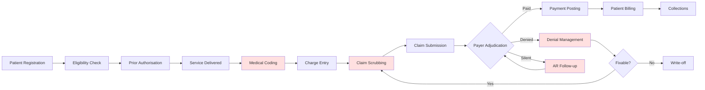

Shaded stages are the primary labour concentrations in a typical RCM operation. Confirm against Muhammad Anas's own time study before treating this as fact — see §7.2.

### 1.4 Where cost accumulates

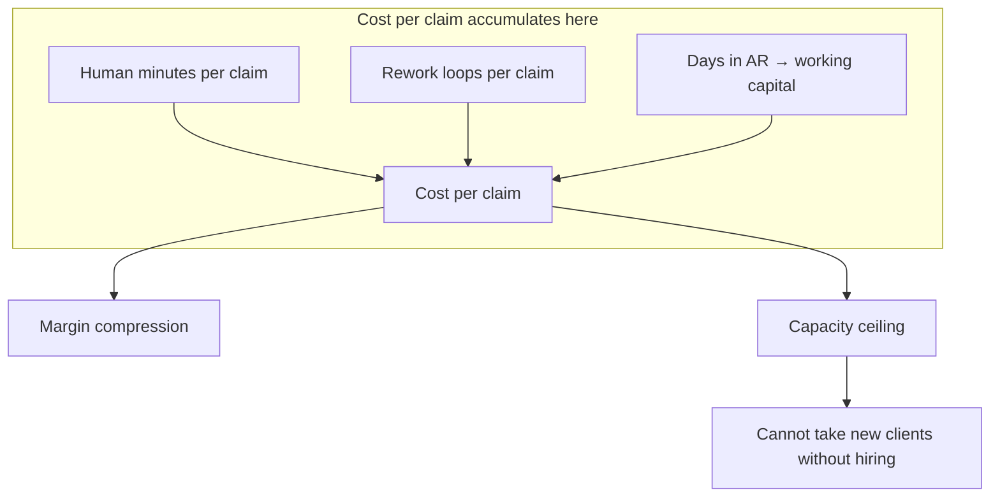

---

## 2. Vision, Mission and Strategic Objectives

### 2.1 Vision

To operate the RCM function at a materially lower cost per claim and higher collection rate than a human-staffed competitor, by automating every stage that does not require clinical or relational judgment.

### 2.2 Mission (programme-level)

Build an internal automation platform that runs alongside the existing operation, proves itself against human performance in parallel, and progressively takes over mechanical work — without ever risking a client's cash flow or compliance position.

### 2.3 Strategic objectives

| ID | Objective | Measured by | Target | Horizon |
|---|---|---|---|---|
| SO-1 | Reduce cost per claim | USD/claim, fully loaded | −40% vs baseline | 18 months |
| SO-2 | Increase first-pass clean claim rate | % accepted with zero rework | ≥95% | 12 months |
| SO-3 | Reduce days in AR | Mean days DOS→payment | −25% vs baseline | 12 months |
| SO-4 | Increase net collection rate | Collected ÷ collectible | +3 percentage points | 18 months |
| SO-5 | Increase capacity per FTE | Claims/FTE/month | ×2.5 | 24 months |
| SO-6 | Maintain compliance posture | Audit findings, coding accuracy | Zero material findings | Continuous |
| SO-7 | Build a defensible data asset | Labelled service lines in warehouse | ≥500k lines | 12 months |

### 2.4 Objective dependency map

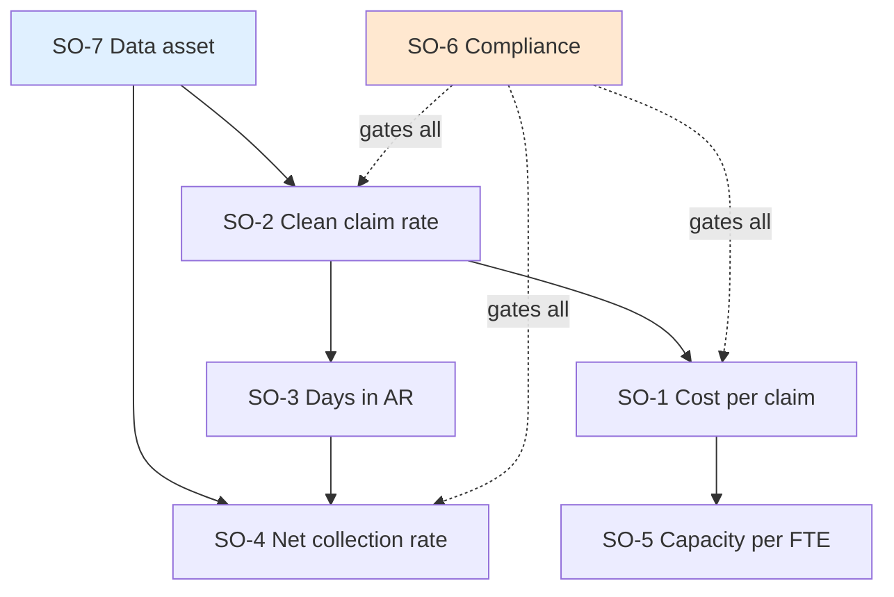

Read this as: the data asset (SO-7) is the root enabler; compliance (SO-6) is a gate, not a goal — failing it stops everything regardless of other progress.

### 2.5 Explicit non-goals

The following are **not** objectives of this programme and any work toward them requires formal scope change:

- Building a commercial SaaS product for external sale (see §6.3 — deferred, not cancelled)
- Replacing the practice management system
- Building an EHR
- Serving specialties outside the current client base
- Achieving full autonomy in medical coding (see §4.3 — permanently human-supervised)

---

## 3. Stakeholders

### 3.1 Stakeholder map

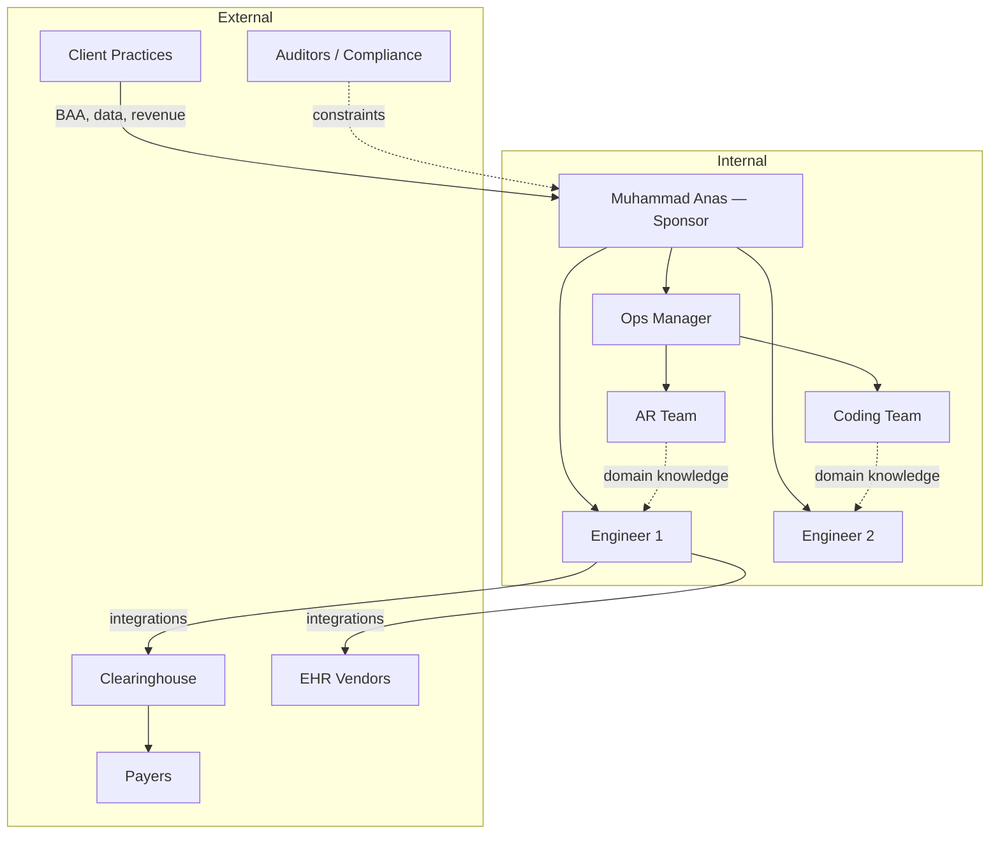

### 3.2 Stakeholder analysis

| Stakeholder | Interest | Influence | Stance risk | Engagement approach |
|---|---|---|---|---|
| Muhammad Anas | Margin, growth, risk | High | — | Weekly steering |
| Engineers (2) | Clear scope, technical autonomy | High | Scope creep | Written specs, phase gates |
| AR / Coding staff | Job security | Medium | **High — may resist or sabotage** | See §3.3 |
| Ops Manager | Continuity, SLA | High | Change fatigue | Involve in design, not just rollout |
| Client practices | Cash flow, accuracy | High | Low if invisible | Do not announce until proven |
| Clearinghouse | Volume | Medium | Low | Commercial relationship |
| Payers | — | High | Adversarial by nature | No engagement; treat as environment |
| EHR vendors | API governance | High | Access refusal | Formal partner programmes |

### 3.3 Critical stakeholder risk: internal staff

This is the most commonly underestimated risk in RCM automation programmes.

**Failure mode:** staff who believe automation threatens their jobs will under-report the system's successes, over-report its errors, decline to teach it, and quietly maintain manual workarounds. The parallel-run validation in Phase 2 depends entirely on honest human comparison data. If staff have an incentive to make the machine look bad, the validation is worthless.

**Mitigation — the stated and genuine position:**

> Automation absorbs calling, typing and status-checking. Cost savings fund **client growth, not headcount reduction.** Staff move to appeals, complex denials, payer relationships, client management and supervising the system.

This must be true, not merely stated. If the intent is headcount reduction, do not claim otherwise — staff will detect it and the programme will fail on data quality. Full treatment in RCM-DOC-15.

---

## 4. Scope

### 4.1 Scope by RCM stage

Automation potential below is an industry-typical estimate. **Column 4 must be replaced with Muhammad Anas's measured figures in Phase 0.**

| # | Stage | Est. automation ceiling | Muhammad Anas's measured hours/mo | Risk if wrong | Phase |
|---|---|---|---|---|---|
| 1 | Credentialing | ~30% | `[TBD-07]` | Low | 4 |
| 2 | Registration / Demographics | ~90% | `[TBD-08]` | Low | 2 |
| 3 | Eligibility Verification | ~85% | `[TBD-09]` | Low | 1 |
| 4 | Prior Authorisation | ~40% | `[TBD-10]` | Medium | 3 |
| 5 | Medical Coding | ~70% | `[TBD-11]` | **Severe** | 4 |
| 6 | Charge Entry | ~95% | `[TBD-12]` | Low | 2 |
| 7 | Claim Scrubbing | ~95% | `[TBD-13]` | Medium | 2 |
| 8 | Claim Submission | ~98% | `[TBD-14]` | Low | 2 |
| 9 | Payment Posting | ~90% | `[TBD-15]` | Medium | 2 |
| 10 | AR Follow-up | ~75% | `[TBD-16]` | Low | 1 |
| 11 | Denial Management | ~60% | `[TBD-17]` | Medium | 3 |
| 12 | Patient Billing | ~85% | `[TBD-18]` | Low | 3 |

### 4.2 Automation ceiling explained

No stage reaches 100%. The residual is not a temporary limitation — it is structural:

| Reason for residual human work | Affected stages |
|---|---|
| Payer requires phone or fax; no electronic channel exists | 4, 10, 11 |
| Clinical judgment required | 5, 11 |
| Ambiguous or missing documentation | 5, 11 |
| Exceptions outside any codified rule | All |
| Compliance requires human sign-off | 5, 11 |
| Relationship and negotiation | 1, 11 |

### 4.3 The coding constraint (permanent)

Medical coding is the highest-value and highest-risk automation target. It is subject to a permanent architectural constraint:

> **No claim may be submitted with an AI-generated code that has not either (a) scored above a defined confidence threshold under a governed model, or (b) been approved by a certified human coder. Every code must carry a traceable citation to the source documentation that justifies it.**

Rationale: systematically incorrect coding is not a software defect. Upcoding creates False Claims Act exposure for both Muhammad Anas and the client practice. "The model decided" is not a defence. This constraint is non-negotiable and is restated in RCM-DOC-03 and RCM-DOC-08.

### 4.4 In scope / out of scope

**In scope**
- Automation of stages 2, 3, 6, 7, 8, 9, 10 (mechanical)
- Partial automation of stages 4, 11, 12
- Human-supervised assistance for stage 5
- Internal work-queue and review UI
- Data warehouse and analytics
- Rules engine and payer rules registry
- Model training, governance and monitoring

**Out of scope (this programme)**
- External SaaS commercialisation
- PM/EHR replacement
- New specialty expansion
- Patient-facing mobile applications
- Anything requiring capital beyond `[TBD-19]`

### 4.5 Scope boundary diagram

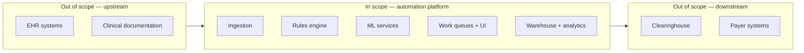

---

## 5. Value Proposition

### 5.1 Internal value (primary, Phases 1–3)

| Lever | Mechanism | Objective served |
|---|---|---|
| Labour reduction | Machine performs high-volume repetitive tasks | SO-1, SO-5 |
| Denial prevention | Rules built from own denial history block known failures pre-submission | SO-2, SO-3 |
| Work prioritisation | AR queue ranked by expected recovery value, not date | SO-4 |
| Error feedback loop | Every denial becomes a scrubbing rule | SO-2 |
| Consistency | Machine does not vary by shift, fatigue or tenure | SO-6 |

### 5.2 Client value (secondary, becomes marketable)

Faster payment, lower denial rate, transparent reporting. Note that **the client buys an outcome, not a technology.** Marketing the automation is optional and possibly counterproductive early — some practices distrust AI touching their claims.

### 5.3 The compounding loop

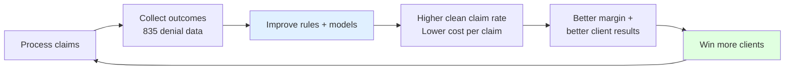

This loop is the strategic core of the programme. Each turn makes the next entrant's task harder. Protecting the loop — specifically the outcome capture in step B — takes priority over any individual feature.

---

## 6. Business Model

### 6.1 Model options

| Option | Description | Revenue | Risk | Verdict |
|---|---|---|---|---|
| A. Internal efficiency only | Automation used only in-house | Existing % of collections, higher margin | Low | **Adopt now** |
| B. AI-augmented service expansion | Take more clients at same headcount | Linear revenue, flat cost | Low–Medium | **Adopt Phase 3+** |
| C. SaaS product for other billing companies | License the platform | Recurring, high multiple | High — different business | Defer, re-evaluate at Month 18 |
| D. Sell data / benchmarks | Anonymised payer behaviour insights | Ancillary | **Legal risk — BAA constraints** | Do not pursue without counsel |

### 6.2 Recommended path

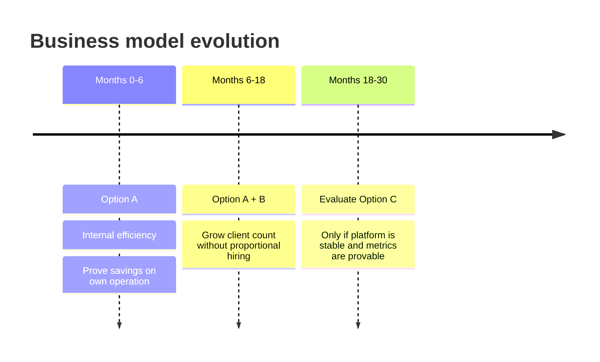

### 6.3 Why SaaS is deferred, not cancelled

Selling software is a different company: it requires sales, support, multi-tenancy, onboarding, SLAs, and a product organisation. Attempting it before the internal platform is stable splits a three-person team across two businesses and fails both.

**Re-evaluation trigger (Month 18):** platform running ≥12 months in production, SO-1 through SO-4 met, and at least one unsolicited external enquiry. If those conditions are not met, defer again.

---

## 7. Wedge Selection

### 7.1 Principle

> Do not build twelve modules. Build one that pays for the second.

With three people, sequencing is the difference between a working platform in 12 months and an abandoned one in 24.

### 7.2 Selection method

Every candidate stage is scored on measured data from Phase 0, not opinion.

```
Priority Score = (Monthly Volume × Minutes per Task × Loaded Hourly Cost)
               + (Recoverable Dollars at Risk)
               ÷ (Implementation Complexity × Compliance Risk)
```

| Input | Source | Owner |
|---|---|---|
| Monthly volume | PM system export | Engineer 1 |
| Minutes per task | One-week time study | Ops Manager |
| Loaded hourly cost | Finance | Muhammad Anas |
| Recoverable dollars | 835 + AR aging analysis | Engineer 2 |
| Complexity (1–5) | Engineering estimate | Engineers |
| Compliance risk (1–5) | RCM-DOC-03 mapping | Muhammad Anas |

### 7.3 Decision procedure

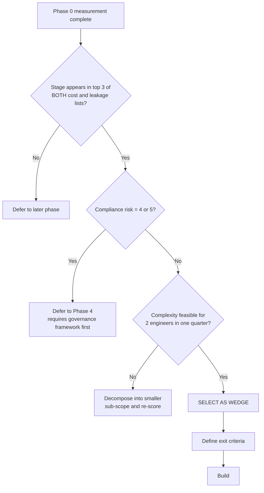

### 7.4 Candidate positioning (hypothesis — replace with measured data)

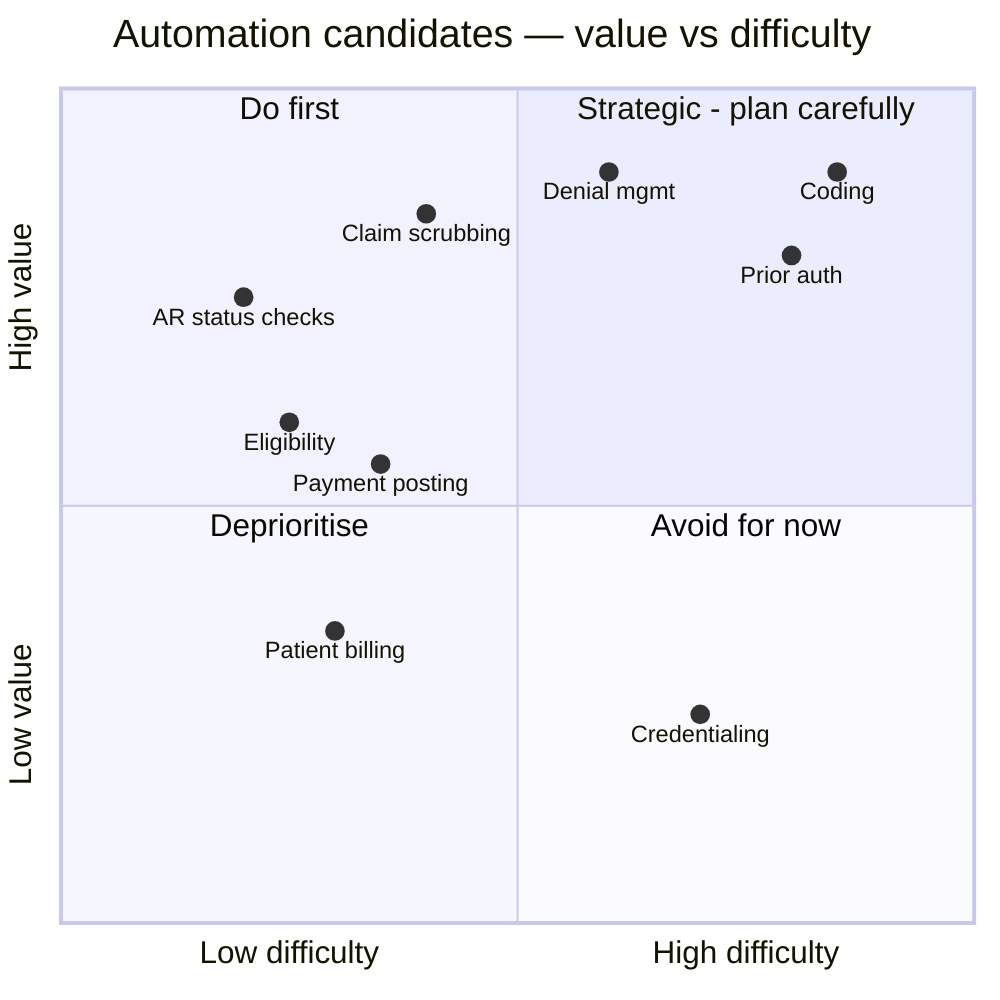

> **This chart is a hypothesis, not a finding.** It reflects typical RCM operations. Muhammad Anas's measured data overrides it entirely. Regenerate this chart in Phase 0 with real scores and record the change in the decision log.

### 7.5 Preliminary recommendation

Pending Phase 0 data, the expected wedge is **AR follow-up automation (status checks) combined with claim scrubbing rules derived from historical denials.** Rationale: highest volume of repetitive human action, lowest compliance risk, immediate and measurable effect on SO-1, SO-2 and SO-3, and it produces the labelled dataset needed for everything later.

---

## 8. Success Metrics

### 8.1 KPI tree

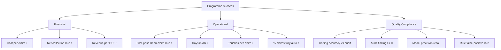

### 8.2 KPI definitions

| KPI | Definition | Baseline | Target | Frequency | Owner |
|---|---|---|---|---|---|
| Cost per claim | Total ops cost ÷ claims submitted | `[TBD-05]` | −40% | Monthly | Muhammad Anas |
| First-pass clean claim rate | Claims accepted & paid with zero rework ÷ total submitted | `[TBD-20]` | ≥95% | Weekly | Ops |
| Denial rate | Lines denied ÷ lines submitted | `[TBD-01]` | ≤5% | Weekly | Ops |
| Days in AR | Mean days DOS → payment posted | `[TBD-21]` | −25% | Weekly | Ops |
| Net collection rate | Collected ÷ (charges − contractual adjustments) | `[TBD-22]` | +3pp | Monthly | Muhammad Anas |
| Claims per FTE/month | Claims ÷ operational FTE | `[TBD-06]` | ×2.5 | Monthly | Ops |
| Touches per claim | Human actions logged per claim | `[TBD-23]` | −60% | Monthly | Eng |
| Automation coverage | Claims requiring zero human touch ÷ total | 0% | ≥50% | Weekly | Eng |
| Coding accuracy | Agreement with audited human coder | `[TBD-24]` | ≥ human baseline | Monthly | Compliance |
| Material audit findings | Count | 0 | 0 | Quarterly | Muhammad Anas |

### 8.3 Measurement rules

1. **Baseline before build.** No metric may be claimed as improved without a pre-programme baseline captured in Phase 0.
2. **Same definition throughout.** Definitions are frozen in RCM-DOC-07. Changing a definition mid-programme invalidates the comparison.
3. **Segment by payer and by client.** Aggregate figures hide the truth; problems concentrate in a few payers.
4. **Maturity window.** No claim is counted in final-outcome metrics until 180 days post-DOS, to capture reversals and recoupments.
5. **No metric gaming during baseline week.** Staff must be told the process is being measured, not the people.

---

## 9. Roadmap

### 9.1 Phases

| Phase | Name | Duration | Goal | Exit criteria |
|---|---|---|---|---|
| 0 | Measure | 3–4 weeks | Establish baseline and select wedge | All `[TBD]` resolved; wedge selected and signed off; 835/837 archive secured |
| 1 | Foundation + Wedge | 3 months | Data pipeline + first automation live | Warehouse populated; wedge running in parallel; measurable KPI movement |
| 2 | Core mechanical | 4 months | Stages 2, 6, 7, 8, 9 automated | ≥50% automation coverage on target stages |
| 3 | Intelligence | 5 months | Denial prediction, prior auth, patient billing | Denial model in production with governance |
| 4 | Coding + Credentialing | 6 months | Human-supervised coding assist | Phase A/B/C progression complete to Phase B minimum |
| 5 | Evaluate commercialisation | — | Go/no-go on SaaS | Decision recorded |

### 9.2 Schedule

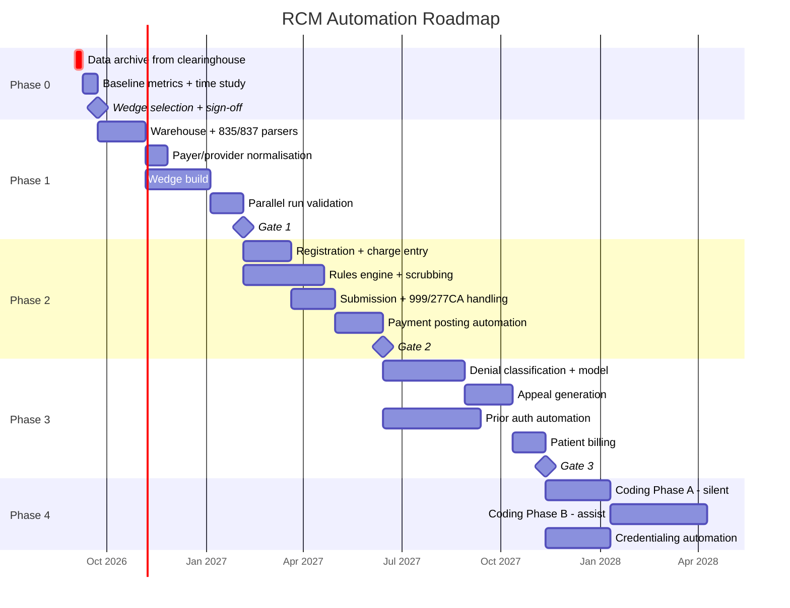

### 9.3 Phase gates

No phase begins until the prior gate passes. Gate review is a formal meeting with a written decision recorded in the decision log.

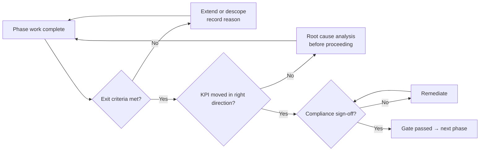

### 9.4 Sequencing rules

1. **Data before automation.** Nothing is automated before its outcomes can be measured.
2. **Rules before models.** If a deterministic rule can do it, do not train a model. Rules are auditable, free to run and cannot hallucinate.
3. **Parallel before replacement.** Every automation runs alongside humans and must beat them on a scoreboard before taking over.
4. **Low risk before high risk.** Coding is last, regardless of how attractive it looks.
5. **No big bang.** Cutover is per-stage, per-client, reversible.

---

## 10. Team and Responsibilities

### 10.1 Roles for a three-person team

| Role | Person | Primary ownership |
|---|---|---|
| Programme Sponsor / Domain Authority | Muhammad Anas | Scope, compliance, client relationships, gate decisions, payer rules validation |
| Engineer 1 — Data & Integration | [Name] | X12 parsing, warehouse, clearinghouse/EHR integration, pipelines |
| Engineer 2 — Application & Intelligence | [Name] | Rules engine, ML services, work-queue UI, dashboards |
| Domain SMEs (part-time, from ops) | AR lead, Coding lead | Rule authoring, validation, labelled data review |

### 10.2 RACI (programme level)

| Activity | Muhammad Anas | Eng 1 | Eng 2 | Ops SME |
|---|---|---|---|---|
| Scope definition | A/R | C | C | C |
| Baseline measurement | A | R | C | R |
| Wedge selection | A/R | C | C | C |
| Data pipeline | A | R | C | I |
| Rules authoring | A | C | R | R |
| Model development | A | C | R | C |
| Compliance sign-off | A/R | I | I | I |
| Parallel-run validation | A | C | C | R |
| Gate decisions | A/R | C | C | C |

A = Accountable, R = Responsible, C = Consulted, I = Informed

### 10.3 Capacity warning

Two engineers is roughly 320 person-hours per month. The Phase 1–4 roadmap assumes **no** sustained parallel workstreams. If two modules are built simultaneously, the timeline in §9.2 is invalid. Record any such decision as a formal change.

---

## 11. Build vs Buy

### 11.1 Decision framework

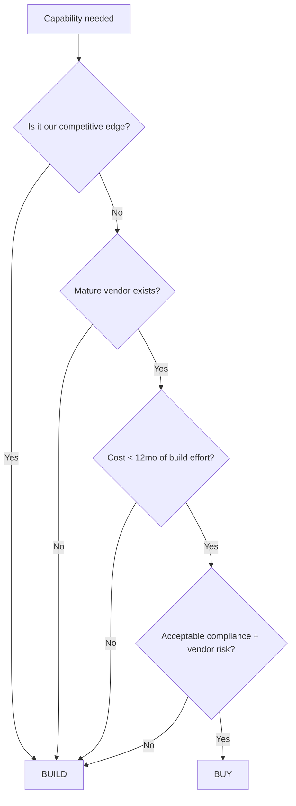

### 11.2 Preliminary positions

| Capability | Position | Rationale |
|---|---|---|
| X12 parsing (835/837) | Buy library / Build thin wrapper | Solved problem; parsing bugs are costly |
| Clearinghouse connectivity | Buy | Non-negotiable external dependency |
| Data warehouse | Buy (managed cloud) | Commodity |
| Rules engine | **Build** | This is the accumulated domain edge |
| Denial prediction model | **Build** | Depends on proprietary data |
| Note-to-code assistance | Evaluate both | Vendors exist; compare against build cost in Phase 4 |
| Work-queue UI | **Build** | Must fit our exact workflow |
| RPA for payer portals | Buy tooling / Build scripts | Tooling is commodity, scripts are payer-specific |
| Reporting dashboards | Buy BI tool | Commodity |

### 11.3 Vendor evaluation criteria (for any "buy")

HIPAA compliance and willingness to sign a BAA; SOC 2 Type II report; data residency and offshore access policy; export capability (no lock-in); pricing model at scale; support SLA; financial stability.

---

## 12. Competitive Context

### 12.1 Landscape

| Category | Examples | Threat to Muhammad Anas |
|---|---|---|
| Incumbent RCM platforms | Waystar, athenahealth, Optum, R1 RCM | High resources, but slow and generic |
| AI-native RCM startups | Well-funded new entrants | Fast, but data-poor and client-poor at start |
| Offshore billing companies | Large labour-arbitrage operations | Direct competitor on price |
| In-house billing teams | Practices doing it themselves | Reduces addressable market |

### 12.2 Where Muhammad Anas actually competes

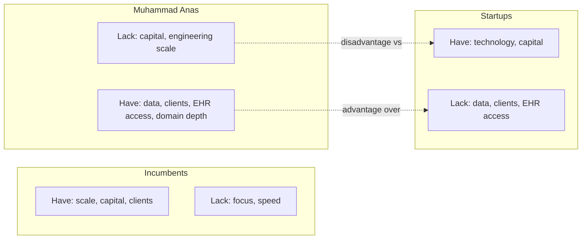

**Strategic conclusion:** compete on depth, not breadth. Own one or two specialties' payer behaviour completely rather than being mediocre across all. Do not attempt to out-engineer funded startups; out-know them.

### 12.3 Structural risks

| Risk | Note |
|---|---|
| Regulatory change (e.g. CMS prior-auth API rules) | Creates opportunity in stage 4 — monitor and verify current status before building on it |
| Clearinghouse single point of failure | Industry precedent exists for multi-week outages. Plan a secondary clearinghouse in Phase 2. |
| Payer rule volatility | Permanent maintenance burden. Budget ongoing capacity, not one-time work. |
| Client concentration | If one client is >`[TBD-25]`% of revenue, the programme's business case is fragile |

---

## 13. Financial Case

### 13.1 Cost model — to be completed in Phase 0

| Line item | Year 1 | Year 2 | Notes |
|---|---|---|---|
| Engineering (2 FTE) | `[TBD-26]` | `[TBD-26]` | Fully loaded |
| Cloud infrastructure | `[TBD-27]` | `[TBD-27]` | Scales with volume |
| Clearinghouse fees | `[TBD-28]` | `[TBD-28]` | Existing cost |
| Third-party tools/licences | `[TBD-29]` | `[TBD-29]` | Incl. CPT licensing if applicable |
| Compliance (SOC 2, legal, insurance) | `[TBD-30]` | `[TBD-30]` | See RCM-DOC-03 |
| Contingency (20%) | — | — | |
| **Total investment** | | | |

### 13.2 Benefit model

| Benefit | Mechanism | Year 1 | Year 2 |
|---|---|---|---|
| Labour cost avoided | Reduced hours per claim | `[TBD-31]` | |
| Additional collections | Higher clean claim + better AR prioritisation | `[TBD-32]` | |
| Capacity monetised | New clients without new hires | — | `[TBD-33]` |
| Working capital released | Lower days in AR | `[TBD-34]` | |

### 13.3 Value driver map

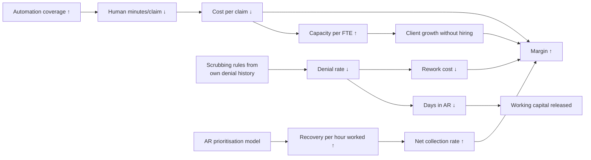

### 13.4 Break-even rule

The programme is judged on `[TBD-35]` — an agreed payback period, to be set by Muhammad Anas in Phase 0. Recommended: cumulative benefit exceeds cumulative cost within 18 months. If Phase 0 measurement shows this is implausible, the scope must be reduced before Phase 1 begins, not after.

---

## 14. Risk Register (Business & Strategy)

Technical, security and compliance risks are held in their respective documents. This register covers strategic risk only.

| ID | Risk | Prob. | Impact | Score | Mitigation | Owner |
|---|---|---|---|---|---|---|
| BR-01 | Scope creep beyond 3-person capacity | High | High | 9 | Phase gates; written change control | Muhammad Anas |
| BR-02 | Wrong wedge chosen (annoying ≠ expensive) | Med | High | 6 | Data-driven scoring §7.2 | Muhammad Anas |
| BR-03 | Staff resistance corrupts parallel-run data | High | High | 9 | §3.3 growth-not-cuts position, made real | Ops Mgr |
| BR-04 | Historical data too dirty to use | High | Med | 6 | Phase 0 data quality assessment before commitment | Eng 1 |
| BR-05 | BAAs do not permit model training on client data | Med | High | 6 | Legal review in Phase 0; amend BAAs | Muhammad Anas |
| BR-06 | EHR API access withdrawn or restricted | Low | High | 5 | Diversify EHR coverage; formal partner status | Eng 1 |
| BR-07 | Clearinghouse outage | Low | High | 5 | Secondary clearinghouse by Phase 2 | Eng 1 |
| BR-08 | Coding automation triggers compliance event | Low | **Severe** | 8 | §4.3 constraint; Phase 4 sequencing; audit trail | Muhammad Anas |
| BR-09 | Client churn during transition | Low | High | 5 | Parallel run; no client-visible change until proven | Muhammad Anas |
| BR-10 | Key person dependency (3-person team) | High | High | 9 | Documentation (this set); no undocumented knowledge | Muhammad Anas |
| BR-11 | Payer rule drift degrades models silently | High | Med | 6 | Monitoring + named owner for accuracy tracking | Eng 2 |
| BR-12 | Offshore data restriction blocks a client | Med | Med | 4 | Per-client verification in Phase 0 | Muhammad Anas |
| BR-13 | Programme runs out of funding mid-build | Med | High | 6 | Phase gates sized so each delivers standalone value | Muhammad Anas |

### 14.1 Risk heat map

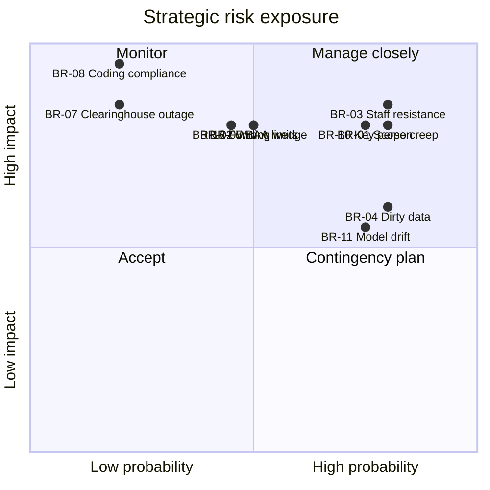

### 14.2 Top three, restated

The three risks most likely to end this programme are, in order:

1. **BR-01 Scope creep** — three people cannot build twelve modules. The roadmap exists to be enforced, not admired.
2. **BR-03 Staff resistance** — corrupts the validation data the whole programme depends on.
3. **BR-08 Coding compliance** — low probability, but it is the only risk that can end the *company*, not just the programme.

---

## 15. Assumptions and Dependencies

### 15.1 Assumptions

| ID | Assumption | If false |
|---|---|---|
| AS-01 | ≥12 months of 835 data is retrievable from the clearinghouse | Timeline extends; models delayed until data accumulates |
| AS-02 | PM system permits bulk data export | Manual extraction required; Phase 0 extends significantly |
| AS-03 | Existing BAAs permit internal analytics | Legal amendment required before Phase 1 |
| AS-04 | Client mix and payer mix remain broadly stable | Models require retraining; baselines invalid |
| AS-05 | Two engineers remain available for the full roadmap | Timeline scales directly with headcount |
| AS-06 | Programme is self-funded from operations | Phase sizing must change |
| AS-07 | No client contractually forbids automation | Per-client review needed |

### 15.2 Dependencies

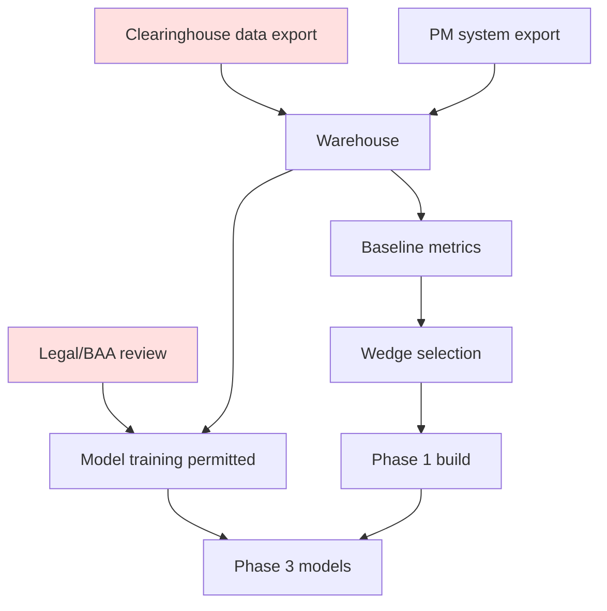

Red items are external dependencies outside the team's direct control and should be started on day one.

---

## 16. Immediate Next Actions

| # | Action | Owner | Due | Blocks |
|---|---|---|---|---|
| 1 | **Bulk-export and archive all available 835 files from clearinghouse** (they expire from portals) | Eng 1 | Week 1 | Everything |
| 2 | Export claims table from PM system, 24 months | Eng 1 | Week 1 | Baseline |
| 3 | Legal review of BAAs re: analytics and model training | Muhammad Anas | Week 2 | Phase 3 |
| 4 | One-week staff time study | Ops Mgr | Week 2 | Wedge selection |
| 5 | Compute the six baseline KPIs | Eng 2 | Week 3 | Wedge selection |
| 6 | Data quality assessment | Eng 1 | Week 3 | Phase 1 scope |
| 7 | Populate all `[TBD]` values in Appendix A | Muhammad Anas + Eng | Week 4 | Gate 0 |
| 8 | Wedge selection meeting + sign-off | All | Week 4 | Phase 1 |

**Action 1 is the highest priority item in this document.** Remittance files age off clearinghouse portals. Data not archived is data permanently lost, and it is the only asset that cannot be recreated.

---

## Appendix A — Placeholder Register

| ID | Description | Source | Owner |
|---|---|---|---|
| TBD-01 | Denial rate (lines denied ÷ submitted) | 835 analysis | Eng 2 |
| TBD-02 | Monthly hours on claim status enquiries | Time study | Ops |
| TBD-03 | % of AR aged >90 days | PM system | Eng 2 |
| TBD-04 | Repeat denial rate (same payer+CPT+CARC) | 835 analysis | Eng 2 |
| TBD-05 | Fully loaded cost per claim | Finance ÷ volume | Muhammad Anas |
| TBD-06 | Claims per FTE per month | PM + HR | Ops |
| TBD-07..18 | Measured monthly hours per RCM stage | Time study | Ops |
| TBD-19 | Maximum programme budget | Finance | Muhammad Anas |
| TBD-20 | First-pass clean claim rate | 835 + PM | Eng 2 |
| TBD-21 | Mean days in AR | PM system | Eng 2 |
| TBD-22 | Net collection rate | Finance | Muhammad Anas |
| TBD-23 | Mean human touches per claim | PM activity log | Eng 2 |
| TBD-24 | Current coding accuracy (audit sample) | Coding audits | Coding lead |
| TBD-25 | Largest client as % of revenue | Finance | Muhammad Anas |
| TBD-26..30 | Cost lines | Finance | Muhammad Anas |
| TBD-31..34 | Benefit lines | Modelled from baseline | Muhammad Anas + Eng 2 |
| TBD-35 | Agreed payback period | Decision | Muhammad Anas |

---

## Appendix B — Glossary (strategy terms only)

Full domain glossary is in RCM-DOC-02.

| Term | Meaning |
|---|---|
| Wedge | The single first automation target chosen to fund and enable the rest |
| Parallel run | Machine and humans perform the same work; outputs compared before cutover |
| Phase gate | Formal go/no-go checkpoint with written decision |
| Automation coverage | % of claims completing a stage with zero human touch |
| Clean claim rate | % accepted and paid on first submission without rework |
| Days in AR | Mean days from date of service to payment posted |
| Net collection rate | Collected ÷ realistically collectible |
| Compounding loop | Process → outcome data → better rules → better process |

---

## Appendix C — Decision Log

Every material decision is recorded here with date, rationale and decider. This is the audit trail for why the programme took the shape it did.

| # | Date | Decision | Rationale | Decided by | Reversible? |
|---|---|---|---|---|---|
| D-001 | [Date] | Internal efficiency first; SaaS deferred to Month 18 | 3-person team cannot run two businesses | Muhammad Anas | Yes |
| D-002 | [Date] | Coding automation sequenced last | Highest compliance risk; needs governance framework first | Muhammad Anas | No — safety constraint |
| D-003 | [Date] | Rules engine built, not bought | Accumulated payer knowledge is the competitive edge | Muhammad Anas | Yes |
| D-004 | [Date] | Wedge = `[to be recorded at Gate 0]` | Per §7.2 scoring | Muhammad Anas | Yes |

---

*End of Document 01 — Business & Strategy*
