# Document 02 — Domain & Functional Specification

## 1. Purpose and How to Use This Document

Document 01 defined *why* and *in what order*. This document defines *what the system must actually do*.

It is the authoritative description of the RCM domain and of every functional module. All later documents inherit from it:

| Downstream document | What it takes from here |
|---|---|
| RCM-DOC-05 Data | Entity definitions in §11 |
| RCM-DOC-06 Integration | Transaction specifications in §5 |
| RCM-DOC-09 Rules Engine | Business rules in each module spec and §8 |
| RCM-DOC-10 Backend | State machine in §7, module boundaries in §6 |
| RCM-DOC-11 Frontend | Human-in-the-loop touchpoints in §12 |
| RCM-DOC-14 QA | Acceptance criteria and edge cases in each module spec |

### 1.1 Reading order

- Engineers new to healthcare: read §2, §3, §4, §5 fully before anything else. Do not skip the glossary; the domain is dense with terms that look interchangeable and are not.
- Implementing a specific module: read §4 for context, then that module's spec in §6, then §7 and §8.
- Writing tests: §6 acceptance criteria plus §13 edge case register.

### 1.2 Module specification template

Every module in §6 follows the same structure, so a reader can navigate any of them the same way:

```
Purpose · Trigger · Actors · Inputs · As-is flow · To-be flow ·
Business rules · Automation boundary · Exceptions · Outputs ·
Acceptance criteria · KPIs · Dependencies
```

### 1.3 Convention notes

- **MUST / MUST NOT / SHOULD / MAY** are used in the RFC 2119 sense. MUST rules are non-negotiable and testable.
- Rules are identified as `BR-<module>-<n>` so tests and code can reference them.
- Edge cases are identified as `EC-<n>` and consolidated in §13.
- `[TBD-##]` continues the numbering from Document 01, Appendix A.

---

## 2. Domain Glossary

This is the authoritative glossary for the programme. Terms not defined here MUST NOT be invented in code or documentation without being added.

### 2.1 Core entities

| Term | Definition |
|---|---|
| **Provider** | The clinician or organisation delivering care. Distinguish *rendering* (who performed it) from *billing* (who gets paid). |
| **Practice / Client** | The provider organisation that contracts with our RCM company. |
| **Patient** | Recipient of care. May or may not be the insurance subscriber. |
| **Subscriber** | The person who holds the insurance policy. Often the patient, often not (e.g. a child on a parent's plan). |
| **Payer** | The insurance company. Also called carrier or plan. |
| **Encounter / Visit** | A single episode of care on a date of service. |
| **Claim** | The formal request for payment sent to a payer for one encounter. |
| **Service line** | One billable item within a claim (one CPT code). **A claim has many lines; adjudication happens per line.** |
| **Charge** | The dollar amount billed for a service line. |
| **Allowed amount** | What the payer's contract says the service is worth. |
| **Paid amount** | What the payer actually sent. |
| **Patient responsibility** | Copay + coinsurance + deductible; what the patient owes. |
| **Adjustment** | Difference between charge and allowed; contractual write-off. |
| **Denial** | Payer refusal to pay a line or claim, with a reason code. |
| **Rejection** | Claim refused *before* adjudication (format/eligibility errors) — see §2.5, this is not the same as a denial. |
| **AR (Accounts Receivable)** | Money billed and not yet collected. |
| **Remittance** | The payer's explanation of what it paid and why. |

### 2.2 Code systems

| System | Purpose | Source | Cost | Notes |
|---|---|---|---|---|
| **ICD-10-CM** | Diagnosis codes ("what's wrong") | CMS/CDC | Free | Updated annually, effective 1 October |
| **ICD-10-PCS** | Inpatient procedure codes | CMS | Free | Facility billing only |
| **CPT** | Procedure codes ("what was done") | AMA | **Licensed — not free** | See §2.6 |
| **HCPCS Level II** | Supplies, drugs, DME, ambulance | CMS | Free | Letter + 4 digits |
| **Modifiers** | Two-character qualifiers on a CPT | AMA/CMS | Mixed | Order matters; see §8.4 |
| **NDC** | National Drug Code | FDA | Free | Required on drug lines by many payers |
| **POS** | Place of Service (11 = office, 21 = inpatient…) | CMS | Free | Affects payment rate |
| **Taxonomy** | Provider specialty code | NUCC | Free | |
| **NPI** | National Provider Identifier | NPPES | Free | 10 digits, bulk file available |
| **CARC** | Claim Adjustment Reason Code — why an amount was adjusted | X12 | Free | ~350 codes |
| **RARC** | Remittance Advice Remark Code — extra explanation | CMS/X12 | Free | ~800 codes |
| **CAS group code** | CO / PR / OA / PI — **who bears the cost** | X12 | Free | See §2.3 — critical |
| **NCCI edits** | Which code pairs may not be billed together | CMS | Free | Updated quarterly |
| **LCD / NCD** | Local/National Coverage Determinations — medical necessity | CMS | Free | |

### 2.3 CAS group codes — why they matter more than the CARC

A CARC code alone is ambiguous. The group code that accompanies it determines the business meaning.

| Group | Name | Meaning | What we do |
|---|---|---|---|
| **CO** | Contractual Obligation | Provider must absorb it. Cannot bill the patient. | Write off, or appeal if wrongly applied |
| **PR** | Patient Responsibility | Patient owes it. | Bill the patient |
| **OA** | Other Adjustment | Neither of the above; often coordination of benefits | Route to secondary payer or review |
| **PI** | Payer Initiated Reduction | Payer's own reduction, not contractual | Usually appealable |

> **BR-GLOBAL-01 (MUST):** The system MUST store the CAS group code with every CARC. A CARC without its group code is unusable. `CO-45` and `PR-45` produce opposite downstream actions — one is a write-off, one is a patient bill. Losing this distinction corrupts both revenue and patient billing.

### 2.4 The financial equation

```
Charge Amount
  − Contractual Adjustment (CO)
  = Allowed Amount
      − Payer Paid Amount
      = Patient Responsibility (PR)
```

Net Collection Rate = Collected ÷ (Charges − Contractual Adjustments)

This denominator matters: measuring against gross charges makes any operation look bad, because gross charges are never fully collectible by design.

### 2.5 Rejection vs Denial — a distinction the system must respect

These are frequently confused and require completely different handling.

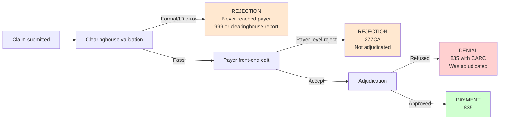

| | Rejection | Denial |
|---|---|---|
| Reached adjudication? | No | Yes |
| Arrives via | 999 / 277CA / clearinghouse report | 835 |
| Counts against timely filing? | Original filing date usually not preserved — **clock keeps running** | Filing date preserved |
| Appealable? | No — just fix and resubmit | Yes |
| Correct action | Correct and resubmit as new | Appeal or corrected claim |
| Counts in denial rate KPI? | **No** — separate metric | Yes |

> **BR-GLOBAL-02 (MUST):** Rejections and denials MUST be stored and reported as distinct outcome types. Conflating them inflates the denial rate and hides front-end data quality problems.

### 2.6 CPT licensing constraint

CPT codes are copyrighted by the American Medical Association. Any system that stores, displays, suggests or transmits CPT code descriptions may require a licence.

> **BR-GLOBAL-03 (MUST):** Licensing position MUST be confirmed with the AMA before any UI displays CPT long descriptions or any model is trained on CPT descriptor text. Owner: Muhammad Anas. Tracked as `[TBD-36]`.

Note that transmitting bare CPT *numbers* on a claim is standard practice; the licensing exposure concerns descriptors, lookup tools and derived products. Confirm scope with counsel rather than assuming either direction.

---

## 3. Actors and Systems

### 3.1 Actor catalogue

| Actor | Type | Role in the process |
|---|---|---|
| Front desk / registrar | Human (client side) | Captures patient and insurance data |
| Provider / clinician | Human (client side) | Delivers care, writes documentation |
| Medical coder | Human (our side) | Assigns and validates codes |
| Charge entry specialist | Human (our side) | Builds claims |
| AR specialist | Human (our side) | Chases unpaid claims |
| Denial specialist | Human (our side) | Root-causes and appeals |
| Payment poster | Human (our side) | Reconciles remittances |
| Credentialing specialist | Human (our side) | Enrols providers with payers |
| Patient | Human (external) | Pays residual balance |
| **EHR** | System (external) | Holds clinical documentation |
| **PM system** | System (external) | Holds demographics, claims, AR |
| **Clearinghouse** | System (external) | Routes transactions to payers |
| **Payer system** | System (external) | Adjudicates |
| **Payer portal** | System (external) | Manual channel where no API exists |
| **Automation platform** | System (ours) | What this programme builds |

### 3.2 System landscape

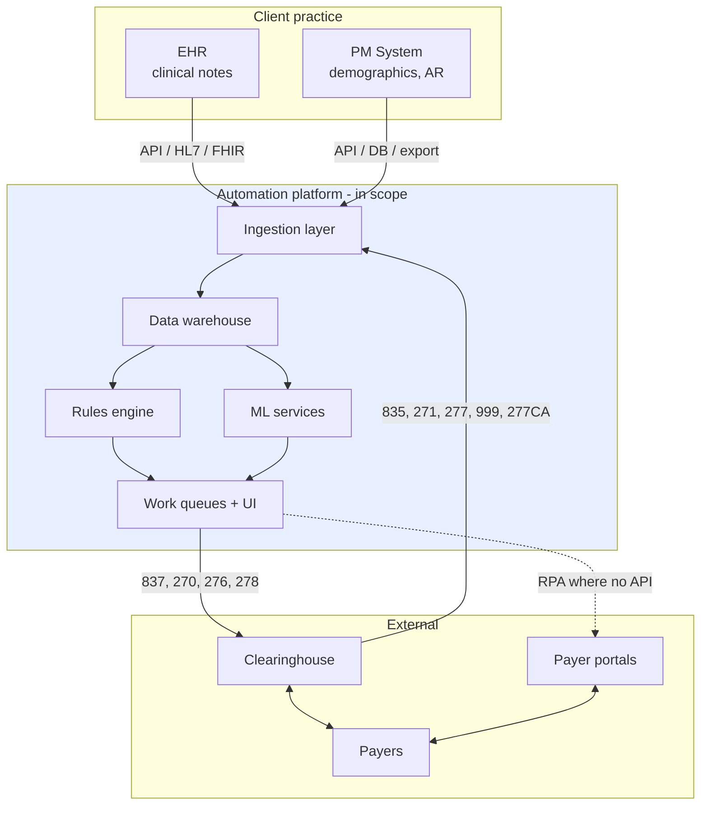

### 3.3 Trust boundaries

Everything outside the blue block is a system we do not control. Three consequences that shape every module:

1. **External systems fail.** Every outbound call needs retry, timeout and idempotency handling.
2. **External data is untrusted.** Every inbound file needs validation before it touches the warehouse.
3. **External behaviour changes without notice.** Payer rules, portal layouts and API contracts change. Nothing may assume permanence.

---

## 4. The RCM Lifecycle

### 4.1 End-to-end master flow

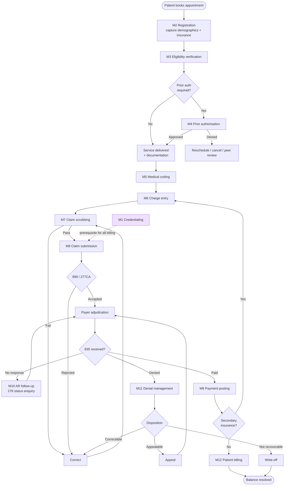

### 4.2 Module register

| ID | Module | Category | Automation ceiling | Compliance risk | Phase |
|---|---|---|---|---|---|
| M1 | Credentialing | Pre-requisite | ~30% | Low | 4 |
| M2 | Registration & Demographics | Front-end | ~90% | Low | 2 |
| M3 | Eligibility Verification | Front-end | ~85% | Low | 1 |
| M4 | Prior Authorisation | Front-end | ~40% | Medium | 3 |
| M5 | Medical Coding | Mid | ~70% | **Severe** | 4 |
| M6 | Charge Entry | Mid | ~95% | Low | 2 |
| M7 | Claim Scrubbing | Mid | ~95% | Medium | 2 |
| M8 | Claim Submission | Mid | ~98% | Low | 2 |
| M9 | Payment Posting | Back-end | ~90% | Medium | 2 |
| M10 | AR Follow-up | Back-end | ~75% | Low | 1 |
| M11 | Denial Management | Back-end | ~60% | Medium | 3 |
| M12 | Patient Billing | Back-end | ~85% | Low | 3 |

### 4.3 Timeline of a normal claim

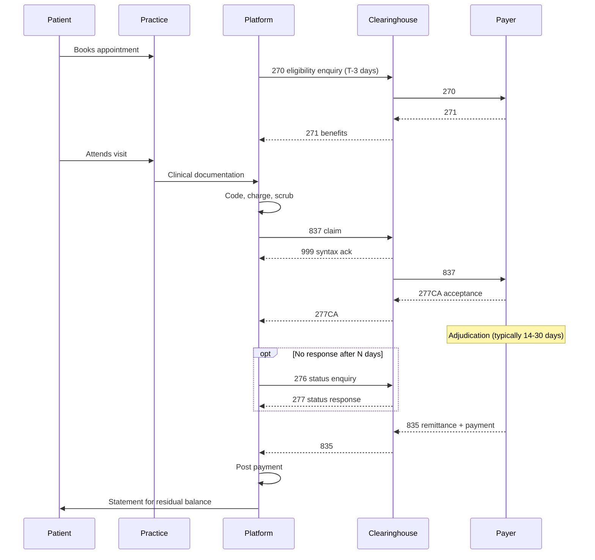

### 4.4 Critical time constraints

| Clock | Typical range | Consequence of breach | Source of truth |
|---|---|---|---|
| **Timely filing** | 90–365 days from DOS, payer-specific | Claim permanently unpayable, non-appealable in most cases | Payer rules registry §9 |
| **Appeal deadline** | 30–180 days from denial | Denial becomes final | Payer rules registry |
| **Prior auth validity** | 30–90 days from approval | Auth expires, service unpaid | Auth record |
| **Corrected claim window** | Payer-specific | Reverts to rejection | Payer rules registry |
| **Secondary filing** | From primary 835 date | Secondary balance lost | Payer rules registry |

> **BR-GLOBAL-04 (MUST):** Every claim MUST carry a computed `days_to_timely_filing_deadline`. Any claim within `[TBD-37]` days of its deadline MUST be escalated to a human queue with highest priority, regardless of its other attributes. This rule overrides all other prioritisation logic.

---

## 5. Transaction Reference (X12 EDI)

### 5.1 Transaction set

| Txn | Name | Direction | Purpose | Module |
|---|---|---|---|---|
| **270** | Eligibility Enquiry | Out | Is this patient covered, and for what? | M3 |
| **271** | Eligibility Response | In | The answer | M3 |
| **278** | Services Review Request/Response | Both | Prior authorisation | M4 |
| **837P** | Claim — Professional | Out | Physician/outpatient claim | M8 |
| **837I** | Claim — Institutional | Out | Facility claim | M8 |
| **999** | Implementation Acknowledgement | In | Was the file syntactically valid? | M8 |
| **277CA** | Claim Acknowledgement | In | Did the payer accept it for adjudication? | M8 |
| **276** | Claim Status Enquiry | Out | Where is my claim? | M10 |
| **277** | Claim Status Response | In | The answer | M10 |
| **835** | Remittance Advice | In | What was paid, what was denied, why | M9, M11 |

### 5.2 Transaction flow

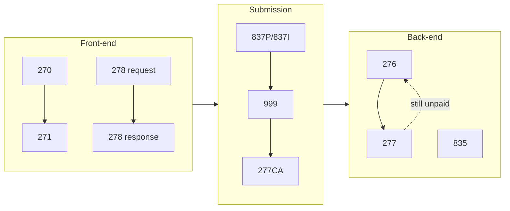

### 5.3 Key structural notes for engineers

These are the points where implementations most often go wrong:

| Point | Note |
|---|---|
| **835 loop structure** | Claim-level data in loop 2100 (CLP segment); service-line data in loop 2110 (SVC segment). Adjustments (CAS) appear at **both** levels and mean different things. |
| **Multiple CAS segments** | One line can carry several adjustments. Each CAS can carry up to six reason/amount pairs. Do not collapse to one. |
| **Grain expansion** | Parsing 835 correctly produces *one row per claim per line per adjustment*, not one row per claim. |
| **Payer control numbers** | The payer's claim number (CLP07) is how you match resubmissions and reversals. Store it. |
| **Reversals** | A payer can reverse a prior payment months later (claim status code 22). The original claim's outcome changes retroactively. |
| **Bulk payments** | One 835 covers many claims and one check/EFT. Reconciliation must balance at file level, not claim level. |
| **271 inconsistency** | Payers return wildly different levels of benefit detail for the same 270. Never assume a field will be populated. |
| **Companion guides** | Each payer publishes its own variant requirements on top of the X12 standard. These must be tracked per payer. |

> **BR-GLOBAL-05 (MUST):** All inbound X12 files MUST be archived in raw, unmodified form before parsing, with immutable storage and a retention period defined in RCM-DOC-05. Parsers will be rewritten; the source files cannot be regenerated.

---

## 6. Module Specifications

---

### 6.1 M1 — Credentialing & Provider Enrolment

**Purpose:** Establish and maintain each provider's authorisation to bill each payer.

**Trigger:** New provider joins a client practice; payer contract added; revalidation due; credential expiring.

**Actors:** Credentialing specialist, provider, payer enrolment departments, CAQH.

**Inputs:** Provider licence, DEA, malpractice insurance, education history, NPI, W-9, practice details, CAQH profile.

**Outputs:** Payer-specific provider ID, effective date, participation status.

#### As-is

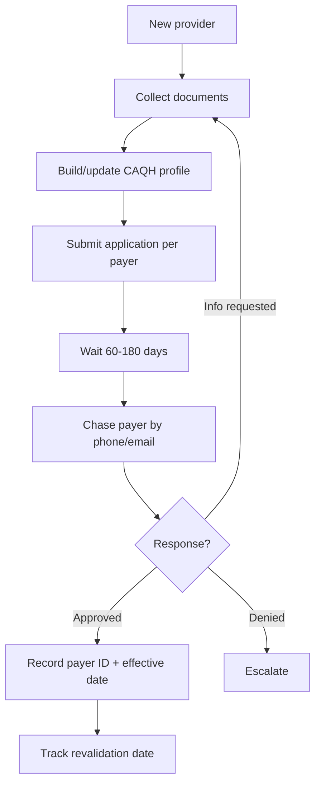

#### To-be

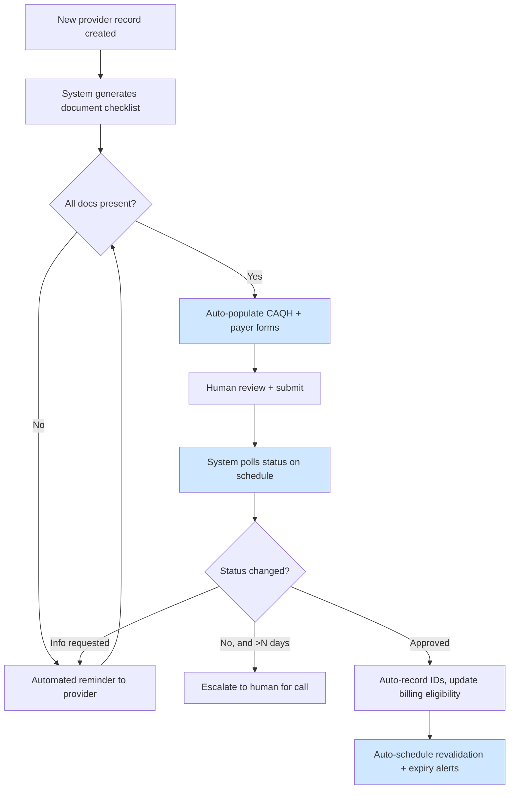

Blue = automated.

#### Business rules

| ID | Rule | Level |
|---|---|---|
| BR-M1-01 | A claim MUST NOT be submitted for a provider/payer combination without an active enrolment and an effective date on or before the DOS. | MUST |
| BR-M1-02 | The system MUST alert at 120, 90, 60 and 30 days before any credential or revalidation expiry. | MUST |
| BR-M1-03 | Retroactive effective dates, where granted, MUST trigger identification and resubmission of claims held during the gap. | MUST |
| BR-M1-04 | Provider data MUST have one authoritative record; per-payer IDs attach to it rather than duplicating the provider. | MUST |

#### Automation boundary

| Automatable | Human required |
|---|---|
| Document checklist and expiry tracking | Payer phone follow-up |
| CAQH attestation reminders | Application exceptions |
| Form pre-population | Contract negotiation |
| Status polling | Denial resolution |

#### Edge cases

`EC-01` Provider moves practices mid-enrolment. `EC-02` Locum tenens billing under another provider. `EC-03` Group vs individual enrolment mismatch. `EC-04` Retroactive effective date creating a backlog of held claims. `EC-05` Provider enrolled with payer but not with the specific plan product.

#### Acceptance criteria

- No claim can be created for a non-enrolled provider/payer pair (hard block, not a warning).
- Expiry alerts fire at all four thresholds.
- Held-claim backlog is automatically identified when a retroactive date is recorded.

**KPIs:** Days to enrolment; % expired credentials (target 0); claims blocked by enrolment gap.

---

### 6.2 M2 — Registration & Demographics

**Purpose:** Capture patient identity and insurance accurately enough that the claim will not fail thirty days later.

**Trigger:** New patient; returning patient with any change; appointment scheduled.

**Actors:** Front desk (client side), patient, platform.

**Inputs:** Patient identity, address, contact, insurance card (front and back), subscriber details, guarantor, accident/injury details, other coverage.

**Outputs:** Validated patient record; validated insurance record.

#### Why this module matters disproportionately

A registration error is invisible until adjudication. By then, 30 days of AR have accrued and a rework cycle is required. Errors here are the cheapest to prevent and among the most expensive to discover late.

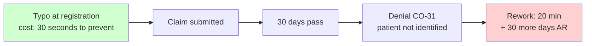

#### To-be

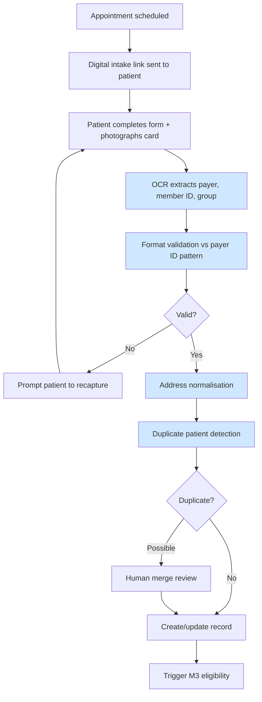

#### Business rules

| ID | Rule | Level |
|---|---|---|
| BR-M2-01 | Member ID MUST be validated against the payer's known format pattern before the record is saved. | MUST |
| BR-M2-02 | Patient name MUST be captured as it appears on the insurance card, not as the patient prefers to be called. | MUST |
| BR-M2-03 | Date of birth MUST be validated for plausibility and cross-checked against the 271 response when available. | MUST |
| BR-M2-04 | Where subscriber ≠ patient, the relationship code MUST be captured. | MUST |
| BR-M2-05 | The system MUST detect potential duplicates on name + DOB + a third identifier before creating a new record. | MUST |
| BR-M2-06 | Coordination of benefits (multiple active coverages) MUST be captured with a payer sequence. | MUST |
| BR-M2-07 | Accident-related indicators MUST be captured, as they redirect liability to auto or workers' compensation. | MUST |
| BR-M2-08 | Address MUST be normalised to a deliverable postal format before patient statements are generated. | SHOULD |

#### Automation boundary

| Automatable | Human required |
|---|---|
| OCR of insurance cards | Ambiguous or damaged cards |
| Format and plausibility validation | Duplicate merge decisions |
| Address normalisation | Complex COB situations |
| Duplicate detection | Legal guardianship / minor edge cases |

#### Edge cases

`EC-06` Patient has two active plans and neither is clearly primary. `EC-07` Newborn billed under mother's ID for the first 30 days. `EC-08` Name change mid-treatment. `EC-09` Card photographed is expired but coverage is active. `EC-10` Self-pay patient who later produces retroactive coverage. `EC-11` Patient is a minor with divorced parents and disputed primary coverage. `EC-12` Workers' comp claim mis-registered as commercial.

#### Acceptance criteria

- Member ID format validation blocks save on known-bad patterns.
- Duplicate detection surfaces at least `[TBD-38]`% of true duplicates in a labelled test set.
- OCR extraction accuracy ≥ `[TBD-39]`% on a held-out card sample, with all low-confidence extractions routed to human review.

**KPIs:** Registration-caused denial rate; % records requiring correction post-submission; duplicate patient rate.

---

### 6.3 M3 — Eligibility Verification

**Purpose:** Confirm active coverage and determine benefits before service, so that non-covered services are known in advance and claims are not submitted to the wrong payer.

**Trigger:** Appointment scheduled (T−3 days); morning of service; any insurance change; before resubmitting an eligibility-related denial.

**Inputs:** Patient demographics, payer, member ID, DOS, service type codes.

**Outputs:** Coverage status, plan details, copay/coinsurance/deductible, active dates, network status, benefit limitations.

#### To-be

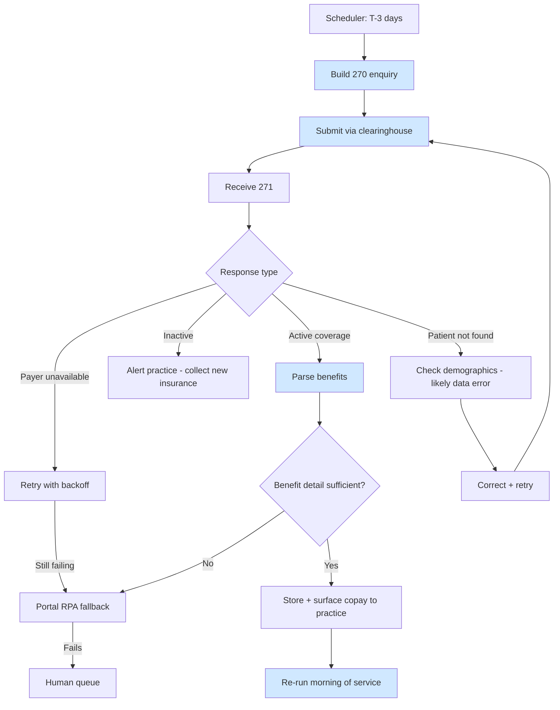

#### Business rules

| ID | Rule | Level |
|---|---|---|
| BR-M3-01 | Eligibility MUST be verified within 72 hours before DOS and re-verified on the morning of service. | MUST |
| BR-M3-02 | A 271 indicating inactive coverage MUST block claim creation and raise an alert to the practice. | MUST |
| BR-M3-03 | "Patient not found" MUST be treated as a probable demographic error, not a coverage denial, and routed to M2 correction. | MUST |
| BR-M3-04 | The full raw 271 MUST be retained, not only the parsed summary. Payers dispute benefit quotes. | MUST |
| BR-M3-05 | Where the 271 lacks the required benefit detail, the system SHOULD fall back to portal retrieval before escalating to a human. | SHOULD |
| BR-M3-06 | Coverage discovered to be terminated after DOS MUST trigger a search for alternative coverage before write-off. | MUST |

#### Automation boundary

Roughly 85% automatable. The residual is payers whose 271 responses are uninformative, plans requiring portal lookup, and coordination-of-benefits ambiguity.

#### Edge cases

`EC-13` Coverage active on DOS but terminated retroactively by the employer. `EC-14` 271 says active but the specific service is excluded. `EC-15` Payer returns a generic "active" with no benefit detail. `EC-16` Medicare Advantage plan returned when Medicare was expected — different payer entirely. `EC-17` Patient has both commercial and Medicaid; Medicaid is payer of last resort.

#### Acceptance criteria

- ≥`[TBD-40]`% of scheduled appointments have a verified eligibility result before DOS.
- Inactive-coverage results reach the practice within `[TBD-41]` hours.
- Raw 271 retrievable for any claim on demand.

**KPIs:** Eligibility verification coverage %; eligibility-related denial rate; % requiring human intervention.

---

### 6.4 M4 — Prior Authorisation

**Purpose:** Obtain payer approval before rendering services that require it.

**Trigger:** Scheduled service matches an auth-required rule; retrospective auth needed after emergency care.

**This is the hardest module.** The 278 transaction exists but adoption is uneven; substantial volume still moves by portal, fax and telephone.

#### To-be

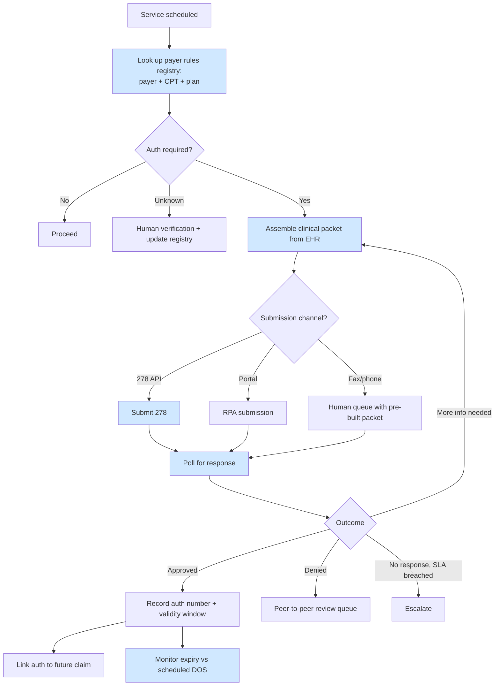

#### Business rules

| ID | Rule | Level |
|---|---|---|
| BR-M4-01 | Where the rules registry indicates auth is required, the claim MUST NOT be submitted without a valid auth number, unless a documented override is recorded with a reason. | MUST |
| BR-M4-02 | Auth validity window MUST be checked against actual DOS at claim creation, not at auth approval. | MUST |
| BR-M4-03 | An auth covers specific CPT codes and unit counts; the system MUST validate that the billed services fall within the authorised scope. | MUST |
| BR-M4-04 | Rules registry entries MUST carry a `last_verified_date`; entries older than `[TBD-42]` days MUST be flagged as stale and re-verified before reliance. | MUST |
| BR-M4-05 | Auth denial MUST NOT auto-cancel the service; it routes to clinical review. | MUST |

#### Automation boundary

| Automatable | Human required |
|---|---|
| Determining whether auth is needed | Peer-to-peer clinical review |
| Assembling the clinical packet | Fax/phone submission |
| 278 submission and polling | Judgment on medical necessity narrative |
| Portal RPA (fragile) | Appeals of auth denials |
| Expiry monitoring | Novel or unlisted procedures |

#### Regulatory note

CMS finalised the Interoperability and Prior Authorization rule (CMS-0057-F), which requires impacted payers to expose FHIR-based prior authorisation APIs and meet decision timelines, phasing in from around 2026–2027. This materially improves automatability of this module.

> **BR-M4-06 (MUST):** Current regulatory status MUST be verified before architectural commitments are made on the assumption of FHIR auth APIs. Do not build a roadmap dependency on a rule without confirming its current effective status and payer applicability. Owner: Muhammad Anas.

#### Edge cases

`EC-18` Emergency service requiring retrospective auth. `EC-19` Auth approved for CPT X, provider performs CPT Y intra-operatively. `EC-20` Auth expires between approval and rescheduled DOS. `EC-21` Payer changes mid-episode; existing auth invalid. `EC-22` Auth obtained by the referring provider, not the rendering provider. `EC-23` Units authorised exceeded by clinical necessity.

#### Acceptance criteria

- Zero claims submitted without auth where the registry says one is required (excluding logged overrides).
- Auth expiry alerts fire before DOS in 100% of cases.
- Stale registry entries are flagged and cannot silently drive a decision.

**KPIs:** Auth-related denial rate; mean auth turnaround; % auths obtained without human touch; registry staleness %.

---

### 6.5 M5 — Medical Coding

**Purpose:** Convert clinical documentation into ICD-10-CM, CPT/HCPCS and modifiers that accurately represent what was documented.

**This module carries severe compliance risk and is sequenced last.**

**Trigger:** Encounter documentation signed by provider.

**Inputs:** Clinical notes, orders, results, procedure reports, provider's own code selections where present.

**Outputs:** Diagnosis codes with pointers, procedure codes, modifiers, units, with justification citations.

#### The risk, stated plainly

Incorrect coding is not a defect class. Systematic upcoding creates False Claims Act exposure for both our company and the client practice. Undercoding loses revenue but is not a legal event; upcoding is. The asymmetry must be reflected in the model's operating point.

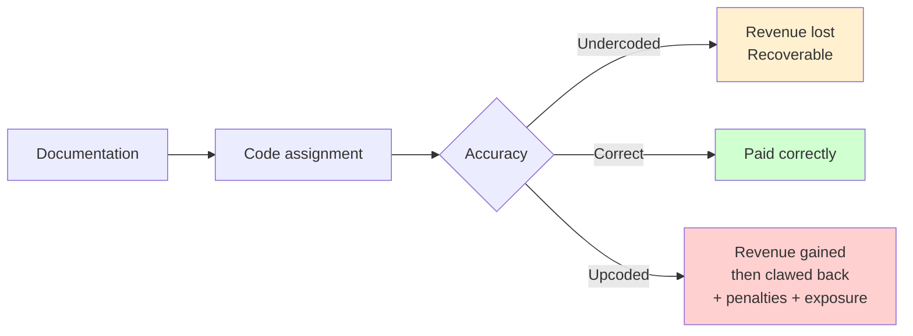

#### Phased introduction — mandatory sequence

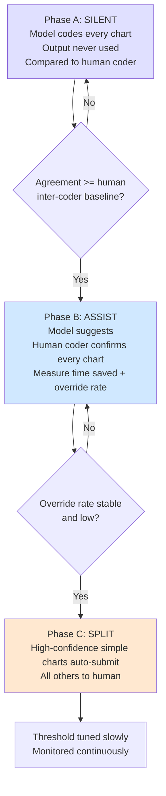

#### Business rules

| ID | Rule | Level |
|---|---|---|
| BR-M5-01 | Every AI-assigned code MUST carry a citation to the specific documentation text that justifies it. | MUST |
| BR-M5-02 | A code MUST NOT be assigned where the documentation does not support it, regardless of clinical likelihood or historical pattern. | MUST |
| BR-M5-03 | Auto-submission is permitted only above a confidence threshold defined and version-controlled in RCM-DOC-08, and only for chart categories explicitly approved. | MUST |
| BR-M5-04 | The model MUST NOT be optimised for reimbursement value. Optimisation target is agreement with correct coding. | MUST |
| BR-M5-05 | Every model suggestion, human override, and final submitted code MUST be logged immutably with timestamp and actor. | MUST |
| BR-M5-06 | Any systematic drift toward higher-value codes MUST trigger automatic suspension of auto-submission pending review. | MUST |
| BR-M5-07 | Audited charts and their corrections MUST be captured as labelled training data. | MUST |
| BR-M5-08 | Modifier assignment MUST follow payer-specific rules from the registry, not a global default. | MUST |

> BR-M5-04 deserves emphasis. A model rewarded for revenue will learn to upcode. The objective function is a compliance control, not a tuning decision.

#### Automation boundary

| Automatable | Human required |
|---|---|
| Straightforward, high-volume, repetitive encounter types | Complex or multi-procedure surgical cases |
| Diagnosis extraction from structured documentation | Ambiguous or contradictory documentation |
| Modifier suggestion from rules | Documentation query to provider |
| Consistency and NCCI checking | Final sign-off on anything below threshold |

#### Edge cases

`EC-24` Documentation contradicts itself between note sections. `EC-25` Procedure documented but not clearly completed. `EC-26` Provider's own code selection conflicts with documentation. `EC-27` Bilateral procedures and modifier 50 vs two lines. `EC-28` Unlisted procedure codes requiring narrative. `EC-29` Documentation supports a code the payer does not cover. `EC-30` Copy-forward text from a prior encounter inflating apparent complexity.

`EC-30` is worth particular attention: templated and copied documentation is common and can make an encounter appear more complex than it was. A model trained naively will learn to code from boilerplate.

#### Acceptance criteria

- Phase A: agreement with human coders ≥ measured human inter-coder agreement baseline `[TBD-43]`.
- Every suggestion has a retrievable citation.
- No auto-submission path exists in code until Phase C is formally approved at a gate.
- Audit trail satisfies external auditor review (tested with a mock audit).

**KPIs:** Coding accuracy vs audit; override rate; coder minutes per chart; coding-related denial rate; drift metric on code value distribution.

---

### 6.6 M6 — Charge Entry

**Purpose:** Assemble the complete, priced claim from coded encounter data.

**Trigger:** Coding complete.

**Inputs:** Codes, patient, provider, payer, fee schedule, POS, auth number, referral, accident details.

**Outputs:** A complete claim ready for scrubbing.

#### To-be

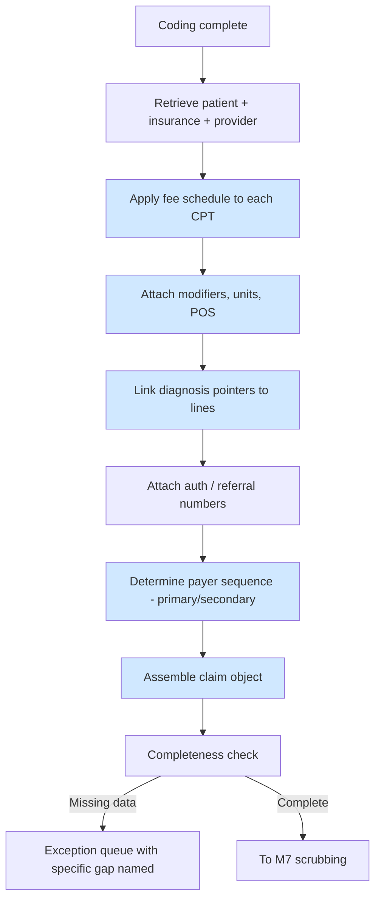

#### Business rules

| ID | Rule | Level |
|---|---|---|
| BR-M6-01 | Every service line MUST have at least one diagnosis pointer. | MUST |
| BR-M6-02 | Charge amounts MUST come from the practice's fee schedule, never from the payer's allowed amount. | MUST |
| BR-M6-03 | Where an auth exists, the auth number MUST be attached to the claim. | MUST |
| BR-M6-04 | Payer sequence MUST be determined from coordination-of-benefits data, not assumed. | MUST |
| BR-M6-05 | Claims MUST NOT be created for dates of service before the provider's enrolment effective date (see BR-M1-01). | MUST |
| BR-M6-06 | Exception queue messages MUST name the specific missing field, not report a generic failure. | SHOULD |

#### Edge cases

`EC-31` Fee schedule missing for a new CPT. `EC-32` Service spans midnight / multi-day. `EC-33` Global surgical period overlapping a separate encounter. `EC-34` Split billing between professional and technical components. `EC-35` Patient changed insurance between DOS and billing date.

#### Acceptance criteria

- 100% of claims have diagnosis pointers on every line.
- Fee schedule lookup failure produces a named exception, never a zero charge.

**KPIs:** % claims through charge entry with zero human touch; exception rate by cause.

---

### 6.7 M7 — Claim Scrubbing

**Purpose:** Detect and correct every error that would cause rejection or denial, before submission.

**This module produces the largest measurable improvement for the least risk, and is the primary consumer of the denial feedback loop.**

**Trigger:** Claim assembled.

#### To-be

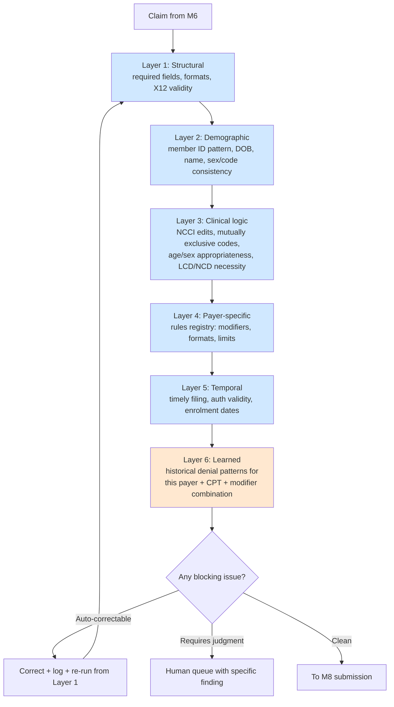

Layer 6 (orange) is the learned layer and is the only one using ML. Layers 1–5 are deterministic rules.

#### The feedback loop — the core of the platform

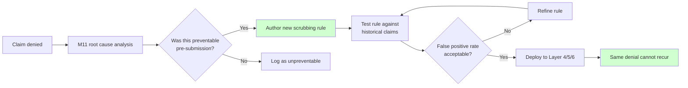

> **BR-M7-01 (MUST):** Every denial classified as preventable MUST result in either a new scrubbing rule or a documented decision not to create one. An unexplained preventable denial recurring more than `[TBD-44]` times is a defect.

#### Business rules

| ID | Rule | Level |
|---|---|---|
| BR-M7-01 | See above — mandatory feedback loop. | MUST |
| BR-M7-02 | Rules MUST be versioned; every claim MUST record which rule version evaluated it. | MUST |
| BR-M7-03 | Auto-correction is permitted only for deterministic fixes (formatting, known field mappings). Anything requiring judgment goes to a human. | MUST |
| BR-M7-04 | Every rule MUST be testable against historical claims before deployment, with its false-positive rate measured. | MUST |
| BR-M7-05 | A rule with a false-positive rate above `[TBD-45]`% MUST NOT be deployed as blocking; it MAY be deployed as advisory. | MUST |
| BR-M7-06 | Human overrides of scrubber findings MUST be logged with reason and fed back into rule quality review. | MUST |
| BR-M7-07 | Deterministic rules MUST take precedence over model predictions where they conflict. | MUST |

#### Edge cases

`EC-36` Rule correct in general but wrong for one payer. `EC-37` NCCI edit has a valid modifier bypass. `EC-38` Legitimate duplicate service on the same day (modifier 76/77). `EC-39` Rule blocks a claim approaching timely filing deadline — see BR-GLOBAL-04, deadline wins. `EC-40` Payer changes a requirement, making a correct rule wrong overnight.

#### Acceptance criteria

- First-pass clean claim rate ≥95% after Phase 2.
- Every rule has a recorded false-positive rate from historical testing.
- No rule deployed without version and rollback capability.

**KPIs:** First-pass clean claim rate; scrubber catch rate; false-positive rate; preventable denials recurring.

---

### 6.8 M8 — Claim Submission

**Purpose:** Transmit claims and process acknowledgements reliably.

**Trigger:** Claim passes scrubbing.

#### To-be

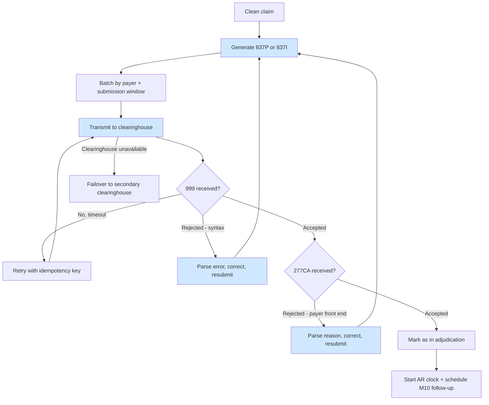

#### Business rules

| ID | Rule | Level |
|---|---|---|
| BR-M8-01 | Every submission MUST carry an idempotency key so that retries cannot create duplicate claims. | MUST |
| BR-M8-02 | A claim MUST NOT be considered submitted until a 277CA acceptance is received. 999 acceptance alone is insufficient — it confirms syntax, not acceptance. | MUST |
| BR-M8-03 | Every outbound 837 and every inbound acknowledgement MUST be archived in raw form. | MUST |
| BR-M8-04 | Rejections MUST be recorded as rejections, not denials (BR-GLOBAL-02). | MUST |
| BR-M8-05 | The system MUST support failover to a secondary clearinghouse. | MUST |
| BR-M8-06 | Corrected claims MUST carry the correct frequency code and reference the original claim number. | MUST |

> BR-M8-05 is not theoretical. The February 2024 Change Healthcare ransomware incident interrupted claim flow across the US industry for weeks. Single-clearinghouse dependency is an unmitigated business continuity risk.

#### Edge cases

`EC-41` Duplicate submission caused by retry without idempotency. `EC-42` Payer requires paper for a specific claim type. `EC-43` Attachment required (operative report, medical records). `EC-44` Batch partially accepted, partially rejected. `EC-45` Clearinghouse routes to the wrong payer due to payer ID ambiguity.

#### Acceptance criteria

- Zero duplicate claims under retry testing.
- 100% of submissions have a matched 999 and 277CA or an open exception.
- Failover tested and documented.

**KPIs:** Submission success rate; rejection rate; mean time from clean claim to accepted; duplicate rate (target 0).

---

### 6.9 M9 — Payment Posting

**Purpose:** Reconcile payer remittances to claims accurately, and correctly split responsibility between write-off and patient.

**Trigger:** 835 file received; paper EOB received; patient payment received.

#### To-be

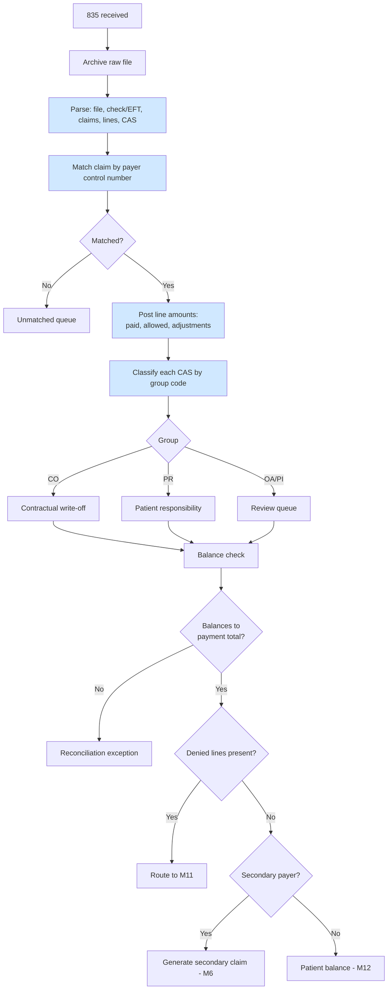

#### Business rules

| ID | Rule | Level |
|---|---|---|
| BR-M9-01 | The 835 MUST balance: sum of claim payments plus adjustments equals the payment total. Any imbalance is an exception, never silently posted. | MUST |
| BR-M9-02 | CAS group code MUST determine posting treatment (BR-GLOBAL-01). | MUST |
| BR-M9-03 | Amounts adjusted under CO MUST NOT be billed to the patient. | MUST |
| BR-M9-04 | Reversals (claim status 22) MUST reverse the original posting and re-open the claim, not create a new negative claim. | MUST |
| BR-M9-05 | Underpayments (paid below contracted allowed) MUST be flagged for review, not silently accepted. | MUST |
| BR-M9-06 | Payment posting MUST be idempotent — reprocessing the same 835 MUST NOT double-post. | MUST |
| BR-M9-07 | Zero-payment 835s MUST be processed; they carry denial information. | MUST |

> BR-M9-03 is a compliance rule, not an accounting preference. Billing a patient for a contractual adjustment breaches payer contracts and may violate state law.

#### Edge cases

`EC-46` One 835 spans dozens of claims and one EFT. `EC-47` Recoupment: payer takes back a prior payment by reducing a current one. `EC-48` Payment received without a matching 835. `EC-49` 835 received without payment. `EC-50` Interest payments. `EC-51` Capitated lines with zero expected payment. `EC-52` Paper EOB requiring OCR. `EC-53` Payment posted to the wrong patient due to control number reuse.

#### Acceptance criteria

- Every 835 balances or raises a named exception.
- Reprocessing an 835 produces no change (idempotency test).
- Reversal handling verified against real historical reversal cases.

**KPIs:** Auto-post rate; unmatched payment rate; posting error rate; underpayments identified.

---

### 6.10 M10 — AR Follow-up

**Purpose:** Ensure no submitted claim is silently forgotten, and direct human effort to the claims where it will recover the most money.

**This is the expected first wedge (Document 01 §7.5).**

**Trigger:** Claim accepted but no 835 after N days; claim in an open status.

#### As-is (the problem)

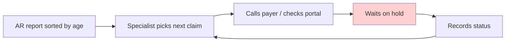

Effort is allocated by claim age, not by expected recovery. Time is spent on hold, adding no value.

#### To-be

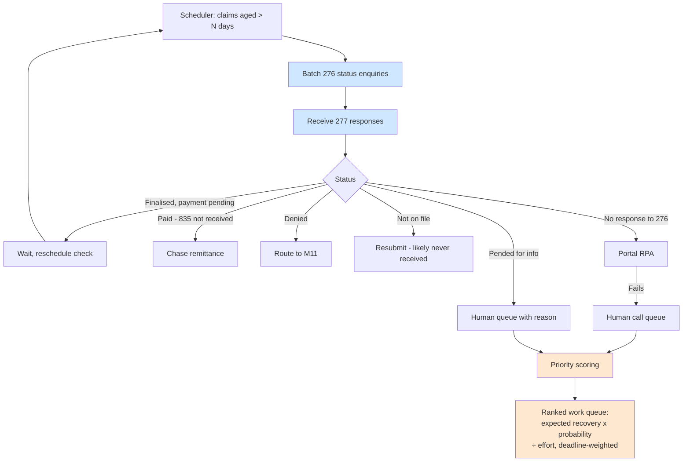

#### Prioritisation model

```
Priority = (Balance × P(recovery)) ÷ Estimated effort
           × Deadline urgency multiplier
```

Where `P(recovery)` is learned from historical outcomes for similar claims, and the deadline multiplier escalates sharply as timely filing approaches (BR-GLOBAL-04).

#### Business rules

| ID | Rule | Level |
|---|---|---|
| BR-M10-01 | Every accepted claim MUST have a scheduled follow-up; no claim may sit in an open state without a next action date. | MUST |
| BR-M10-02 | Electronic status enquiry (276) MUST be attempted before any human contact. | MUST |
| BR-M10-03 | Claims approaching timely filing deadline MUST be escalated regardless of priority score. | MUST |
| BR-M10-04 | Follow-up cadence MUST be payer-specific, based on that payer's observed adjudication time, not a global default. | SHOULD |
| BR-M10-05 | Every human interaction (call, portal check) MUST be logged with outcome, to build effort and recovery data. | MUST |
| BR-M10-06 | Claims with expected recovery below `[TBD-46]` SHOULD be routed to bulk handling rather than individual work. | SHOULD |

#### Edge cases

`EC-54` Payer 277 says paid but no 835 or funds received. `EC-55` Claim not on file after confirmed 277CA acceptance. `EC-56` Payer repeatedly pends without stating a reason. `EC-57` Claim in appeal — must not be double-worked by AR. `EC-58` Very low balance where cost of pursuit exceeds recovery.

#### Acceptance criteria

- Zero claims in an open state without a next action date.
- ≥`[TBD-47]`% of status determinations obtained electronically without human contact.
- Priority queue demonstrably outperforms age-sorted ordering in a controlled comparison.

**KPIs:** Days in AR; % AR >90 days; recovery per human hour; % status checks automated.

---

### 6.11 M11 — Denial Management

**Purpose:** Determine why a claim was denied, recover what is recoverable, and ensure the same denial cannot happen again.

**Trigger:** 835 contains a denial; appeal outcome received.

#### To-be

```mermaid
flowchart TD
    A[Denial from 835] --> B[Extract CARC + RARC + CAS group + amount]
    B --> C[Classify into denial taxonomy - §8]
    C --> D[Determine root cause category]
    D --> E{Disposition}

    E -->|Auto-correctable| F[Apply known fix<br/>demographic, modifier, format]
    F --> G[Regenerate corrected claim]
    G --> H[Back through M7 scrubbing]

    E -->|Appealable| I[Assemble appeal packet:<br/>records, letter, evidence]
    I --> J[Human review + sign]
    J --> K[Submit appeal]
    K --> L[Track appeal deadline + outcome]

    E -->|Patient responsibility| M[To M12]
    E -->|Not recoverable| N[Write-off with reason code]

    C --> O[Preventability analysis]
    O --> P{Preventable?}
    P -->|Yes| Q[Author scrubbing rule - M7]
    P -->|No| R[Log as environmental]

    style B fill:#d0e8ff
    style C fill:#d0e8ff
    style F fill:#d0e8ff
    style I fill:#d0e8ff
    style O fill:#d0ffd0
    style Q fill:#d0ffd0
```

The green path is what makes this a platform rather than a workflow tool. Without it, the system automates rework instead of eliminating it.

#### Business rules

| ID | Rule | Level |
|---|---|---|
| BR-M11-01 | Every denial MUST be classified by root cause, not merely recorded by CARC code. | MUST |
| BR-M11-02 | Every denial MUST receive a preventability determination (BR-M7-01). | MUST |
| BR-M11-03 | Appeal deadlines MUST be tracked per payer from the denial date; a missed deadline is a defect. | MUST |
| BR-M11-04 | Appeal letters MAY be generated automatically but MUST be reviewed and approved by a human before submission. | MUST |
| BR-M11-05 | Write-offs above `[TBD-48]` MUST require named human approval. | MUST |
| BR-M11-06 | A denial on a claim already under appeal MUST NOT trigger a second parallel appeal. | MUST |
| BR-M11-07 | Appeal outcomes MUST be recorded and used to estimate future appeal success probability. | MUST |

#### Denial disposition split

```mermaid
pie showData
    title Typical denial disposition (illustrative - replace with measured data)
    "Auto-correctable" : 35
    "Appealable" : 30
    "Patient responsibility" : 20
    "Not recoverable" : 15
```

> This chart is illustrative only. Replace with Muhammad Anas's measured distribution from the 835 analysis in Phase 0. Do not size the module against these figures.

#### Edge cases

`EC-59` Denial reason is generic (CO-16 "missing information") without a RARC specifying what. `EC-60` Payer denies for lack of auth when auth exists. `EC-61` Denial contradicts the payer's own prior eligibility response. `EC-62` Multiple denials on the same claim with conflicting reasons. `EC-63` Appeal won but payment never arrives. `EC-64` Denial arrives after timely filing has expired for correction. `EC-65` Same claim denied differently on resubmission.

`EC-59` is extremely common and is the main reason CARC codes alone are insufficient for classification. RARC and payer-specific interpretation are required.

#### Acceptance criteria

- 100% of denials classified with a root cause.
- Zero missed appeal deadlines.
- Preventable denial recurrence declining measurably quarter on quarter.

**KPIs:** Denial rate by cause; appeal success rate; recovery rate; preventable denial recurrence; mean days denial→resolution.

---

### 6.12 M12 — Patient Billing & Collections

**Purpose:** Collect the patient-responsibility balance lawfully and effectively.

**Trigger:** Patient responsibility determined after all payers have adjudicated.

#### To-be

```mermaid
flowchart TD
    A[Patient balance determined] --> B{All payers adjudicated?}
    B -->|No| C[Hold - do not bill]
    B -->|Yes| D[Validate: only PR amounts included]
    D --> E[Generate statement]
    E --> F[Multi-channel delivery:<br/>text, email, post]
    F --> G[Payment link]
    G --> H{Paid?}
    H -->|Yes| I[Post + close]
    H -->|No| J[Reminder cadence]
    J --> K{Threshold reached?}
    K -->|No| J
    K -->|Yes| L{Balance > threshold?}
    L -->|Yes| M[Payment plan offer / collections review]
    L -->|No| N[Small balance write-off]
    M --> O[Human decision]

    style D fill:#d0e8ff
    style E fill:#d0e8ff
    style F fill:#d0e8ff
    style J fill:#d0e8ff
```

#### Business rules

| ID | Rule | Level |
|---|---|---|
| BR-M12-01 | A patient MUST NOT be billed before all payers have adjudicated. | MUST |
| BR-M12-02 | Only PR-group amounts may appear on a patient statement (BR-M9-03). | MUST |
| BR-M12-03 | Statements MUST itemise service, date and amount in plain language. | MUST |
| BR-M12-04 | Collections referral MUST require explicit human approval and comply with applicable federal and state debt collection law. | MUST |
| BR-M12-05 | Balances below `[TBD-49]` SHOULD be written off rather than pursued. | SHOULD |
| BR-M12-06 | Financial hardship and charity policies of the client practice MUST be respected before escalation. | MUST |

#### Edge cases

`EC-66` Patient pays, then insurance retroactively pays, creating a refund obligation. `EC-67` Deceased patient. `EC-68` Balance disputed. `EC-69` Minor patient with responsible guarantor. `EC-70` Retroactive Medicaid eligibility eliminating the balance after billing.

`EC-66` requires a refund workflow; retaining a patient overpayment creates legal exposure.

#### Acceptance criteria

- No statement issued before all payer adjudication.
- No CO-group amount ever appears on a statement (automated assertion, tested).
- Refund obligations detected automatically.

**KPIs:** Patient collection rate; days to patient payment; % collected via digital channel; refund turnaround.

---

## 7. Claim State Machine

### 7.1 States

```mermaid
stateDiagram-v2
    [*] --> Registered
    Registered --> EligibilityVerified
    EligibilityVerified --> AuthPending: auth required
    EligibilityVerified --> ServiceRendered: no auth needed
    AuthPending --> AuthApproved
    AuthPending --> AuthDenied
    AuthApproved --> ServiceRendered
    AuthDenied --> Cancelled
    ServiceRendered --> Coded
    Coded --> Charged
    Charged --> Scrubbing
    Scrubbing --> ScrubFailed
    ScrubFailed --> Charged: corrected
    Scrubbing --> ReadyToSubmit
    ReadyToSubmit --> Submitted
    Submitted --> Rejected: 999/277CA reject
    Rejected --> Charged: corrected
    Submitted --> InAdjudication: 277CA accept
    InAdjudication --> Paid
    InAdjudication --> PartiallyPaid
    InAdjudication --> Denied
    InAdjudication --> InAdjudication: 276/277 status check
    Denied --> Appealing
    Denied --> Correcting
    Denied --> WrittenOff
    Correcting --> Charged
    Appealing --> Paid
    Appealing --> Denied
    Paid --> SecondaryBilling: secondary exists
    PartiallyPaid --> SecondaryBilling: secondary exists
    SecondaryBilling --> Charged
    Paid --> PatientBalance: no secondary
    PartiallyPaid --> PatientBalance
    PatientBalance --> Closed
    WrittenOff --> Closed
    Cancelled --> [*]
    Closed --> Reopened: reversal/recoupment
    Reopened --> InAdjudication
    Closed --> [*]
```

### 7.2 State machine rules

| ID | Rule | Level |
|---|---|---|
| BR-STATE-01 | Every state transition MUST be logged with timestamp, actor (human or system), and reason. | MUST |
| BR-STATE-02 | Transitions not defined above MUST be rejected by the system, not silently permitted. | MUST |
| BR-STATE-03 | `Closed` is not final — reversals and recoupments can reopen a claim months later. | MUST |
| BR-STATE-04 | No claim may remain in a non-terminal state without a scheduled next action. | MUST |
| BR-STATE-05 | Final outcome metrics MUST NOT be computed until `[TBD-50]` days post-DOS (recommended 180) to allow for reversals. | MUST |

---

## 8. Cross-Cutting Business Rules

### 8.1 Denial taxonomy

CARC codes are too granular and too ambiguous to drive workflow directly. The system uses an internal taxonomy layered on top.

```mermaid
flowchart TD
    A[Denial] --> B[Category 1: Registration/Eligibility]
    A --> C[Category 2: Authorisation]
    A --> D[Category 3: Coding]
    A --> E[Category 4: Medical Necessity]
    A --> F[Category 5: Timely Filing]
    A --> G[Category 6: Duplicate]
    A --> H[Category 7: Coordination of Benefits]
    A --> I[Category 8: Contractual/Non-covered]
    A --> J[Category 9: Provider Enrolment]
    A --> K[Category 10: Payer Error]

    B --> B1[Preventable at M2/M3]
    C --> C1[Preventable at M4]
    D --> D1[Preventable at M5/M7]
    E --> E1[Partially preventable - LCD checking]
    F --> F1[Preventable at M8/M10]
    G --> G1[Preventable at M7/M8]
    H --> H1[Preventable at M2/M3]
    I --> I1[Not preventable - correct outcome]
    J --> J1[Preventable at M1]
    K --> K1[Not preventable - appeal]
```

> **BR-TAX-01 (MUST):** Every denial MUST map to exactly one category and one preventability determination. The CARC→category mapping MUST be version-controlled and reviewed quarterly, because payers change how they use codes.

### 8.2 Human-in-the-loop principle

```mermaid
flowchart TD
    A[Task arrives] --> B{Deterministic rule<br/>fully covers it?}
    B -->|Yes| C[Automate - no human]
    B -->|No| D{Model confidence<br/>above threshold?}
    D -->|Yes| E{Compliance risk<br/>low?}
    E -->|Yes| F[Automate with logging]
    E -->|No| G[Human review required]
    D -->|No| G
    G --> H[Human decision logged<br/>as training signal]
    H --> I[Feeds model improvement]

    style C fill:#d0ffd0
    style F fill:#fff0d0
    style G fill:#ffe0e0
```

> **BR-HITL-01 (MUST):** Deterministic rules take precedence over models. A model MUST NOT override a rule.
> **BR-HITL-02 (MUST):** Every human decision on an escalated item MUST be captured as labelled training data.
> **BR-HITL-03 (MUST):** Confidence thresholds MUST be configurable, version-controlled, and changeable only through a governed process — never hard-coded.

### 8.3 Audit trail requirement

> **BR-AUDIT-01 (MUST):** For every automated decision the system MUST be able to answer, on demand: what decision was made, by which component and version, on what input, under which rule or model version, at what time, and — for code assignment — citing which source text.

"The model decided" is not an acceptable audit response. This requirement shapes the data model and cannot be retrofitted; it is specified here rather than in RCM-DOC-10 because it is a functional requirement, not an implementation detail.

### 8.4 Modifier handling

Modifiers are a disproportionate source of denials and deserve explicit treatment.

| Rule | Level |
|---|---|
| Modifier order MUST follow payer requirements; pricing modifiers generally precede informational ones. | MUST |
| Modifier appropriateness MUST be validated against the CPT and the clinical circumstance, not applied by pattern. | MUST |
| Modifier 25 and 59 (and the X{EPSU} subset) MUST NOT be applied automatically to bypass NCCI edits — this is a recognised audit target. | MUST |
| Payer-specific modifier rules MUST come from the registry, not global defaults. | MUST |

### 8.5 Data quality gates

| Gate | Point | Action on failure |
|---|---|---|
| Inbound file validation | Ingestion | Quarantine, alert, do not parse into warehouse |
| Demographic validation | M2 | Block save |
| Claim completeness | M6 | Named exception queue |
| Scrubbing | M7 | Block submission or advise |
| 835 balance | M9 | Reconciliation exception |

---

## 9. Payer Rules Registry

Not a module, but the reference data that every module depends on. It is hand-maintained and will outperform any model.

### 9.1 Structure

| Key | Attributes |
|---|---|
| `payer_id` + `plan_type` + `cpt` (or wildcard) | `prior_auth_required`, `auth_validity_days`, `timely_filing_days`, `appeal_deadline_days`, `required_modifiers`, `prohibited_modifiers`, `frequency_limits`, `documentation_required`, `submission_channel`, `member_id_pattern`, `companion_guide_variance`, `typical_adjudication_days`, `last_verified_date`, `verified_by`, `source_url` |

### 9.2 Maintenance rules

| ID | Rule | Level |
|---|---|---|
| BR-REG-01 | Every entry MUST carry `last_verified_date` and `verified_by`. | MUST |
| BR-REG-02 | Entries older than `[TBD-42]` days MUST be flagged stale and MUST NOT silently drive a blocking decision. | MUST |
| BR-REG-03 | Registry changes MUST be versioned; claims MUST record which registry version applied. | MUST |
| BR-REG-04 | Denials attributable to an incorrect registry entry MUST trigger review of that entry. | MUST |
| BR-REG-05 | A named owner MUST be accountable for registry currency. | MUST |

> The registry decays. Payers change rules without notice. Without BR-REG-02, the system becomes confidently wrong — worse than having no rule at all, because it blocks correct claims and passes incorrect ones.

---

## 10. Exception Handling and Escalation

### 10.1 Escalation routing

```mermaid
flowchart TD
    A[Exception raised] --> B{Type}
    B -->|Data quality| C[Correction queue - ops]
    B -->|Rule conflict| D[Rules review - Eng 2 + SME]
    B -->|Model low confidence| E[Domain queue - specialist]
    B -->|External system failure| F[Technical queue - Eng 1]
    B -->|Compliance concern| G[Immediate escalation - Muhammad Anas]
    B -->|Deadline risk| H[Priority queue - overrides all]

    G --> I[Automation suspended for<br/>affected path pending review]
    style G fill:#ffd0d0
    style I fill:#ffd0d0
    style H fill:#ffe8d0
```

### 10.2 Exception rules

| ID | Rule | Level |
|---|---|---|
| BR-EXC-01 | Every exception MUST name the specific problem and the specific record. Generic failure messages are defects. | MUST |
| BR-EXC-02 | Every exception MUST have an owner and an SLA. | MUST |
| BR-EXC-03 | Compliance-category exceptions MUST suspend the affected automation path until reviewed. | MUST |
| BR-EXC-04 | Exception volume by type MUST be monitored; a rising trend indicates upstream degradation. | MUST |
| BR-EXC-05 | No exception may be closed without a recorded resolution. | MUST |

---

## 11. Conceptual Data Entities

Full schema is in RCM-DOC-05. This is the conceptual model the functional spec assumes.

```mermaid
erDiagram
    PRACTICE ||--o{ PROVIDER : employs
    PROVIDER ||--o{ ENROLMENT : has
    PAYER ||--o{ ENROLMENT : grants
    PATIENT ||--o{ COVERAGE : has
    PAYER ||--o{ COVERAGE : issues
    PATIENT ||--o{ ENCOUNTER : attends
    PROVIDER ||--o{ ENCOUNTER : renders
    ENCOUNTER ||--o{ AUTHORISATION : may_require
    ENCOUNTER ||--|| CODING : produces
    CODING ||--|| CLAIM : becomes
    CLAIM ||--|{ SERVICE_LINE : contains
    CLAIM ||--o{ SUBMISSION : has
    SUBMISSION ||--o{ ACKNOWLEDGEMENT : receives
    CLAIM ||--o{ REMITTANCE_LINE : receives
    SERVICE_LINE ||--o{ ADJUSTMENT : has
    ADJUSTMENT }o--|| CARC_CODE : cites
    REMITTANCE_LINE ||--o{ DENIAL : may_be
    DENIAL ||--o{ APPEAL : may_have
    CLAIM ||--o{ PATIENT_BALANCE : may_produce
    PAYER ||--o{ PAYER_RULE : governed_by
```

### 11.1 Grain rules

| ID | Rule | Level |
|---|---|---|
| BR-DATA-01 | Analytical tables MUST be at service-line grain, not claim grain. Adjudication is per line. | MUST |
| BR-DATA-02 | Adjustments MUST be stored one row per CAS reason, not collapsed. | MUST |
| BR-DATA-03 | Resubmissions MUST be chained to the original claim, not stored as independent claims. Failure to do this inflates volume and distorts the denial rate. | MUST |
| BR-DATA-04 | Payer identity MUST be keyed on payer ID, never on free-text payer name. | MUST |
| BR-DATA-05 | Every record MUST support point-in-time reconstruction — what did we know, and when? Required for both audit and leakage-free model training. | MUST |

---

## 12. Human-in-the-Loop Touchpoints

Consolidated list of every point where a human is required. These drive the UI design in RCM-DOC-11.

| # | Touchpoint | Module | Why human | Interface needed |
|---|---|---|---|---|
| 1 | Duplicate patient merge | M2 | Judgment, irreversible | Side-by-side comparison |
| 2 | Ambiguous card OCR | M2 | Perception | Image + extracted fields |
| 3 | Eligibility exception | M3 | Payer contact | Queue + call log |
| 4 | Auth clinical review | M4 | Clinical judgment | Packet view + submission |
| 5 | Peer-to-peer review | M4 | Clinician only | Scheduling + notes |
| 6 | Coding confirmation | M5 | Compliance | Note + suggestion + citation + override |
| 7 | Coding audit | M5 | Compliance | Sampling + correction capture |
| 8 | Charge exception | M6 | Missing data | Named-gap resolution |
| 9 | Scrubber override | M7 | Judgment | Finding + reason capture |
| 10 | Rule authoring | M7 | Domain expertise | Rule builder + historical test |
| 11 | Rejection resolution | M8 | Judgment | Error + claim + fix |
| 12 | Unmatched payment | M9 | Investigation | Search + manual match |
| 13 | Reconciliation exception | M9 | Investigation | Balance breakdown |
| 14 | AR call queue | M10 | Payer contact | Prioritised queue + script + outcome log |
| 15 | Denial disposition | M11 | Judgment | Denial + history + recommendation |
| 16 | Appeal approval | M11 | Compliance | Draft letter + evidence + sign-off |
| 17 | Write-off approval | M11 | Financial control | Threshold-gated approval |
| 18 | Collections decision | M12 | Legal/ethical | Patient history + hardship policy |
| 19 | Compliance escalation | All | Risk | Alert + suspension control |

---

## 13. Edge Case Register

All edge cases from §6 consolidated. Each MUST have a test case in RCM-DOC-14.

| ID | Module | Edge case | Priority |
|---|---|---|---|
| EC-01 | M1 | Provider moves practice mid-enrolment | Med |
| EC-02 | M1 | Locum tenens billing | Med |
| EC-03 | M1 | Group vs individual enrolment mismatch | Med |
| EC-04 | M1 | Retroactive effective date → held claim backlog | High |
| EC-05 | M1 | Enrolled with payer but not the plan product | High |
| EC-06 | M2 | Two active plans, primary unclear | High |
| EC-07 | M2 | Newborn on mother's ID | Med |
| EC-08 | M2 | Name change mid-treatment | Low |
| EC-09 | M2 | Expired card, active coverage | Med |
| EC-10 | M2 | Self-pay with retroactive coverage | Med |
| EC-11 | M2 | Minor, divorced parents, disputed coverage | Med |
| EC-12 | M2 | Workers' comp mis-registered as commercial | High |
| EC-13 | M3 | Retroactive termination | High |
| EC-14 | M3 | Active but service excluded | High |
| EC-15 | M3 | Uninformative 271 | High |
| EC-16 | M3 | Medicare Advantage vs Medicare confusion | High |
| EC-17 | M3 | Medicaid as payer of last resort | Med |
| EC-18 | M4 | Retrospective auth after emergency | High |
| EC-19 | M4 | Intra-operative procedure change | High |
| EC-20 | M4 | Auth expires before rescheduled DOS | High |
| EC-21 | M4 | Payer change mid-episode | Med |
| EC-22 | M4 | Auth held by referring, not rendering provider | Med |
| EC-23 | M4 | Authorised units exceeded | Med |
| EC-24 | M5 | Contradictory documentation | High |
| EC-25 | M5 | Procedure documented, completion unclear | High |
| EC-26 | M5 | Provider code conflicts with documentation | High |
| EC-27 | M5 | Bilateral: modifier 50 vs two lines | Med |
| EC-28 | M5 | Unlisted procedure requiring narrative | Med |
| EC-29 | M5 | Documented but non-covered | Med |
| EC-30 | M5 | Copy-forward inflating complexity | **High** |
| EC-31 | M6 | Missing fee schedule entry | Med |
| EC-32 | M6 | Service spanning midnight | Low |
| EC-33 | M6 | Global surgical period overlap | High |
| EC-34 | M6 | Professional/technical component split | Med |
| EC-35 | M6 | Insurance changed between DOS and billing | High |
| EC-36 | M7 | Rule correct generally, wrong for one payer | High |
| EC-37 | M7 | NCCI edit with valid modifier bypass | High |
| EC-38 | M7 | Legitimate same-day duplicate (76/77) | Med |
| EC-39 | M7 | Rule blocks claim near filing deadline | **High** |
| EC-40 | M7 | Payer changes requirement overnight | High |
| EC-41 | M8 | Duplicate from retry | **High** |
| EC-42 | M8 | Paper-only claim type | Low |
| EC-43 | M8 | Attachment required | Med |
| EC-44 | M8 | Partial batch acceptance | Med |
| EC-45 | M8 | Misrouted by payer ID ambiguity | Med |
| EC-46 | M9 | Bulk 835 across many claims | High |
| EC-47 | M9 | Recoupment against current payment | **High** |
| EC-48 | M9 | Payment without 835 | Med |
| EC-49 | M9 | 835 without payment | Med |
| EC-50 | M9 | Interest payment | Low |
| EC-51 | M9 | Capitated zero-payment lines | Med |
| EC-52 | M9 | Paper EOB requiring OCR | Med |
| EC-53 | M9 | Control number reuse → misposting | High |
| EC-54 | M10 | 277 says paid, no funds | High |
| EC-55 | M10 | Not on file despite 277CA acceptance | High |
| EC-56 | M10 | Repeated pending without reason | Med |
| EC-57 | M10 | Claim under appeal double-worked | Med |
| EC-58 | M10 | Balance below pursuit threshold | Low |
| EC-59 | M11 | Generic CO-16 without specifying RARC | **High** |
| EC-60 | M11 | Auth denial despite valid auth | High |
| EC-61 | M11 | Denial contradicts prior eligibility response | High |
| EC-62 | M11 | Conflicting denial reasons on one claim | Med |
| EC-63 | M11 | Appeal won, payment not received | Med |
| EC-64 | M11 | Denial after filing window closed | High |
| EC-65 | M11 | Different denial on resubmission | Med |
| EC-66 | M12 | Patient overpayment → refund obligation | **High** |
| EC-67 | M12 | Deceased patient | Med |
| EC-68 | M12 | Disputed balance | Med |
| EC-69 | M12 | Minor with guarantor | Low |
| EC-70 | M12 | Retroactive Medicaid eliminating balance | Med |

---

## 14. Global Business Rules Summary

Quick reference for the rules that cut across all modules.

| ID | Rule |
|---|---|
| BR-GLOBAL-01 | CAS group code MUST be stored with every CARC |
| BR-GLOBAL-02 | Rejections and denials MUST be distinct outcome types |
| BR-GLOBAL-03 | CPT licensing position MUST be confirmed before display or training |
| BR-GLOBAL-04 | Timely filing deadline overrides all other prioritisation |
| BR-GLOBAL-05 | Raw inbound files MUST be archived before parsing |
| BR-STATE-01..05 | State transitions logged; undefined transitions rejected; Closed is not final |
| BR-HITL-01..03 | Rules beat models; human decisions are training data; thresholds are governed |
| BR-AUDIT-01 | Every automated decision must be fully explainable on demand |
| BR-TAX-01 | Every denial mapped to one category and a preventability determination |
| BR-REG-01..05 | Payer registry entries are dated, owned, versioned and expire |
| BR-DATA-01..05 | Line grain; unrolled adjustments; chained resubmissions; payer IDs; point-in-time reconstruction |
| BR-EXC-01..05 | Exceptions are specific, owned, SLA-bound, monitored and closed with a resolution |

---

## 15. Open Questions

| # | Question | Owner | Blocks |
|---|---|---|---|
| Q-01 | Which EHRs are in use across the client base, and what API access exists for each? | Eng 1 | Integration design |
| Q-02 | Which PM system, and what export/API capability? | Eng 1 | Ingestion design |
| Q-03 | Which clearinghouse, what transaction set is enabled, what is the data retention window? | Eng 1 | **Urgent — data archival** |
| Q-04 | Which specialties and therefore which coding domains are in scope? | Muhammad Anas | M5 scope |
| Q-05 | Top 20 payers by volume? | Eng 2 | Registry build order |
| Q-06 | Current denial mix by CARC and by dollar value? | Eng 2 | Wedge confirmation |
| Q-07 | Do any client contracts restrict automation or offshore processing? | Muhammad Anas | Client onboarding |
| Q-08 | Does the current PM system log human touches per claim? | Eng 2 | Baseline for touch KPI |
| Q-09 | Is there an existing coding audit process, and are its results retained? | Coding lead | M5 training data |
| Q-10 | What is the AMA CPT licensing position? | Muhammad Anas | M5 UI and training |

---

## Appendix A — Placeholder Register (continued from Document 01)

| ID | Description | Owner |
|---|---|---|
| TBD-36 | AMA CPT licensing determination | Muhammad Anas |
| TBD-37 | Timely-filing escalation threshold (days) | Muhammad Anas |
| TBD-38 | Duplicate detection recall target | Eng 2 |
| TBD-39 | OCR extraction accuracy target | Eng 2 |
| TBD-40 | Eligibility pre-verification coverage target | Ops |
| TBD-41 | Inactive-coverage alert SLA (hours) | Ops |
| TBD-42 | Payer registry staleness threshold (days) | Muhammad Anas |
| TBD-43 | Human inter-coder agreement baseline | Coding lead |
| TBD-44 | Preventable denial recurrence defect threshold | Eng 2 |
| TBD-45 | Maximum false-positive rate for blocking rules | Eng 2 |
| TBD-46 | Minimum balance for individual AR work | Muhammad Anas |
| TBD-47 | Target % electronic status determinations | Ops |
| TBD-48 | Write-off approval threshold | Muhammad Anas |
| TBD-49 | Small-balance write-off threshold | Muhammad Anas |
| TBD-50 | Outcome maturity window (days, recommend 180) | Eng 2 |

---

*End of Document 02 — Domain & Functional Specification*
