# Document 03 — Software Requirements Specification (SRS)
## RCM Automation Platform

---

# PART I — FOUNDATION

## 1. Introduction

### 1.1 Purpose

This document is the authoritative technical specification for the RCM Automation Platform. It defines the architecture, technology stack, data model, service design, user interface, security posture, and build sequence.

It answers, for a developer joining the team: *what am I building, with what, in what order, and how do I know it's correct?*

### 1.2 Relationship to other documents

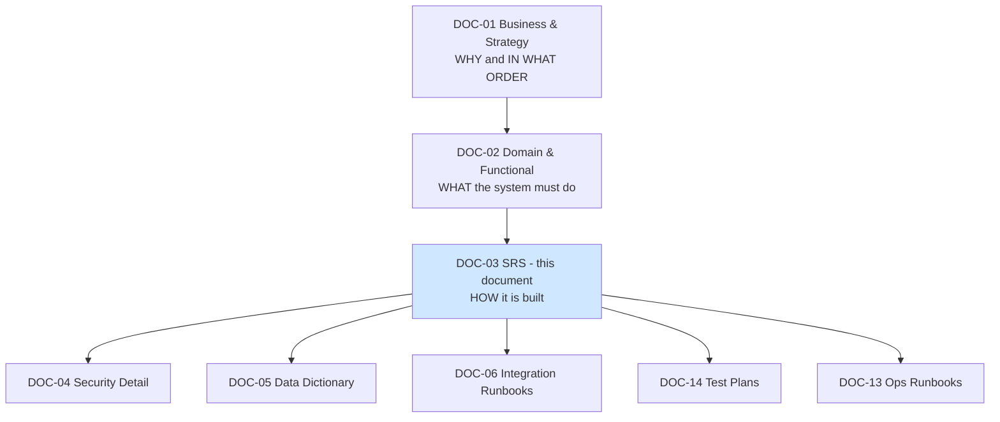

This SRS absorbs what were originally planned as separate documents for backend, frontend, integration, ML, DevOps and architecture. Those aspects are sections here rather than standalone files, because with a three-person team, fragmented documentation goes stale faster than it gets read.

**Rule of precedence:** if this document conflicts with DOC-02 on *what the system does*, DOC-02 wins and this document is corrected. If it conflicts on *how it is built*, this document wins.

### 1.3 Scope

**In scope:** the automation platform — ingestion, warehouse, rules engine, ML services, work queues, operator UI, dashboards, and all integrations.

**Out of scope:** the EHR, the practice management system, the clearinghouse, payer systems. These are external systems the platform integrates with and does not control.

### 1.4 Intended readership

| Reader | Sections |
|---|---|
| Engineer 1 (Data & Integration) | 3, 4, 5, 6, 7, 13, 15 |
| Engineer 2 (Application & Intelligence) | 3, 4, 7, 8, 9, 10, 15 |
| Muhammad Anas (Sponsor) | 1, 2, 3, 4, 11, 12, 15, 16 |
| Future hires | All, in order |

### 1.5 Requirement identifiers

| Prefix | Meaning |
|---|---|
| `FR-` | Functional requirement |
| `NFR-` | Non-functional requirement |
| `SR-` | Security requirement |
| `DR-` | Data requirement |
| `IR-` | Integration requirement |
| `UR-` | UI requirement |

MUST / SHOULD / MAY carry RFC 2119 meaning. **MUST requirements are testable and blocking.**

### 1.6 Conventions

- Code identifiers in `monospace`.
- `[TBD-##]` continues numbering from DOC-01 Appendix A and DOC-02 Appendix A.
- `[DECISION-##]` marks a choice that must be formally recorded before the affected work begins.

---

## 2. Overall Description

### 2.1 Product perspective

The platform is a **middleware and decision layer** inserted between the client practice's systems and the payer ecosystem. It does not replace either side. It reads from upstream systems, makes decisions, writes transactions downstream, and presents exceptions to humans.

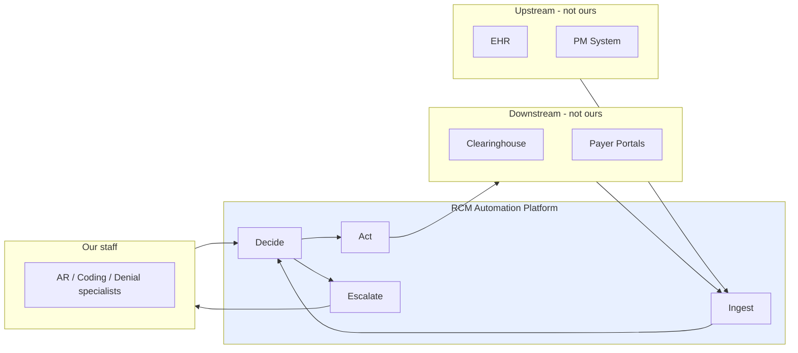

### 2.2 Design philosophy

Seven principles that resolve most design arguments before they start.

| # | Principle | Consequence |
|---|---|---|
| 1 | **Rules before models** | Deterministic logic is preferred everywhere it suffices. Models fill gaps rules cannot. |
| 2 | **Everything is auditable** | Every decision records its inputs, the logic version, and its output. Non-negotiable (DOC-02 BR-AUDIT-01). |
| 3 | **Raw data is sacred** | Source files archived immutably before parsing. Parsers get rewritten; sources cannot be regenerated. |
| 4 | **Parallel before replacement** | Every automation runs shadow-mode first and must beat humans on a scoreboard. |
| 5 | **Fail visible, never silent** | An unhandled case becomes a named exception with an owner. Never a default value. |
| 6 | **Boring technology** | Three people cannot operate exotic infrastructure. Choose the well-documented option. |
| 7 | **Idempotent everything** | External systems are unreliable. Every operation must be safely repeatable. |

### 2.3 User classes

| Class | Count | Technical skill | Primary need | Access level |
|---|---|---|---|---|
| AR Specialist | Many | Low | Fast work queue, call logging | Operational |
| Denial Specialist | Few | Medium | Denial context, appeal tooling | Operational |
| Medical Coder | Few | Domain-expert | Note + suggestion + citation review | Operational (PHI-heavy) |
| Payment Poster | Few | Low | Exception resolution, matching | Operational |
| Ops Manager | 1–2 | Medium | Queue oversight, SLA monitoring | Supervisory |
| Rules Author | 1–2 | Medium-high | Rule builder with historical testing | Configuration |
| Engineer | 2 | High | Everything, plus infrastructure | Admin |
| Sponsor | 1 | Medium | Dashboards, compliance, approvals | Executive + approvals |
| Auditor (external) | Occasional | Medium | Read-only audit trail access | Audit-only |

### 2.4 Operating environment

| Aspect | Specification |
|---|---|
| Deployment | Cloud, US region only (`[DECISION-01]` — see §11.3 on offshore access) |
| Client access | Web browser, desktop-first (operators work at desks with dual monitors) |
| Browser support | Evergreen Chrome, Edge, Firefox, Safari — last 2 versions |
| Availability window | Business hours critical; batch processing overnight |
| Data volume | `[TBD-51]` claims/month currently; design for 10× |
| Concurrent users | `[TBD-52]` |

### 2.5 Constraints

| ID | Constraint | Design impact |
|---|---|---|
| C-01 | Three-person team | Monolith-first, managed services, minimal infrastructure surface |
| C-02 | PHI throughout | Encryption, audit logging, access control are not optional features |
| C-03 | Live operation | Shadow mode mandatory; no destructive migrations |
| C-04 | Offshore development | Data residency and access controls constrain who can see production data |
| C-05 | Self-funded | Cloud cost must scale with revenue, not ahead of it |
| C-06 | External systems unreliable | Retry, circuit breaking, failover throughout |
| C-07 | CPT licensing | Descriptor display and model training gated on `[TBD-36]` |

### 2.6 Assumptions

| ID | Assumption | If false |
|---|---|---|
| A-01 | Clearinghouse offers SFTP or API access to X12 files | Manual download; automation delayed |
| A-02 | PM system offers DB access or scheduled export | Screen-scraping fallback; significant cost |
| A-03 | ≥12 months of 835 history retrievable | ML phases postponed until data accumulates |
| A-04 | Client BAAs permit internal analytics | Legal amendment required before Phase 3 |
| A-05 | Team can access US-hosted infrastructure compliantly | Architecture change required |

---

# PART II — ARCHITECTURE

## 3. System Architecture

### 3.1 Context view

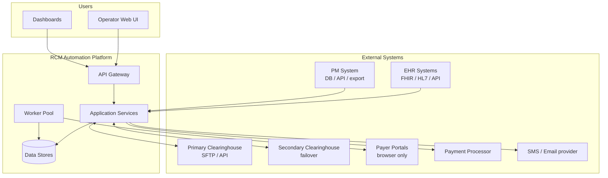

### 3.2 Container view

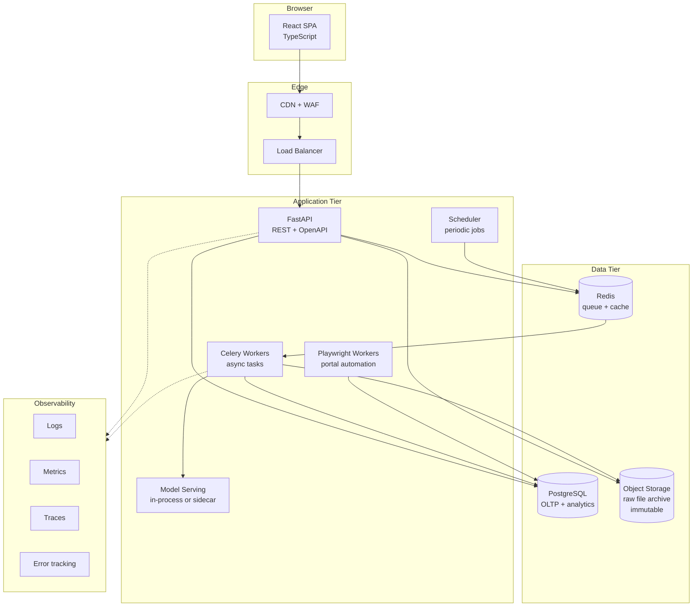

### 3.3 Component view — application services

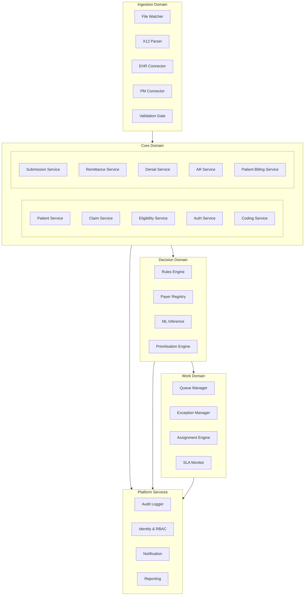

### 3.4 Architecture style decision

`[DECISION-02]` **Modular monolith, not microservices.**

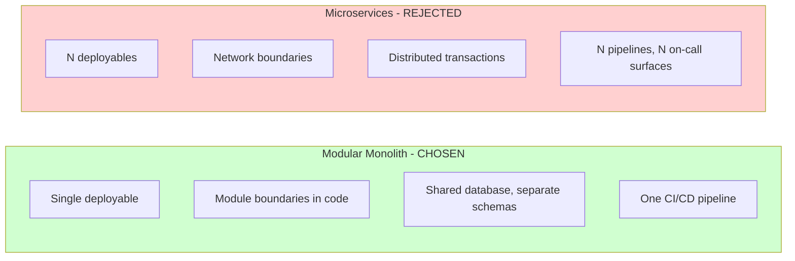

**Rationale:** two engineers cannot operate a distributed system. Microservices trade development simplicity for operational complexity, and operational complexity is the scarce resource here. Module boundaries are enforced in code (import rules, separate schemas, no cross-module table access) so that extraction to services remains possible later if scale demands it.

**Exceptions permitted as separate deployables:**

- RPA workers (different runtime, browser dependencies, different failure profile)
- ML training jobs (different resource profile, batch not request-serving)

### 3.5 Deployment view

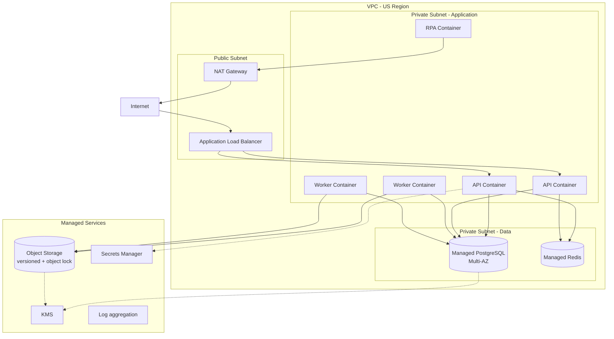

**NFR-ARCH-01 (MUST):** No data-tier resource may be publicly routable.
**NFR-ARCH-02 (MUST):** All outbound traffic to external systems routes through a NAT gateway with a fixed IP, so clearinghouse and payer IP allowlisting is possible.

---

## 4. Technology Stack

### 4.1 Selection criteria

Every choice is scored against: (1) can two engineers operate it at 3am, (2) is hiring for it realistic, (3) is the documentation good, (4) does it have a HIPAA-compatible deployment path, (5) does it avoid lock-in that would be expensive to reverse.

### 4.2 The stack

| Layer | Choice | Version policy | Why |
|---|---|---|---|
| **Backend language** | Python 3.12+ | LTS-ish, upgrade annually | Best ecosystem for healthcare data, X12 tooling, and ML. One language across API, pipelines and models. |
| **API framework** | FastAPI | Latest stable | Async, Pydantic validation, auto-generated OpenAPI → frontend types |
| **Data validation** | Pydantic v2 | Pinned | Runtime validation at every boundary. Critical when inputs are untrusted X12. |
| **ORM / DB access** | SQLAlchemy 2.x (Core + ORM) | Pinned | Mature; Core for analytical queries, ORM for domain objects |
| **Migrations** | Alembic | Pinned | Versioned, reversible schema change |
| **Primary database** | PostgreSQL 16+ | Managed service | Transactional integrity, JSONB for semi-structured payer data, strong analytical capability, partitioning |
| **Cache / broker** | Redis | Managed service | Queue broker + cache + distributed locks |
| **Task queue** | Celery | Pinned | Mature, well-understood retry semantics |
| **Scheduler** | Celery Beat, or Dagster if pipeline complexity grows | — | Start simple; revisit at Phase 3 |
| **Analytics transforms** | dbt-core | Pinned | Versioned, tested, documented SQL transformations |
| **Frontend language** | TypeScript (strict) | — | Type safety across a large operator UI is not optional |
| **Frontend framework** | React 18+ | — | Hiring pool, ecosystem, table libraries |
| **Build tool** | Vite | — | Fast, simple |
| **Server state** | TanStack Query | — | Caching, retries, background refetch — exactly what a work queue UI needs |
| **Client state** | Zustand | — | Minimal; Redux is overkill here |
| **Tables** | TanStack Table | — | Work queues are tables. This is the core UI primitive. |
| **Styling** | Tailwind CSS | — | Fast iteration, no CSS architecture debates |
| **Components** | shadcn/ui (Radix primitives) | — | Accessible, owned in-repo, no vendor lock |
| **Forms** | React Hook Form + Zod | — | Zod schemas mirror Pydantic |
| **Charts** | Recharts | — | Sufficient for operational dashboards |
| **API client** | openapi-typescript + generated client | — | Types generated from backend OpenAPI. No hand-written API types. |
| **ML — tabular** | LightGBM / XGBoost | — | Best-in-class for tabular denial prediction; interpretable via SHAP |
| **ML — NLP** | Transformers (Phase 4 only) | — | Coding assistance |
| **Experiment tracking** | MLflow | — | Model registry + lineage; required for governance |
| **Explainability** | SHAP | — | Required for BR-AUDIT-01 |
| **RPA** | Playwright (Python) | — | Reliable, headless, good selector model |
| **OCR** | Cloud OCR service + Tesseract fallback | — | Insurance cards, paper EOBs |
| **Cloud** | AWS | — | BAA available, broadest HIPAA-eligible service list |
| **Compute** | ECS Fargate | — | No cluster to manage. Kubernetes rejected under C-01. |
| **IaC** | Terraform | — | Declarative, reviewable, reversible |
| **CI/CD** | GitHub Actions | — | Colocated with code |
| **Secrets** | AWS Secrets Manager | — | Rotation, audit, no secrets in code |
| **Error tracking** | Sentry (self-hosted or BAA) | — | `[DECISION-03]` — verify PHI scrubbing before use |
| **Testing (BE)** | pytest + Hypothesis | — | Property-based testing for X12 parsers |
| **Testing (FE)** | Vitest + React Testing Library + Playwright | — | Unit → integration → E2E |
| **Linting** | Ruff + mypy (BE), ESLint + tsc (FE) | — | Enforced in CI |
| **Formatting** | Ruff format, Prettier | — | Zero style debate |

### 4.3 Explicitly rejected

| Rejected | Why |
|---|---|
| Kubernetes | Operational burden unjustifiable for 3 people |
| Microservices | See §3.4 |
| MongoDB / document store as primary | Financial data needs transactional integrity and joins |
| Separate analytics warehouse (Snowflake/BigQuery) at launch | Postgres handles projected volume. Revisit when it doesn't. |
| GraphQL | REST + OpenAPI codegen gives typed clients with less machinery |
| Node.js backend | Splits the language; loses the ML ecosystem |
| Off-the-shelf BPM/workflow engine | Domain state machine is small and specific; a generic engine adds more than it removes |
| LLM as primary decision-maker | Non-deterministic, hard to audit, contradicts Principle 1 |

### 4.4 X12 parsing decision

`[DECISION-04]` This is the single most consequential technical choice in the platform.

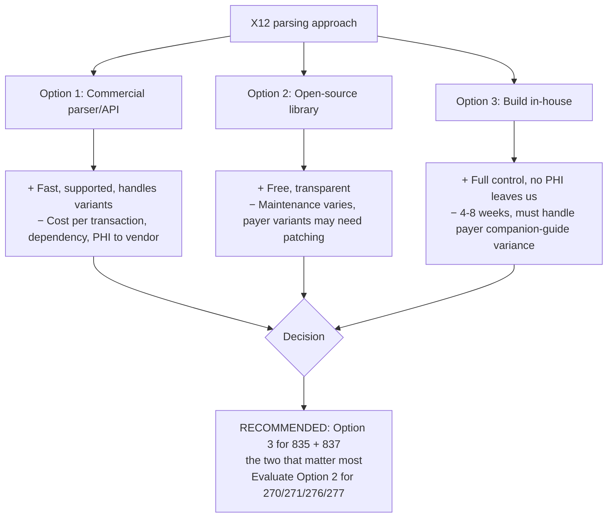

**Rationale for building the 835 parser in-house:** the 835 is the source of every denial label. Parser bugs corrupt the training data silently and irreversibly. Owning it means owning correctness. It is also the highest-leverage piece of domain knowledge the engineering team will acquire.

**IR-01 (MUST):** The 835 parser MUST be validated against at least `[TBD-53]` real remittance files across at least `[TBD-54]` distinct payers before production use.
**IR-02 (MUST):** Parser output MUST be reconcilable — parsed amounts must sum to the file-level payment total, else the file is quarantined (DOC-02 BR-M9-01).

---

# PART III — DATA

## 5. Data Architecture

### 5.1 Data layers

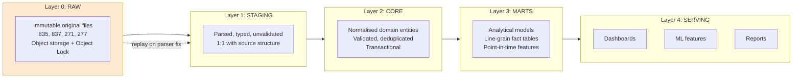

**DR-01 (MUST):** Layer 0 is write-once. No process may modify or delete a raw file within its retention period.
**DR-02 (MUST):** Any layer 1–3 table must be fully reconstructible from Layer 0 plus code. This makes parser bugs recoverable.
**DR-03 (MUST):** Layer 3 features MUST be computed point-in-time — see §5.6.

### 5.2 Core schema — principal entities

Illustrative DDL. Full dictionary in DOC-05.

```sql
-- Payer master. Free-text names are never keys (DOC-02 BR-DATA-04).
CREATE TABLE payer (
    payer_id            TEXT PRIMARY KEY,          -- clearinghouse payer ID
    canonical_name      TEXT NOT NULL,
    plan_type           TEXT NOT NULL,             -- COMMERCIAL|MEDICARE|MA|MEDICAID|MCO|WC|OTHER
    member_id_pattern   TEXT,                      -- regex for validation
    created_at          TIMESTAMPTZ NOT NULL DEFAULT now()
);

CREATE TABLE payer_alias (                          -- every spelling ever seen
    alias               TEXT PRIMARY KEY,
    payer_id            TEXT NOT NULL REFERENCES payer(payer_id),
    source              TEXT NOT NULL,
    confidence          NUMERIC(3,2) NOT NULL
);

CREATE TABLE claim (
    claim_id            UUID PRIMARY KEY,
    practice_id         UUID NOT NULL REFERENCES practice(practice_id),
    patient_id          UUID NOT NULL REFERENCES patient(patient_id),
    billing_npi         TEXT NOT NULL,
    rendering_npi       TEXT NOT NULL,
    payer_id            TEXT NOT NULL REFERENCES payer(payer_id),
    payer_sequence      SMALLINT NOT NULL,          -- 1=primary, 2=secondary
    date_of_service     DATE NOT NULL,
    place_of_service    TEXT NOT NULL,
    total_charge        NUMERIC(12,2) NOT NULL,
    state               TEXT NOT NULL,              -- see §7.5 state machine
    original_claim_id   UUID REFERENCES claim(claim_id),   -- resubmission chain (BR-DATA-03)
    payer_control_number TEXT,                      -- CLP07 from 835
    timely_filing_deadline DATE NOT NULL,           -- computed at creation (BR-GLOBAL-04)
    created_at          TIMESTAMPTZ NOT NULL DEFAULT now(),
    updated_at          TIMESTAMPTZ NOT NULL
);

CREATE TABLE service_line (
    service_line_id     UUID PRIMARY KEY,
    claim_id            UUID NOT NULL REFERENCES claim(claim_id),
    line_number         SMALLINT NOT NULL,
    cpt_hcpcs           TEXT NOT NULL,
    modifier_1          TEXT, modifier_2 TEXT,
    modifier_3          TEXT, modifier_4 TEXT,      -- ordered; never a set
    units               NUMERIC(9,3) NOT NULL,
    charge_amount       NUMERIC(12,2) NOT NULL,
    dx_pointers         SMALLINT[] NOT NULL,
    ndc_code            TEXT,
    UNIQUE (claim_id, line_number)
);

-- Grain: one row per adjustment reason (DOC-02 BR-DATA-02). Never collapsed.
CREATE TABLE remittance_adjustment (
    adjustment_id       UUID PRIMARY KEY,
    remittance_line_id  UUID NOT NULL REFERENCES remittance_line(remittance_line_id),
    cas_group_code      TEXT NOT NULL,              -- CO|PR|OA|PI — MUST (BR-GLOBAL-01)
    carc_code           TEXT NOT NULL,
    rarc_codes          TEXT[],
    amount              NUMERIC(12,2) NOT NULL,
    quantity            NUMERIC(9,3),
    sequence_in_cas     SMALLINT NOT NULL
);
```

**DR-04 (MUST):** `cas_group_code` is NOT NULL. A CARC without its group code is unusable and corrupts both revenue posting and patient billing.
**DR-05 (MUST):** `modifier_1..4` are ordered positional columns, not an array or set. Modifier order is semantically significant.

### 5.3 Entity relationships

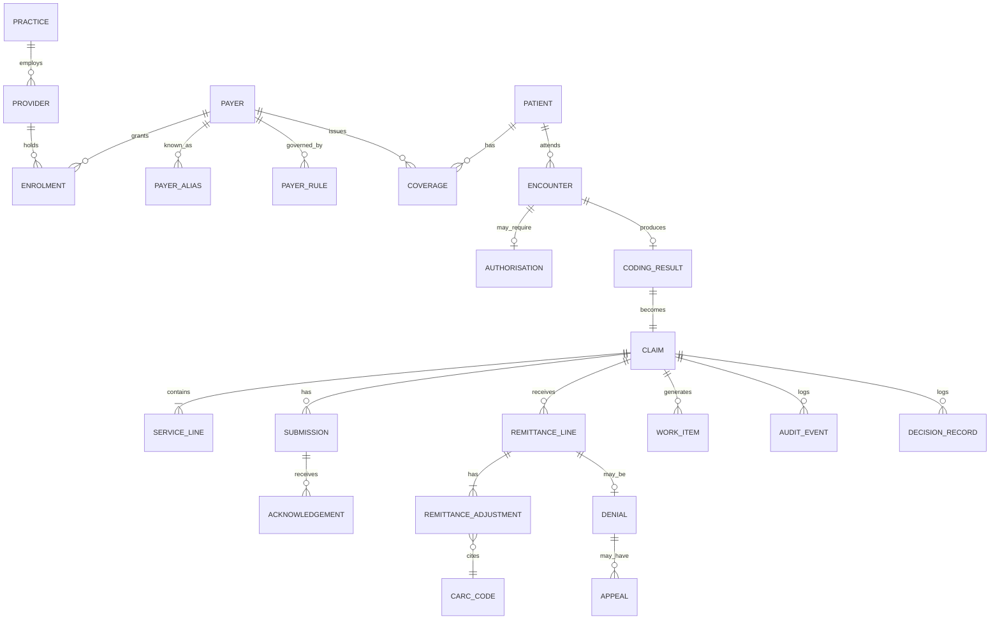

### 5.4 The audit tables

These are not optional infrastructure. They are how BR-AUDIT-01 is satisfied.

```sql
CREATE TABLE decision_record (
    decision_id         UUID PRIMARY KEY,
    entity_type         TEXT NOT NULL,          -- claim|service_line|encounter
    entity_id           UUID NOT NULL,
    decision_type       TEXT NOT NULL,          -- SCRUB|CODE|PRIORITISE|CLASSIFY_DENIAL
    decided_by          TEXT NOT NULL,          -- rules_engine|model:<name>|user:<id>
    logic_version       TEXT NOT NULL,          -- ruleset version or model version
    input_snapshot      JSONB NOT NULL,         -- exact inputs at decision time
    output              JSONB NOT NULL,
    confidence          NUMERIC(5,4),
    citations           JSONB,                  -- required for coding decisions
    decided_at          TIMESTAMPTZ NOT NULL DEFAULT now()
);
CREATE INDEX ON decision_record (entity_type, entity_id, decided_at DESC);

CREATE TABLE audit_event (
    event_id            BIGSERIAL PRIMARY KEY,
    actor_type          TEXT NOT NULL,          -- USER|SYSTEM
    actor_id            TEXT NOT NULL,
    action              TEXT NOT NULL,
    entity_type         TEXT NOT NULL,
    entity_id           UUID,
    before_state        JSONB,
    after_state         JSONB,
    ip_address          INET,
    session_id          UUID,
    occurred_at         TIMESTAMPTZ NOT NULL DEFAULT now()
);
```

**DR-06 (MUST):** `decision_record` and `audit_event` are append-only. Database roles used by the application MUST NOT hold UPDATE or DELETE on these tables.
**SR-01 (MUST):** Every PHI read MUST produce an `audit_event`. This is a HIPAA access-logging requirement, not a debugging nicety.

### 5.5 Analytical marts

The central table — this is DOC-02's Dataset 1 made concrete:

```sql
-- One row per service line per adjustment. Time-partitioned.
CREATE TABLE mart_claim_line_outcome (
    -- keys
    service_line_id, claim_id, adjustment_id,
    -- features (all knowable at submission time)
    payer_id, plan_type, payer_sequence, is_secondary,
    billing_npi, rendering_npi, taxonomy, specialty, place_of_service,
    patient_age_bucket, patient_sex, patient_state,
    cpt_hcpcs, modifier_1, modifier_2, modifier_3, modifier_4,
    units, primary_dx, dx_2, dx_3, dx_4, dx_pointer, ndc_code,
    line_charge, claim_total_charge, lines_on_claim,
    days_dos_to_submission, days_to_filing_deadline,
    eligibility_checked, eligibility_result,
    auth_required, auth_number_present, referral_present,
    scrub_flags_raised, scrub_flags_overridden,
    submission_attempt, coder_id_hashed, submission_dow, submission_month,
    -- trailing features, computed AS OF submission date only
    payer_cpt_denial_rate_90d,
    payer_provider_denial_rate_90d,
    cpt_modifier_denial_rate_90d,
    -- labels (from 835)
    line_paid, line_allowed, cas_group_code, carc_code, rarc_codes,
    adjustment_amount, claim_status_code,
    is_denied, denial_category, preventability,
    days_dos_to_payment, days_submission_to_adjudication,
    final_outcome, rework_touches, net_collected, underpayment_flag,
    outcome_matured_at
);
```

### 5.6 The leakage rule

This is the requirement most likely to be violated accidentally, and it silently destroys model validity.

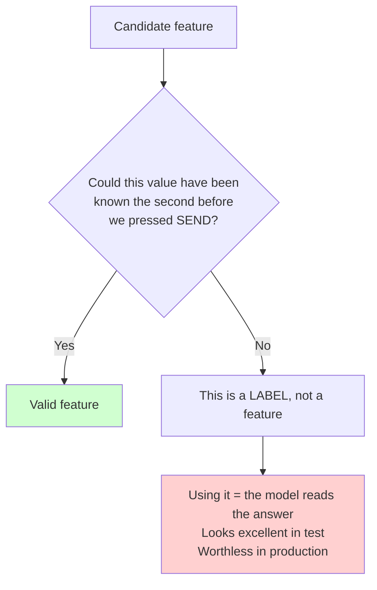

**DR-07 (MUST):** All trailing-window features MUST be computed with an as-of date equal to the claim's submission timestamp. Computing them over the full history is leakage.
**DR-08 (MUST):** Train/test splits MUST be temporal, never random. Random splits leak payer behaviour across the boundary and inflate measured accuracy.
**DR-09 (MUST):** No row enters final-outcome training until `outcome_matured_at` has passed (recommended 180 days post-DOS), because reversals and recoupments change outcomes retroactively.

### 5.7 Data quality gates

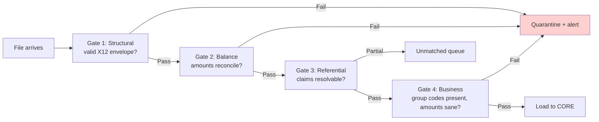

**DR-10 (MUST):** Quarantined files MUST raise a named alert with the specific failing assertion. Silent skipping is prohibited.

### 5.8 Retention and PHI handling

| Data | Retention | Notes |
|---|---|---|
| Raw X12 files | `[TBD-55]`, minimum 7 years | Object Lock; regulatory + client contractual |
| Core transactional | 7+ years | Standard medical billing retention |
| Audit logs | 6 years minimum | HIPAA |
| Analytical marts | Rebuildable; retain 3 years hot | |
| Model artefacts | Life of model + 2 years | Governance |
| Dev/test data | Synthetic only | See §14.4 |

**SR-02 (MUST):** Non-production environments MUST NOT contain production PHI. Test data is synthetic or de-identified under an approved method.

---

# PART IV — INTEGRATION

## 6. Integration Layer

### 6.1 Integration inventory

| # | System | Direction | Protocol | Criticality | Failure mode |
|---|---|---|---|---|---|
| 1 | Clearinghouse (primary) | Both | SFTP / REST | **Critical** | Failover to secondary |
| 2 | Clearinghouse (secondary) | Both | SFTP / REST | High | Manual submission |
| 3 | PM system | Read + write-back | DB / API / export | **Critical** | Batch delay |
| 4 | EHR | Read | FHIR / HL7v2 / API | High | Coding blocked |
| 5 | Payer portals | Both | Browser (RPA) | Medium | Human fallback |
| 6 | Payment processor | Both | REST | Medium | Manual posting |
| 7 | SMS / Email | Out | REST | Low | Retry |
| 8 | OCR service | Out | REST | Medium | Tesseract fallback |

### 6.2 Ingestion pipeline — the 835 path

This is the most important pipeline in the platform. Every denial label originates here.

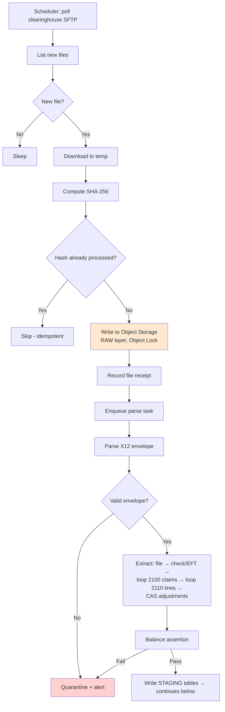

**Stage 2 — match, load and emit events.**

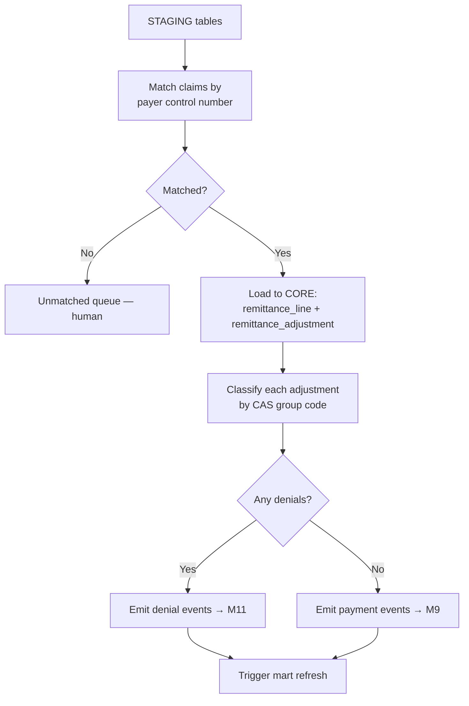

**IR-03 (MUST):** File hash deduplication MUST occur before parsing. Clearinghouses re-deliver files.
**IR-04 (MUST):** The raw file MUST be durably archived before parsing begins, not after.
**IR-05 (MUST):** Parsing MUST be idempotent — reprocessing the same file MUST NOT double-post (DOC-02 BR-M9-06).

### 6.3 Submission pipeline — the 837 path

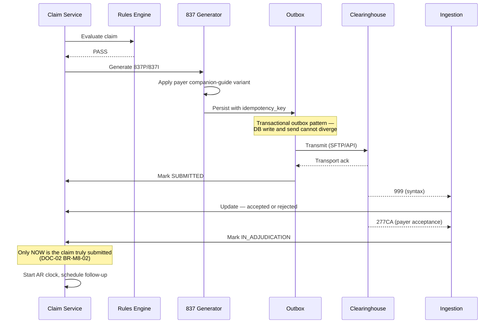

**IR-06 (MUST):** Submission MUST use the transactional outbox pattern. Writing "submitted" to the database and transmitting the file must not be able to diverge.
**IR-07 (MUST):** Every submission carries an idempotency key. Retries MUST NOT create duplicate claims (DOC-02 EC-41).

### 6.4 Clearinghouse abstraction

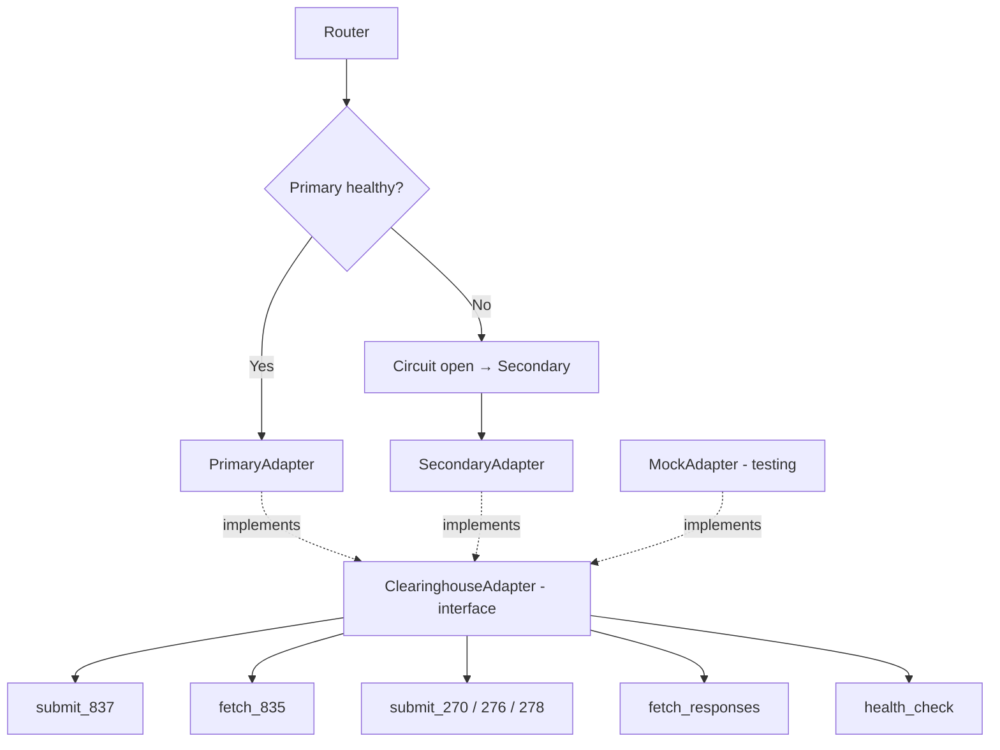

**IR-08 (MUST):** All clearinghouse interaction goes through the adapter interface. No clearinghouse-specific code outside an adapter.
**IR-09 (MUST):** A circuit breaker MUST trigger failover. The February 2024 Change Healthcare outage halted claim flow industry-wide for weeks; single-vendor dependency is an unmitigated continuity risk.

### 6.5 EHR integration

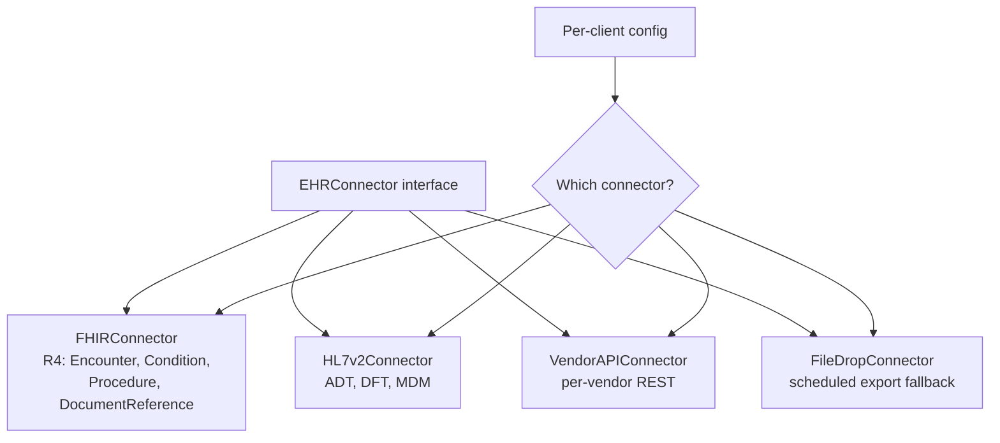

**IR-10 (MUST):** EHR connectors MUST be per-client configurable. Clients will not share an EHR.
**IR-11 (SHOULD):** Prefer FHIR where available; it is the most stable contract.

### 6.6 RPA subsystem

For payers with no electronic channel.

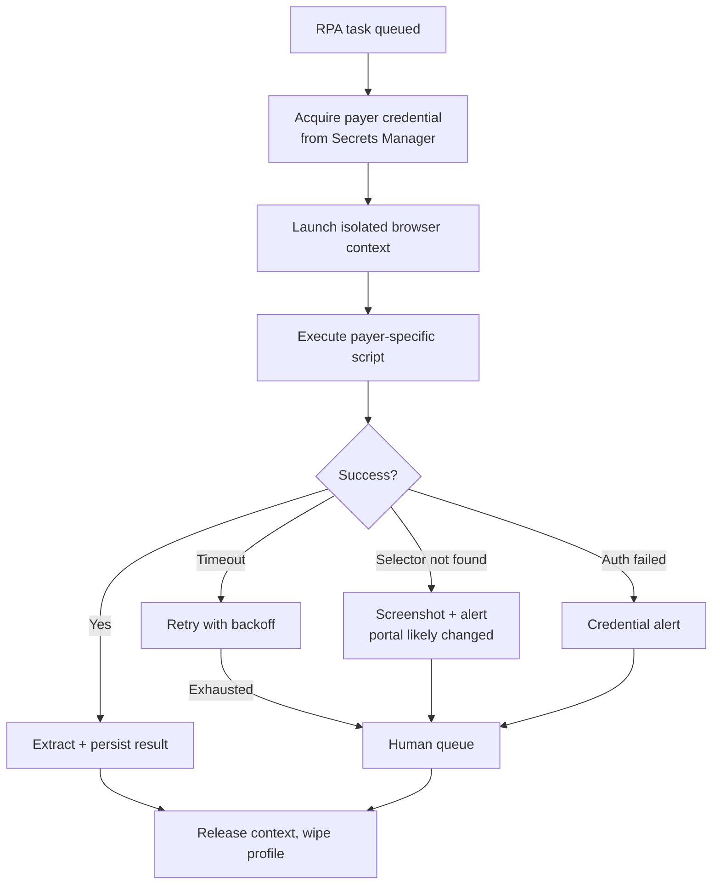

**IR-12 (MUST):** RPA workers run in isolated containers with no persistent browser profile.
**IR-13 (MUST):** Credentials are fetched per-execution from Secrets Manager, never stored in scripts or environment files.
**IR-14 (MUST):** Selector failures MUST alert rather than retry indefinitely — they indicate the portal changed.
**NFR-RPA-01:** RPA is understood to be structurally fragile. Every RPA path MUST have a documented human fallback.

---

# PART V — BACKEND

## 7. Backend Design

### 7.1 Module structure

```
src/
├── platform/          # cross-cutting: auth, audit, config, db, errors
├── ingestion/         # file watchers, X12 parsers, validation gates
│   ├── x12/           # tokenizer, envelope, 835, 837, 271, 277 parsers
│   ├── ehr/           # EHR connectors
│   └── pm/            # PM connectors
├── domain/            # business entities and services
│   ├── patient/
│   ├── eligibility/
│   ├── authorisation/
│   ├── coding/
│   ├── claim/
│   ├── submission/
│   ├── remittance/
│   ├── denial/
│   ├── ar/
│   └── billing/
├── decision/          # rules engine, payer registry, ML inference, prioritisation
├── work/              # queues, exceptions, assignment, SLA
├── api/               # FastAPI routers, schemas, dependencies
├── workers/           # Celery tasks
└── analytics/         # dbt project, feature builders
```

**FR-BE-01 (MUST):** Modules communicate through published service interfaces, not by reaching into each other's tables. Enforced by an import-linting rule in CI.
**FR-BE-02 (MUST):** Each domain module owns its schema. Cross-schema foreign keys are permitted only to reference data.

### 7.2 API design

REST, resource-oriented, OpenAPI-first.

```
GET    /api/v1/claims                       list, filtered
GET    /api/v1/claims/{id}                  detail
POST   /api/v1/claims/{id}/actions/scrub    trigger scrub
POST   /api/v1/claims/{id}/actions/submit   submit
GET    /api/v1/claims/{id}/timeline         full event history
GET    /api/v1/claims/{id}/decisions        audit — every decision made

GET    /api/v1/work-queues                  queues visible to me
GET    /api/v1/work-queues/{id}/items       prioritised items
POST   /api/v1/work-items/{id}/claim        assign to me
POST   /api/v1/work-items/{id}/resolve      resolve with outcome

GET    /api/v1/denials                      filtered
POST   /api/v1/denials/{id}/disposition     correct | appeal | writeoff
POST   /api/v1/denials/{id}/appeal          generate appeal draft

GET    /api/v1/rules                        list rulesets
POST   /api/v1/rules/{id}/backtest          test against history
POST   /api/v1/rules/{id}/versions          new version
POST   /api/v1/rules/{id}/activate          promote

GET    /api/v1/payer-rules                  registry
PUT    /api/v1/payer-rules/{payer}/{cpt}    upsert with verification date

GET    /api/v1/metrics/kpis                 dashboard data
GET    /api/v1/exceptions                   open exceptions
```

**FR-API-01 (MUST):** All state-changing endpoints accept an `Idempotency-Key` header.
**FR-API-02 (MUST):** List endpoints are cursor-paginated. Offset pagination breaks on live-updating queues.
**FR-API-03 (MUST):** Every response carries a `request_id` correlating to logs and audit events.
**FR-API-04 (MUST):** Errors follow RFC 7807 Problem Details with a machine-readable `type`.
**FR-API-05 (MUST):** Frontend types are generated from the OpenAPI schema. Hand-written API types are prohibited.

### 7.3 Task orchestration

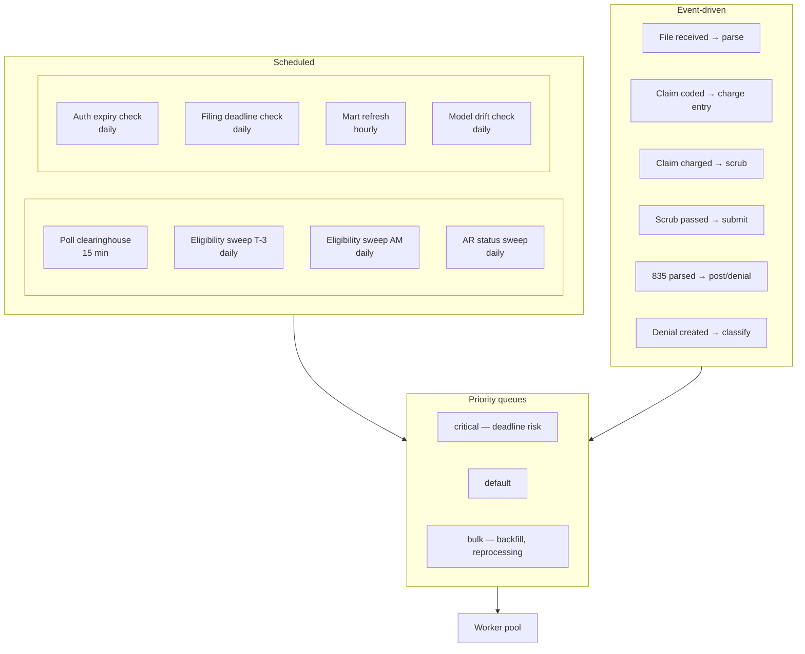

**FR-BE-03 (MUST):** Every task is idempotent and safely re-runnable.
**FR-BE-04 (MUST):** Retries use exponential backoff with jitter and a maximum attempt count. Exhausted tasks go to a dead-letter queue with an alert, never silent failure.
**FR-BE-05 (MUST):** Long-running batch tasks checkpoint progress so restart does not redo completed work.
**FR-BE-06 (MUST):** Bulk queue tasks MUST NOT be able to starve the critical queue.

### 7.4 Error taxonomy

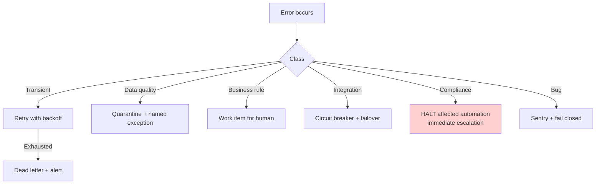

**FR-BE-07 (MUST):** Compliance-class errors suspend the affected automation path pending human review (DOC-02 BR-EXC-03).
**FR-BE-08 (MUST):** The system fails closed. When uncertain, do not submit; escalate.

### 7.5 State machine implementation

```mermaid
flowchart LR
    A[Transition requested] --> B[Load current state<br/>SELECT FOR UPDATE]
    B --> C{Transition defined<br/>in state table?}
    C -->|No| D[Reject — invalid transition]
    C -->|Yes| E{Guard conditions met?}
    E -->|No| F[Reject with reason]
    E -->|Yes| G[Apply transition]
    G --> H[Write audit_event]
    H --> I[Emit domain event]
    I --> J[Schedule next action]
    J --> K[Commit]
```

**FR-BE-09 (MUST):** Valid transitions are declared as data, not scattered through `if` statements. Undefined transitions are rejected (DOC-02 BR-STATE-02).
**FR-BE-10 (MUST):** Transitions occur inside a database transaction with row-level locking. Concurrent transitions must not interleave.
**FR-BE-11 (MUST):** No claim may rest in a non-terminal state without a scheduled next action (DOC-02 BR-STATE-04).

---

### 7.6 Request lifecycle

Every API request follows one path. Middleware order is fixed and security-relevant — authentication before authorisation, authorisation before any data access, audit before the response leaves.

```mermaid
sequenceDiagram
    participant U as Browser
    participant LB as Load Balancer
    participant MW as Middleware Chain
    participant H as Route Handler
    participant S as Domain Service
    participant DB as PostgreSQL
    participant A as Audit Logger

    U->>LB: HTTPS request + session
    LB->>MW: forward
    MW->>MW: 1. assign request_id
    MW->>MW: 2. authenticate (OIDC)
    MW->>MW: 3. authorise (RBAC + client scope)
    MW->>MW: 4. rate limit
    MW->>MW: 5. validate body (Pydantic)
    MW->>MW: 6. idempotency check
    MW->>H: dispatch
    H->>S: call service
    S->>DB: BEGIN
    S->>DB: query / mutate
    S->>A: write audit_event (same txn)
    S->>DB: COMMIT
    S-->>H: result
    H-->>MW: response
    MW->>MW: 7. strip PHI from logs
    MW-->>U: response + request_id
```

**FR-BE-12 (MUST):** The audit write occurs inside the same transaction as the data change. An audit log that can diverge from the data it describes is not an audit log.
**FR-BE-13 (MUST):** Client scoping is applied at the query layer, not the handler. A handler that forgets to filter must not be able to leak another client's data.

---

### 7.7 Work item lifecycle

Distinct from the claim state machine. A claim may generate many work items over its life.

```mermaid
stateDiagram-v2
    [*] --> Created: system raises exception<br/>or queue rule matches
    Created --> Queued: priority scored
    Queued --> Assigned: operator claims it
    Queued --> AutoResolved: system resolves<br/>before human touch
    Assigned --> InProgress: operator opens
    InProgress --> Resolved: outcome recorded
    InProgress --> Queued: released / timeout
    InProgress --> Escalated: needs supervisor
    Escalated --> Assigned: reassigned
    Escalated --> Resolved
    Resolved --> Reopened: outcome reversed
    Reopened --> Queued
    Resolved --> [*]
    AutoResolved --> [*]
```

**FR-WORK-01 (MUST):** Assignment places an exclusive lock. Two operators must never work one item (UR-04).
**FR-WORK-02 (MUST):** Assignment locks expire after `[TBD-57]` minutes of inactivity and return the item to the queue. Operators go home mid-item.
**FR-WORK-03 (MUST):** `AutoResolved` items are counted separately in throughput metrics. Mixing them with human resolutions makes automation coverage unmeasurable.
**FR-WORK-04 (MUST):** Every resolution records a structured outcome, not free text. Outcomes are the training signal.

---

### 7.8 Queue prioritisation algorithm

```mermaid
flowchart TD
    A[Open work items] --> B{Filing deadline<br/>within threshold?}
    B -->|Yes| C[PIN — score 100<br/>bypasses all other logic]
    B -->|No| D[Compute expected value<br/>balance × P recovery]
    subgraph SCORE["Scoring"]
        direction LR
        E[Divide by<br/>estimated effort] --> F[Apply age decay] --> G[Apply payer factor] --> H[Normalise 0-99]
    end
    D --> E
    H --> I{Below individual<br/>work threshold?}
    I -->|Yes| J[Route to bulk handling]
    I -->|No| K[Ranked queue]
    C --> K

    style C fill:#FDECEA
```

**FR-WORK-05 (MUST):** Deadline-pinned items bypass the scoring model entirely (DOC-02 BR-GLOBAL-04). No model output may demote a claim about to expire.
**FR-WORK-06 (SHOULD):** The queue exposes *why* an item ranks where it does. Operators who do not trust the ordering will re-sort by age and the prioritisation is wasted.

---

---

## 8. Rules Engine

The rules engine is the platform's competitive core. It encodes accumulated payer knowledge and outperforms any model on the cases it covers.

### 8.1 Rule representation

Declarative, versioned, stored as data — not code deployments.

```yaml
rule_id: PAYER_X_MOD25_REQUIRED
version: 3
layer: PAYER_SPECIFIC          # STRUCTURAL|DEMOGRAPHIC|CLINICAL|PAYER_SPECIFIC|TEMPORAL|LEARNED
severity: BLOCKING             # BLOCKING|ADVISORY|INFORMATIONAL
scope:
  payer_id: ["12345"]
  cpt: ["99213", "99214"]
condition:
  all:
    - field: claim.has_procedure_same_day
      op: eq
      value: true
    - field: line.modifiers
      op: not_contains
      value: "25"
action:
  type: FLAG
  auto_correct: false          # judgment required — never auto-apply modifier 25
  message: "E/M with same-day procedure requires modifier 25 review for this payer"
  route_to: CODING_REVIEW
provenance:
  source: DENIAL_ANALYSIS
  evidence_denial_count: 47
  authored_by: "ar_lead"
  authored_at: "2026-03-14"
backtest:
  claims_evaluated: 18420
  would_have_flagged: 312
  true_positives: 289
  false_positive_rate: 0.074
```

### 8.2 Evaluation pipeline

```mermaid
flowchart TD
    A[Claim] --> B[Load active ruleset version]
    subgraph LAYERS["Evaluation layers, in order"]
        direction LR
        C[Layer 1<br/>STRUCTURAL] --> D[Layer 2<br/>DEMOGRAPHIC] --> E[Layer 3<br/>CLINICAL<br/>NCCI, LCD/NCD]
        E --> F[Layer 4<br/>PAYER_SPECIFIC<br/>registry] --> G[Layer 5<br/>TEMPORAL<br/>filing, auth] --> H[Layer 6<br/>LEARNED<br/>ML risk score]
    end
    B --> C
    H --> I[Aggregate findings]
    I --> J{Any BLOCKING?}
    J -->|Yes, auto-correctable| K[Apply fix, log, re-evaluate from Layer 1]
    K --> C
    J -->|Yes, judgment needed| L[Work item with specific finding]
    J -->|No| M[PASS → submit]
    I --> N[Persist decision_record<br/>with ruleset version]

    style H fill:#ffe8d0
    style N fill:#d0e8ff
```

**FR-RULES-01 (MUST):** Rules are versioned; every evaluated claim records the ruleset version applied (DOC-02 BR-M7-02).
**FR-RULES-02 (MUST):** No rule deploys without a backtest against historical claims, with its measured false-positive rate recorded (BR-M7-04).
**FR-RULES-03 (MUST):** A rule with false-positive rate above `[TBD-45]` MUST NOT deploy as BLOCKING; it MAY deploy as ADVISORY.
**FR-RULES-04 (MUST):** Deterministic rules override model output on conflict (BR-HITL-01).
**FR-RULES-05 (MUST):** Auto-correction is permitted only for deterministic fixes. Modifier 25/59 MUST NEVER be auto-applied — this is a recognised audit target.
**FR-RULES-06 (MUST):** Rules are promoted through: draft → backtest → shadow → advisory → blocking. No shortcuts.

### 8.3 Rule lifecycle

```mermaid
stateDiagram-v2
    [*] --> Draft
    Draft --> Backtesting: submit
    Backtesting --> Draft: FP rate too high
    Backtesting --> Shadow: FP acceptable
    Shadow --> Advisory: shadow results confirm
    Advisory --> Blocking: operator override rate low
    Advisory --> Draft: refine
    Blocking --> Deprecated: payer changed
    Blocking --> Draft: revision needed
    Deprecated --> [*]
```

### 8.4 The denial feedback loop

```mermaid
flowchart LR
    A[Denial arrives] --> B[Classify — taxonomy]
    B --> C[Preventability analysis]
    C --> D{Preventable?}
    D -->|No| E[Log environmental]
    D -->|Yes| F{Existing rule covers it?}
    F -->|Yes| G[DEFECT — rule failed<br/>investigate]
    F -->|No| H[Draft candidate rule]
    H --> I[Backtest against history]
    I --> J{Acceptable FP?}
    J -->|No| K[Refine]
    K --> I
    J -->|Yes| L[Shadow → Advisory → Blocking]
    L --> M[Denial class cannot recur]

    style M fill:#d0ffd0
    style G fill:#ffd0d0
```

**FR-RULES-07 (MUST):** Every preventable denial produces either a candidate rule or a recorded decision not to create one (DOC-02 BR-M7-01).

This loop is the product. Everything else is plumbing around it.

---

## 9. Machine Learning Subsystem

### 9.1 Model inventory

| ID | Model | Type | Input | Output | Phase | Risk |
|---|---|---|---|---|---|---|
| ML-1 | Denial risk | Binary classifier | Line features | P(denial) + top drivers | 3 | Low |
| ML-2 | Denial category | Multiclass | Line + CARC + RARC | Taxonomy category | 3 | Low |
| ML-3 | Recovery probability | Binary classifier | Denial + history | P(recovery) | 3 | Low |
| ML-4 | Payment amount | Regression | Line features | Expected payment | 3 | Low |
| ML-5 | Appeal success | Binary classifier | Denial + appeal type | P(win) | 3 | Low |
| ML-6 | Note → codes | NLP / seq | Clinical note | Codes + citations | 4 | **Severe** |

### 9.2 Training pipeline

```mermaid
flowchart TD
    subgraph PREP["Prepare"]
        direction LR
        A[mart_claim_line<br/>_outcome] --> B[Filter: outcome<br/>matured] --> C[Point-in-time<br/>feature assembly] --> D[Temporal split<br/>18 / 3 / 3 months]
    end
    D --> E[Leakage assertion suite]
    E -->|Fail| F[HALT — do not train]
    E -->|Pass| G[Train LightGBM]
    G --> H[Evaluate: PR-AUC, calibration,<br/>per-payer breakdown]
    H --> I{Beats current production<br/>AND beats rules baseline?}
    I -->|No| J[Reject, log experiment]
    I -->|Yes| K[Fairness / stability checks<br/>across payers and providers]
    K --> L[Register in MLflow<br/>with data hash + code hash]
    L --> M[Shadow deploy]
    M --> N[Compare vs production<br/>for N weeks]
    N -->|Better| O[Promote]
    N -->|Not better| J

    style E fill:#ffe8d0
    style F fill:#ffd0d0
```

**FR-ML-01 (MUST):** An automated leakage assertion suite runs before every training job. Any feature not knowable at submission time fails the build.
**FR-ML-02 (MUST):** Splits are temporal (DR-08).
**FR-ML-03 (MUST):** Every model version records training data hash, code commit, hyperparameters, and full evaluation results.
**FR-ML-04 (MUST):** No model reaches production without a shadow period.
**FR-ML-05 (MUST):** Every prediction persists a `decision_record` with model version, inputs, output, confidence, and SHAP drivers.

### 9.3 Serving

```mermaid
flowchart LR
    A[Request] --> B[Feature assembly]
    B --> C{Features complete?}
    C -->|No| D[Fall back to rules only<br/>log degradation]
    C -->|Yes| E[Model inference]
    E --> F[Confidence check]
    F --> G{Above threshold?}
    G -->|Yes| H[Automated path]
    G -->|No| I[Human queue]
    E --> J[SHAP drivers]
    H --> K[decision_record]
    I --> K
    J --> K
```

**FR-ML-06 (MUST):** Inference degrades gracefully. Missing features never produce a guessed prediction — they route to rules or humans.
**FR-ML-07 (MUST):** Confidence thresholds are stored configuration, version-controlled, changeable only through a governed process. Never hard-coded (BR-HITL-03).

### 9.4 Monitoring and drift

```mermaid
flowchart TD
    A[Daily monitor] --> B[Input drift: PSI on feature distributions]
    A --> C[Output drift: prediction distribution shift]
    A --> D[Performance: rolling accuracy vs realised outcomes]
    A --> E[Calibration: predicted vs actual rates]
    A --> F[Coverage: % predictions above threshold]
    B & C & D & E & F --> G{Any breach?}
    G -->|Warning| H[Alert, investigate]
    G -->|Critical| I[Auto-revert to rules-only<br/>disable model path]

    style I fill:#ffd0d0
```

**FR-ML-08 (MUST):** Critical drift triggers automatic reversion to rules-only operation. The system must degrade to a known-safe state without waiting for a human.

Payers change rules constantly. A model that is not monitored becomes confidently wrong, which is worse than absent.

### 9.5 Coding model — additional controls

ML-6 carries severe compliance risk and is subject to controls no other model has.

```mermaid
flowchart TD
    subgraph EXTRACT["Extract"]
        direction LR
        A[Clinical note] --> B[Extract candidate<br/>codes] --> C[MANDATORY: locate<br/>justifying text span]
    end
    C --> D{Span found?}
    D -->|No| E[REJECT the code<br/>documentation does not support it]
    D -->|Yes| F[Confidence scoring]
    F --> G{Above threshold AND<br/>chart type approved AND<br/>Phase C active?}
    G -->|No| H[Human coder review<br/>with suggestion + citation]
    G -->|Yes| I[Auto-submit]
    H --> J[Capture override as training label]
    I --> K[decision_record with citation]
    J --> K
    K --> L[Daily: code value distribution monitor]
    L --> M{Systematic upward drift?}
    M -->|Yes| N[SUSPEND auto-submission<br/>escalate immediately]

    style E fill:#ffe8d0
    style N fill:#ffd0d0
```

**FR-ML-09 (MUST):** Every suggested code carries a citation to the source text. No citation → no code (DOC-02 BR-M5-01).
**FR-ML-10 (MUST):** The optimisation target is agreement with correct coding. Reimbursement value MUST NOT appear in the loss function (BR-M5-04). A model rewarded for revenue will learn to upcode.
**FR-ML-11 (MUST):** Systematic drift toward higher-value codes triggers automatic suspension (BR-M5-06).
**FR-ML-12 (MUST):** The auto-submission code path MUST NOT exist in the codebase until Phase C is formally approved at a gate.

---

# PART VI — FRONTEND

## 10. Frontend Design

### 10.1 Design goals

The primary users spend their entire working day in this interface, processing high volumes of similar items. The design optimises for **throughput and keyboard operation**, not visual impression.

| Goal | Implication |
|---|---|
| Speed of repetitive work | Keyboard shortcuts for every frequent action; no mouse required for the common path |
| Context without navigation | All information needed for a decision on one screen |
| Prevent errors | Confirm destructive actions; show consequences before commit |
| Trust in automation | Always show *why* the system decided something |
| Density over whitespace | Operators want more rows visible, not larger cards |

### 10.2 Information architecture

```mermaid
flowchart TD
    LOGIN[Login] --> HOME[Home / My Work]
    HOME --> WQ[Work Queues]
    HOME --> DASH[Dashboards]
    HOME --> SEARCH[Global Search]

    WQ --> WQ1[AR Follow-up]
    WQ --> WQ2[Denial Workbench]
    WQ --> WQ3[Coding Review]
    WQ --> WQ4[Scrubber Exceptions]
    WQ --> WQ5[Payment Exceptions]
    WQ --> WQ6[Eligibility Exceptions]
    WQ --> WQ7[Auth Queue]
    WQ --> WQ8[Registration Review]

    WQ1 & WQ2 & WQ3 & WQ4 & WQ5 --> DETAIL[Claim Detail]
    DETAIL --> TIMELINE[Timeline]
    DETAIL --> DECISIONS[Decision Audit]
    DETAIL --> DOCS[Documents]

    HOME --> ADMIN[Administration]
    ADMIN --> RULES[Rule Builder]
    ADMIN --> REG[Payer Registry]
    ADMIN --> USERS[Users & Roles]
    ADMIN --> MODELS[Model Governance]
    ADMIN --> EXC[Exception Monitor]
```

### 10.3 Design system

The visual language is deliberately restrained. Operators read this interface for eight hours; personality in the chrome becomes fatigue by hour three.

#### Colour tokens

| Token | Value | Use |
|---|---|---|
| `--bg` | `#FFFFFF` | Page background |
| `--surface` | `#F7F9FC` | Panels, cards |
| `--surface-alt` | `#EEF2F7` | Table headers, section bars |
| `--border` | `#C9D4E0` | All borders |
| `--text` | `#1A222C` | Primary text |
| `--text-muted` | `#6B7885` | Labels, metadata |
| `--nav` | `#22303F` | Top bar, bulk action bar |
| `--accent` | `#2F6FA8` | Primary action, links, selection |
| `--accent-soft` | `#E8F1FB` | Selected rows, info panels |
| `--danger` | `#C0392B` | Deadline risk, denials, destructive |
| `--danger-soft` | `#FDECEA` | Denial panels, alert bar |
| `--warn` | `#D98324` | Low confidence, staleness, advisory |
| `--warn-soft` | `#FEF6E7` | Warning panels |
| `--success` | `#2E7D52` | Paid, verified, passing |
| `--success-soft` | `#DCF0E4` | Confirmation panels |

**UR-31 (MUST):** Semantic colours carry fixed meaning across every screen. Red is never decorative. If something is red, money or compliance is at risk.

#### Typography and spacing

| Token | Value | Use |
|---|---|---|
| Font | System sans stack | No web font loading on a queue of 10,000 rows |
| `--fs-xs` | 11px | Chips, badges |
| `--fs-sm` | 12px | Section labels, metadata |
| `--fs-base` | 13px | Table cells, body — the workhorse |
| `--fs-md` | 14px | Buttons, navigation |
| `--fs-lg` | 17px | Panel headings |
| `--fs-xl` | 20px | Page titles |
| Table row height | 40px | Density over comfort — deliberate |
| Spacing scale | 4 / 8 / 12 / 16 / 24 / 32 | No arbitrary values |
| Radius | 4px controls, 5px panels, 11px chips | |

**UR-32 (MUST):** Tabular numerals for all monetary and numeric columns. Proportional digits make column scanning measurably slower.

#### Layout grid

```mermaid
flowchart LR
    A["Sidebar<br/>212px fixed"] --> B["Content region<br/>fluid, min 988px"]
    B --> C["Detail screens:<br/>3 columns<br/>290 / fluid / 314"]
    B --> D["Queue screens:<br/>full-width table<br/>+ footer panels"]
```

**UR-33 (MUST):** Minimum supported viewport is 1366×768. Operators work on desktops; a mobile layout is explicitly out of scope for the operator UI.

---

---

### 10.4 Screen catalogue

### 10.4.0 Application shell

Every screen renders inside one persistent shell. Operators never lose navigation, never lose the deadline alert bar, and never lose the global search.

<svg viewBox="0 0 1200 640" xmlns="http://www.w3.org/2000/svg" width="100%" style="border:1px solid #C9D4E0;background:#fff">
<rect x="0" y="0" width="1200" height="640" fill="#FFFFFF"/>
<rect x="0" y="0" width="1200" height="52" fill="#22303F"/>
<text x="24" y="33" font-family="Arial" font-size="17" font-weight="bold" fill="#FFFFFF">RCM Platform</text>
<rect x="200" y="12" width="420" height="28" rx="4" fill="#33455A"/>
<text x="214" y="31" font-family="Arial" font-size="14" fill="#A8B8C8">Search claim ID, patient, payer…    /</text>
<circle cx="1042" cy="26" r="9" fill="#C0392B"/>
<text x="1042" y="31" font-family="Arial" font-size="12" font-weight="bold" fill="#fff" text-anchor="middle">7</text>
<text x="1062" y="31" font-family="Arial" font-size="14" fill="#D8E2EC">Alerts</text>
<circle cx="1150" cy="26" r="14" fill="#4A6FA5"/>
<text x="1150" y="31" font-family="Arial" font-size="12" font-weight="bold" fill="#fff" text-anchor="middle">AK</text>
<rect x="0" y="52" width="1200" height="34" fill="#FDECEA"/>
<rect x="0" y="52" width="5" height="34" fill="#C0392B"/>
<text x="20" y="74" font-family="Arial" font-size="14" font-weight="bold" fill="#8E2B22">FILING DEADLINE RISK</text>
<text x="190" y="74" font-family="Arial" font-size="14" fill="#8E2B22">12 claims expire within 7 days · $84,210 at risk</text>
<rect x="1080" y="60" width="100" height="20" rx="3" fill="#C0392B"/>
<text x="1130" y="74" font-family="Arial" font-size="12" font-weight="bold" fill="#fff" text-anchor="middle">WORK NOW</text>
<rect x="0" y="86" width="212" height="554" fill="#F1F4F8"/>
<line x1="212" y1="86" x2="212" y2="640" stroke="#C9D4E0"/>
<text x="20" y="116" font-family="Arial" font-size="12" font-weight="bold" fill="#6B7885">WORK</text>
<rect x="8" y="126" width="196" height="30" rx="4" fill="#DCE8F5"/>
<rect x="8" y="126" width="4" height="30" fill="#2F6FA8"/>
<text x="26" y="146" font-family="Arial" font-size="14" font-weight="bold" fill="#1A222C">My Work</text>
<text x="176" y="146" font-family="Arial" font-size="13" fill="#2F6FA8">24</text>
<text x="26" y="176" font-family="Arial" font-size="14" fill="#1A222C">AR Follow-up</text><text x="176" y="176" font-family="Arial" font-size="13" fill="#6B7885">1,847</text>
<text x="26" y="204" font-family="Arial" font-size="14" fill="#1A222C">Denial Workbench</text><text x="176" y="204" font-family="Arial" font-size="13" fill="#6B7885">312</text>
<text x="26" y="232" font-family="Arial" font-size="14" fill="#1A222C">Coding Review</text><text x="176" y="232" font-family="Arial" font-size="13" fill="#6B7885">88</text>
<text x="26" y="260" font-family="Arial" font-size="14" fill="#1A222C">Scrubber Exceptions</text><text x="176" y="260" font-family="Arial" font-size="13" fill="#6B7885">41</text>
<text x="26" y="288" font-family="Arial" font-size="14" fill="#1A222C">Payment Exceptions</text><text x="176" y="288" font-family="Arial" font-size="13" fill="#6B7885">19</text>
<text x="26" y="316" font-family="Arial" font-size="14" fill="#1A222C">Eligibility Exceptions</text><text x="176" y="316" font-family="Arial" font-size="13" fill="#6B7885">7</text>
<text x="26" y="344" font-family="Arial" font-size="14" fill="#1A222C">Prior Auth</text><text x="176" y="344" font-family="Arial" font-size="13" fill="#6B7885">23</text>
<line x1="16" y1="366" x2="196" y2="366" stroke="#C9D4E0"/>
<text x="20" y="394" font-family="Arial" font-size="12" font-weight="bold" fill="#6B7885">INSIGHT</text>
<text x="26" y="420" font-family="Arial" font-size="14" fill="#1A222C">Dashboards</text>
<text x="26" y="448" font-family="Arial" font-size="14" fill="#1A222C">Reports</text>
<line x1="16" y1="470" x2="196" y2="470" stroke="#C9D4E0"/>
<text x="20" y="498" font-family="Arial" font-size="12" font-weight="bold" fill="#6B7885">ADMIN</text>
<text x="26" y="524" font-family="Arial" font-size="14" fill="#1A222C">Rule Builder</text>
<text x="26" y="552" font-family="Arial" font-size="14" fill="#1A222C">Payer Registry</text>
<text x="26" y="580" font-family="Arial" font-size="14" fill="#1A222C">Model Governance</text>
<text x="26" y="608" font-family="Arial" font-size="14" fill="#1A222C">Users &amp; Roles</text>
<rect x="212" y="86" width="988" height="554" fill="#FFFFFF"/>
<rect x="252" y="300" width="908" height="120" rx="6" fill="#F7F9FC" stroke="#C9D4E0" stroke-dasharray="6 4"/>
<text x="706" y="368" font-family="Arial" font-size="20" fill="#8899AA" text-anchor="middle">ROUTED SCREEN CONTENT</text>
</svg>

**UR-26 (MUST):** The deadline alert bar is global and cannot be dismissed while claims are at risk. It is the one piece of chrome that outranks whatever screen the operator is on.

---

---

#### S-01 Home / My Work

**Purpose:** the operator's landing page. Answers "what should I do right now?"

| Element | Detail |
|---|---|
| My assigned items | Count by queue, with SLA status |
| Priority alerts | Filing-deadline claims — always at top, red |
| Today's activity | Items resolved, dollars recovered |
| Queue availability | Unassigned volume per queue I have access to |
| Quick actions | Jump into highest-priority queue (keyboard: `g` `q`) |

#### S-02 Work Queue (generic pattern)

Every queue shares one component with per-queue configuration.

```mermaid
flowchart LR
    subgraph SCREEN[Work Queue Screen]
        direction TB
        H[Header: queue name, count, SLA summary]
        F[Filter bar: payer, client, age, value, status]
        T[Virtualised data table]
        B[Bulk action bar - appears on selection]
        P[Cursor pagination]
    end
    T --> D[Row click → Detail panel or full page]
```

**Table columns (AR queue example):** priority score · claim ID · patient · payer · DOS · age (days) · balance · P(recovery) · days to filing deadline · last action · assigned to · next action date.

**UR-01 (MUST):** Tables are virtualised. Queues will contain tens of thousands of rows.
**UR-02 (MUST):** Default sort is priority score, not date. Age-sorted work is the behaviour we are replacing.
**UR-03 (MUST):** Filing-deadline-critical items are visually distinct and pinned regardless of filter.
**UR-04 (MUST):** Claiming an item locks it to the user. Two operators MUST NOT work the same item.
**UR-05 (SHOULD):** Full keyboard navigation: `j`/`k` move, `Enter` open, `a` assign, `r` resolve, `/` filter.

### 10.4.1 S-02 Work Queue — wireframe

<svg viewBox="0 0 1200 660" xmlns="http://www.w3.org/2000/svg" width="100%" style="border:1px solid #C9D4E0;background:#fff">
<rect x="0" y="0" width="1200" height="660" fill="#FFFFFF"/>
<text x="24" y="34" font-family="Arial" font-size="21" font-weight="bold" fill="#1A222C">AR Follow-up</text>
<rect x="196" y="18" width="132" height="22" rx="11" fill="#E8F1FB"/>
<text x="262" y="34" font-family="Arial" font-size="13" fill="#2F6FA8" text-anchor="middle">1,847 open</text>
<rect x="338" y="18" width="150" height="22" rx="11" fill="#FDECEA"/>
<text x="413" y="34" font-family="Arial" font-size="13" fill="#C0392B" text-anchor="middle">12 deadline risk</text>
<text x="900" y="34" font-family="Arial" font-size="14" fill="#6B7885">Recovered today:</text>
<text x="1030" y="34" font-family="Arial" font-size="16" font-weight="bold" fill="#2E7D52">$18,430</text>
<rect x="24" y="54" width="1152" height="42" rx="5" fill="#F7F9FC" stroke="#C9D4E0"/>
<rect x="36" y="65" width="118" height="22" rx="4" fill="#fff" stroke="#C9D4E0"/><text x="46" y="80" font-family="Arial" font-size="13" fill="#1A222C">Payer: All  ▾</text>
<rect x="164" y="65" width="126" height="22" rx="4" fill="#fff" stroke="#C9D4E0"/><text x="174" y="80" font-family="Arial" font-size="13" fill="#1A222C">Client: All  ▾</text>
<rect x="300" y="65" width="126" height="22" rx="4" fill="#fff" stroke="#C9D4E0"/><text x="310" y="80" font-family="Arial" font-size="13" fill="#1A222C">Age: 30+ d  ▾</text>
<rect x="436" y="65" width="132" height="22" rx="4" fill="#fff" stroke="#C9D4E0"/><text x="446" y="80" font-family="Arial" font-size="13" fill="#1A222C">Balance: any ▾</text>
<rect x="578" y="65" width="150" height="22" rx="4" fill="#E8F1FB" stroke="#2F6FA8"/><text x="588" y="80" font-family="Arial" font-size="13" fill="#2F6FA8">Assigned: Me  ×</text>
<text x="1020" y="80" font-family="Arial" font-size="13" fill="#2F6FA8">Save view</text>
<text x="1108" y="80" font-family="Arial" font-size="13" fill="#2F6FA8">Export</text>
<rect x="24" y="106" width="1152" height="34" fill="#EEF2F7"/>
<text x="40" y="128" font-family="Arial" font-size="12" font-weight="bold" fill="#42505E">PRI</text>
<text x="92" y="128" font-family="Arial" font-size="12" font-weight="bold" fill="#42505E">CLAIM</text>
<text x="196" y="128" font-family="Arial" font-size="12" font-weight="bold" fill="#42505E">PATIENT</text>
<text x="326" y="128" font-family="Arial" font-size="12" font-weight="bold" fill="#42505E">PAYER</text>
<text x="470" y="128" font-family="Arial" font-size="12" font-weight="bold" fill="#42505E">DOS</text>
<text x="562" y="128" font-family="Arial" font-size="12" font-weight="bold" fill="#42505E">AGE</text>
<text x="628" y="128" font-family="Arial" font-size="12" font-weight="bold" fill="#42505E">BALANCE</text>
<text x="730" y="128" font-family="Arial" font-size="12" font-weight="bold" fill="#42505E">P(REC)</text>
<text x="806" y="128" font-family="Arial" font-size="12" font-weight="bold" fill="#42505E">DEADLINE</text>
<text x="912" y="128" font-family="Arial" font-size="12" font-weight="bold" fill="#42505E">LAST ACTION</text>
<text x="1076" y="128" font-family="Arial" font-size="12" font-weight="bold" fill="#42505E">NEXT</text>
<rect x="24" y="140" width="1152" height="40" fill="#FDECEA"/>
<rect x="24" y="140" width="4" height="40" fill="#C0392B"/>
<rect x="36" y="152" width="38" height="17" rx="3" fill="#C0392B"/><text x="55" y="165" font-family="Arial" font-size="11" font-weight="bold" fill="#fff" text-anchor="middle">98</text>
<text x="92" y="165" font-family="Arial" font-size="13" fill="#1A222C">CLM-88214</text>
<text x="196" y="165" font-family="Arial" font-size="13" fill="#1A222C">R. Delgado</text>
<text x="326" y="165" font-family="Arial" font-size="13" fill="#1A222C">Aetna Commercial</text>
<text x="470" y="165" font-family="Arial" font-size="13" fill="#1A222C">2026-02-14</text>
<text x="562" y="165" font-family="Arial" font-size="13" fill="#1A222C">196</text>
<text x="628" y="165" font-family="Arial" font-size="13" font-weight="bold" fill="#1A222C">$12,480</text>
<text x="730" y="165" font-family="Arial" font-size="13" fill="#1A222C">0.71</text>
<text x="806" y="165" font-family="Arial" font-size="13" font-weight="bold" fill="#C0392B">4 days</text>
<text x="912" y="165" font-family="Arial" font-size="13" fill="#6B7885">277: pended</text>
<text x="1076" y="165" font-family="Arial" font-size="13" fill="#6B7885">Call</text>
<line x1="24" y1="180" x2="1176" y2="180" stroke="#E2E8EF"/>
<rect x="36" y="192" width="38" height="17" rx="3" fill="#D98324"/><text x="55" y="205" font-family="Arial" font-size="11" font-weight="bold" fill="#fff" text-anchor="middle">84</text>
<text x="92" y="205" font-family="Arial" font-size="13" fill="#1A222C">CLM-90117</text>
<text x="196" y="205" font-family="Arial" font-size="13" fill="#1A222C">M. Osei</text>
<text x="326" y="205" font-family="Arial" font-size="13" fill="#1A222C">UHC Medicare Adv</text>
<text x="470" y="205" font-family="Arial" font-size="13" fill="#1A222C">2026-05-02</text>
<text x="562" y="205" font-family="Arial" font-size="13" fill="#1A222C">119</text>
<text x="628" y="205" font-family="Arial" font-size="13" font-weight="bold" fill="#1A222C">$8,940</text>
<text x="730" y="205" font-family="Arial" font-size="13" fill="#1A222C">0.66</text>
<text x="806" y="205" font-family="Arial" font-size="13" fill="#1A222C">61 days</text>
<text x="912" y="205" font-family="Arial" font-size="13" fill="#6B7885">276 sent 2d ago</text>
<text x="1076" y="205" font-family="Arial" font-size="13" fill="#6B7885">Auto</text>
<line x1="24" y1="220" x2="1176" y2="220" stroke="#E2E8EF"/>
<rect x="36" y="232" width="38" height="17" rx="3" fill="#D98324"/><text x="55" y="245" font-family="Arial" font-size="11" font-weight="bold" fill="#fff" text-anchor="middle">77</text>
<text x="92" y="245" font-family="Arial" font-size="13" fill="#1A222C">CLM-90422</text>
<text x="196" y="245" font-family="Arial" font-size="13" fill="#1A222C">J. Whitfield</text>
<text x="326" y="245" font-family="Arial" font-size="13" fill="#1A222C">BCBS TX</text>
<text x="470" y="245" font-family="Arial" font-size="13" fill="#1A222C">2026-05-19</text>
<text x="562" y="245" font-family="Arial" font-size="13" fill="#1A222C">102</text>
<text x="628" y="245" font-family="Arial" font-size="13" font-weight="bold" fill="#1A222C">$6,215</text>
<text x="730" y="245" font-family="Arial" font-size="13" fill="#1A222C">0.58</text>
<text x="806" y="245" font-family="Arial" font-size="13" fill="#1A222C">88 days</text>
<text x="912" y="245" font-family="Arial" font-size="13" fill="#6B7885">Portal check ok</text>
<text x="1076" y="245" font-family="Arial" font-size="13" fill="#6B7885">Call</text>
<line x1="24" y1="260" x2="1176" y2="260" stroke="#E2E8EF"/>
<rect x="24" y="260" width="1152" height="40" fill="#F4F8FC"/>
<rect x="36" y="272" width="38" height="17" rx="3" fill="#6B7885"/><text x="55" y="285" font-family="Arial" font-size="11" font-weight="bold" fill="#fff" text-anchor="middle">52</text>
<text x="92" y="285" font-family="Arial" font-size="13" fill="#1A222C">CLM-91008</text>
<text x="196" y="285" font-family="Arial" font-size="13" fill="#1A222C">P. Nakamura</text>
<text x="326" y="285" font-family="Arial" font-size="13" fill="#1A222C">Cigna PPO</text>
<text x="470" y="285" font-family="Arial" font-size="13" fill="#1A222C">2026-06-30</text>
<text x="562" y="285" font-family="Arial" font-size="13" fill="#1A222C">60</text>
<text x="628" y="285" font-family="Arial" font-size="13" fill="#1A222C">$1,120</text>
<text x="730" y="285" font-family="Arial" font-size="13" fill="#1A222C">0.44</text>
<text x="806" y="285" font-family="Arial" font-size="13" fill="#1A222C">120 days</text>
<text x="912" y="285" font-family="Arial" font-size="13" fill="#6B7885">Auto-status 1d</text>
<text x="1076" y="285" font-family="Arial" font-size="13" fill="#6B7885">Auto</text>
<line x1="24" y1="300" x2="1176" y2="300" stroke="#E2E8EF"/>
<text x="92" y="326" font-family="Arial" font-size="13" fill="#8899AA">… 1,843 more rows (virtualised)</text>
<rect x="24" y="352" width="1152" height="46" rx="5" fill="#22303F"/>
<text x="42" y="380" font-family="Arial" font-size="14" font-weight="bold" fill="#fff">3 selected</text>
<rect x="140" y="363" width="118" height="24" rx="4" fill="#2F6FA8"/><text x="199" y="380" font-family="Arial" font-size="13" fill="#fff" text-anchor="middle">Assign to me</text>
<rect x="268" y="363" width="128" height="24" rx="4" fill="#3E5061"/><text x="332" y="380" font-family="Arial" font-size="13" fill="#fff" text-anchor="middle">Re-check status</text>
<rect x="406" y="363" width="118" height="24" rx="4" fill="#3E5061"/><text x="465" y="380" font-family="Arial" font-size="13" fill="#fff" text-anchor="middle">Add note</text>
<text x="1080" y="380" font-family="Arial" font-size="13" fill="#A8B8C8">Clear (Esc)</text>
<rect x="24" y="416" width="1152" height="1" fill="#C9D4E0"/>
<text x="24" y="446" font-family="Arial" font-size="12" font-weight="bold" fill="#6B7885">KEYBOARD</text>
<text x="24" y="470" font-family="Arial" font-size="13" fill="#42505E">j / k  move    ·    Enter  open    ·    a  assign    ·    r  resolve    ·    x  select    ·    /  filter    ·    Esc  clear</text>
<rect x="24" y="496" width="560" height="140" rx="5" fill="#F7F9FC" stroke="#C9D4E0"/>
<text x="40" y="522" font-family="Arial" font-size="13" font-weight="bold" fill="#1A222C">QUEUE HEALTH</text>
<text x="40" y="548" font-family="Arial" font-size="13" fill="#42505E">Automated status determinations today</text>
<text x="520" y="548" font-family="Arial" font-size="13" font-weight="bold" fill="#2E7D52" text-anchor="end">81%</text>
<rect x="40" y="558" width="490" height="8" rx="4" fill="#E2E8EF"/><rect x="40" y="558" width="397" height="8" rx="4" fill="#2E7D52"/>
<text x="40" y="592" font-family="Arial" font-size="13" fill="#42505E">Items breaching SLA</text>
<text x="520" y="592" font-family="Arial" font-size="13" font-weight="bold" fill="#C0392B" text-anchor="end">6</text>
<text x="40" y="618" font-family="Arial" font-size="13" fill="#42505E">Mean age of queue</text>
<text x="520" y="618" font-family="Arial" font-size="13" font-weight="bold" fill="#1A222C" text-anchor="end">74 days</text>
<rect x="616" y="496" width="560" height="140" rx="5" fill="#F7F9FC" stroke="#C9D4E0"/>
<text x="632" y="522" font-family="Arial" font-size="13" font-weight="bold" fill="#1A222C">WHY THIS ORDER?</text>
<text x="632" y="548" font-family="Arial" font-size="13" fill="#42505E">Priority = (balance × P(recovery)) ÷ effort</text>
<text x="632" y="570" font-family="Arial" font-size="13" fill="#42505E">× deadline urgency multiplier</text>
<text x="632" y="600" font-family="Arial" font-size="13" fill="#42505E">Deadline-critical items are pinned and</text>
<text x="632" y="620" font-family="Arial" font-size="13" fill="#42505E">cannot be filtered out of view.</text>
</svg>

---

---

#### S-03 Claim Detail

The most important screen. Everything needed for a decision, without navigation.

```mermaid
flowchart TB
    subgraph LAYOUT[Claim Detail - three column]
        direction LR
        subgraph L[Left - Context]
            L1[Patient + coverage]
            L2[Provider + enrolment]
            L3[Payer + registry rules]
            L4[Related claims]
        end
        subgraph C[Centre - The Claim]
            C1[Header: status, dates, deadline countdown]
            C2[Service lines table<br/>charge / allowed / paid / adjustments]
            C3[Diagnoses]
            C4[Denial detail if present:<br/>CARC + RARC + group + amount]
            C5[Action bar]
        end
        subgraph R[Right - History]
            R1[Timeline — every event]
            R2[Decision audit — every automated decision]
            R3[Notes + call log]
            R4[Documents]
        end
    end
```

**UR-06 (MUST):** The decision audit panel shows, for every automated decision: what was decided, by which rule or model version, on what inputs, at what time. This is the operator-facing surface of BR-AUDIT-01.
**UR-07 (MUST):** Filing deadline is rendered as a live countdown, colour-coded.
**UR-08 (MUST):** Denial display always shows the CAS group code alongside the CARC. Never the CARC alone.

### 10.4.2 S-03 Claim Detail — wireframe

<svg viewBox="0 0 1200 700" xmlns="http://www.w3.org/2000/svg" width="100%" style="border:1px solid #C9D4E0;background:#fff">
<rect x="0" y="0" width="1200" height="700" fill="#FFFFFF"/>
<text x="24" y="32" font-family="Arial" font-size="20" font-weight="bold" fill="#1A222C">CLM-88214</text>
<rect x="160" y="16" width="128" height="22" rx="11" fill="#FDECEA"/><text x="224" y="32" font-family="Arial" font-size="13" font-weight="bold" fill="#C0392B" text-anchor="middle">DENIED</text>
<rect x="300" y="16" width="176" height="22" rx="11" fill="#FDECEA"/><text x="388" y="32" font-family="Arial" font-size="13" font-weight="bold" fill="#C0392B" text-anchor="middle">FILING: 4 DAYS LEFT</text>
<text x="960" y="32" font-family="Arial" font-size="13" fill="#6B7885">Balance</text>
<text x="1176" y="32" font-family="Arial" font-size="18" font-weight="bold" fill="#1A222C" text-anchor="end">$12,480.00</text>
<rect x="24" y="52" width="290" height="628" rx="5" fill="#F7F9FC" stroke="#C9D4E0"/>
<text x="40" y="78" font-family="Arial" font-size="12" font-weight="bold" fill="#6B7885">PATIENT</text>
<text x="40" y="100" font-family="Arial" font-size="14" font-weight="bold" fill="#1A222C">Delgado, Rosa M.</text>
<text x="40" y="120" font-family="Arial" font-size="13" fill="#42505E">DOB 1968-04-11 · F · TX</text>
<text x="40" y="146" font-family="Arial" font-size="12" font-weight="bold" fill="#6B7885">COVERAGE</text>
<text x="40" y="168" font-family="Arial" font-size="14" fill="#1A222C">Aetna Commercial (primary)</text>
<text x="40" y="188" font-family="Arial" font-size="13" fill="#42505E">Member W8842119301</text>
<text x="40" y="208" font-family="Arial" font-size="13" fill="#2E7D52">Verified active on DOS ✓</text>
<text x="40" y="228" font-family="Arial" font-size="13" fill="#2F6FA8">View raw 271 →</text>
<text x="40" y="256" font-family="Arial" font-size="12" font-weight="bold" fill="#6B7885">PROVIDER</text>
<text x="40" y="278" font-family="Arial" font-size="14" fill="#1A222C">Dr. A. Farhan · NPI 1841…</text>
<text x="40" y="298" font-family="Arial" font-size="13" fill="#2E7D52">Enrolled, eff. 2019-01-01 ✓</text>
<text x="40" y="326" font-family="Arial" font-size="12" font-weight="bold" fill="#6B7885">PAYER RULES IN EFFECT</text>
<text x="40" y="348" font-family="Arial" font-size="13" fill="#42505E">Timely filing: 200 days</text>
<text x="40" y="368" font-family="Arial" font-size="13" fill="#42505E">Appeal window: 60 days</text>
<text x="40" y="388" font-family="Arial" font-size="13" fill="#42505E">Auth required: no</text>
<rect x="36" y="400" width="266" height="26" rx="4" fill="#FEF6E7"/>
<text x="46" y="418" font-family="Arial" font-size="12" fill="#8A5A16">⚠ Registry verified 214 days ago</text>
<text x="40" y="452" font-family="Arial" font-size="12" font-weight="bold" fill="#6B7885">RELATED CLAIMS</text>
<text x="40" y="474" font-family="Arial" font-size="13" fill="#2F6FA8">CLM-88214-R1 (resubmit) →</text>
<text x="40" y="494" font-family="Arial" font-size="13" fill="#2F6FA8">CLM-84003 same patient →</text>
<text x="40" y="522" font-family="Arial" font-size="12" font-weight="bold" fill="#6B7885">SIMILAR DENIALS</text>
<text x="40" y="544" font-family="Arial" font-size="13" fill="#42505E">Aetna + 99214 + CO-97</text>
<text x="40" y="564" font-family="Arial" font-size="13" fill="#42505E">47 in last 12 months</text>
<text x="40" y="584" font-family="Arial" font-size="13" fill="#2E7D52">Appeal success: 68%</text>
<rect x="326" y="52" width="524" height="628" rx="5" fill="#FFFFFF" stroke="#C9D4E0"/>
<text x="342" y="78" font-family="Arial" font-size="12" font-weight="bold" fill="#6B7885">SERVICE LINES</text>
<rect x="342" y="88" width="492" height="26" fill="#EEF2F7"/>
<text x="352" y="106" font-family="Arial" font-size="11" font-weight="bold" fill="#42505E">#</text>
<text x="378" y="106" font-family="Arial" font-size="11" font-weight="bold" fill="#42505E">CPT</text>
<text x="440" y="106" font-family="Arial" font-size="11" font-weight="bold" fill="#42505E">MOD</text>
<text x="504" y="106" font-family="Arial" font-size="11" font-weight="bold" fill="#42505E">CHARGE</text>
<text x="588" y="106" font-family="Arial" font-size="11" font-weight="bold" fill="#42505E">ALLOWED</text>
<text x="678" y="106" font-family="Arial" font-size="11" font-weight="bold" fill="#42505E">PAID</text>
<text x="748" y="106" font-family="Arial" font-size="11" font-weight="bold" fill="#42505E">STATUS</text>
<text x="352" y="132" font-family="Arial" font-size="13" fill="#1A222C">1</text>
<text x="378" y="132" font-family="Arial" font-size="13" fill="#1A222C">99214</text>
<text x="440" y="132" font-family="Arial" font-size="13" fill="#1A222C">25</text>
<text x="504" y="132" font-family="Arial" font-size="13" fill="#1A222C">$420.00</text>
<text x="588" y="132" font-family="Arial" font-size="13" fill="#1A222C">$0.00</text>
<text x="678" y="132" font-family="Arial" font-size="13" fill="#1A222C">$0.00</text>
<rect x="744" y="120" width="62" height="17" rx="3" fill="#FDECEA"/><text x="775" y="133" font-family="Arial" font-size="11" font-weight="bold" fill="#C0392B" text-anchor="middle">DENIED</text>
<line x1="342" y1="144" x2="834" y2="144" stroke="#E2E8EF"/>
<text x="352" y="166" font-family="Arial" font-size="13" fill="#1A222C">2</text>
<text x="378" y="166" font-family="Arial" font-size="13" fill="#1A222C">45378</text>
<text x="440" y="166" font-family="Arial" font-size="13" fill="#1A222C">—</text>
<text x="504" y="166" font-family="Arial" font-size="13" fill="#1A222C">$12,900</text>
<text x="588" y="166" font-family="Arial" font-size="13" fill="#1A222C">$0.00</text>
<text x="678" y="166" font-family="Arial" font-size="13" fill="#1A222C">$0.00</text>
<rect x="744" y="154" width="62" height="17" rx="3" fill="#FDECEA"/><text x="775" y="167" font-family="Arial" font-size="11" font-weight="bold" fill="#C0392B" text-anchor="middle">DENIED</text>
<line x1="342" y1="178" x2="834" y2="178" stroke="#E2E8EF"/>
<text x="342" y="208" font-family="Arial" font-size="12" font-weight="bold" fill="#6B7885">DIAGNOSES</text>
<text x="342" y="230" font-family="Arial" font-size="13" fill="#42505E">K21.9 (ptr 1,2) · R10.13 (ptr 1) · Z12.11 (ptr 2)</text>
<rect x="342" y="250" width="492" height="140" rx="5" fill="#FDECEA" stroke="#E8B4AE"/>
<text x="356" y="274" font-family="Arial" font-size="12" font-weight="bold" fill="#8E2B22">DENIAL DETAIL</text>
<rect x="356" y="286" width="70" height="22" rx="4" fill="#C0392B"/><text x="391" y="302" font-family="Arial" font-size="13" font-weight="bold" fill="#fff" text-anchor="middle">CO-97</text>
<text x="438" y="302" font-family="Arial" font-size="13" fill="#1A222C">Benefit included in another service already adjudicated</text>
<text x="356" y="330" font-family="Arial" font-size="13" font-weight="bold" fill="#42505E">RARC:</text>
<text x="412" y="330" font-family="Arial" font-size="13" fill="#42505E">N19 — procedure code incidental to primary</text>
<text x="356" y="354" font-family="Arial" font-size="13" font-weight="bold" fill="#42505E">Group:</text>
<text x="412" y="354" font-family="Arial" font-size="13" fill="#42505E">CO — contractual, cannot bill patient</text>
<text x="356" y="378" font-family="Arial" font-size="13" font-weight="bold" fill="#42505E">Amount:</text>
<text x="418" y="378" font-family="Arial" font-size="13" font-weight="bold" fill="#1A222C">$13,320.00</text>
<rect x="342" y="404" width="492" height="88" rx="5" fill="#F0F6FB" stroke="#B8D0E5"/>
<text x="356" y="428" font-family="Arial" font-size="12" font-weight="bold" fill="#2F6FA8">SYSTEM RECOMMENDATION</text>
<text x="356" y="452" font-family="Arial" font-size="13" fill="#1A222C">APPEAL — modifier 25 supports separate E/M service.</text>
<text x="356" y="472" font-family="Arial" font-size="13" fill="#42505E">Basis: 47 similar denials, 68% appeal success. Documentation review required.</text>
<rect x="342" y="508" width="150" height="34" rx="4" fill="#2F6FA8"/><text x="417" y="530" font-family="Arial" font-size="14" font-weight="bold" fill="#fff" text-anchor="middle">Start appeal</text>
<rect x="502" y="508" width="160" height="34" rx="4" fill="#fff" stroke="#2F6FA8"/><text x="582" y="530" font-family="Arial" font-size="14" fill="#2F6FA8" text-anchor="middle">Correct &amp; resubmit</text>
<rect x="672" y="508" width="90" height="34" rx="4" fill="#fff" stroke="#C9D4E0"/><text x="717" y="530" font-family="Arial" font-size="14" fill="#42505E" text-anchor="middle">Write off</text>
<rect x="772" y="508" width="62" height="34" rx="4" fill="#fff" stroke="#C9D4E0"/><text x="803" y="530" font-family="Arial" font-size="14" fill="#42505E" text-anchor="middle">Note</text>
<text x="342" y="576" font-family="Arial" font-size="12" font-weight="bold" fill="#6B7885">CALL LOG</text>
<text x="342" y="600" font-family="Arial" font-size="13" fill="#42505E">2026-08-22 · S. Iqbal · 34 min · "pended, no reason given"</text>
<text x="342" y="622" font-family="Arial" font-size="13" fill="#42505E">2026-07-15 · Auto 276 · response: P4 pending</text>
<rect x="862" y="52" width="314" height="628" rx="5" fill="#F7F9FC" stroke="#C9D4E0"/>
<rect x="874" y="64" width="96" height="26" rx="4" fill="#2F6FA8"/><text x="922" y="82" font-family="Arial" font-size="13" font-weight="bold" fill="#fff" text-anchor="middle">Timeline</text>
<text x="1010" y="82" font-family="Arial" font-size="13" fill="#6B7885">Decisions</text>
<text x="1112" y="82" font-family="Arial" font-size="13" fill="#6B7885">Docs</text>
<circle cx="886" cy="116" r="5" fill="#C0392B"/><line x1="886" y1="121" x2="886" y2="156" stroke="#C9D4E0"/>
<text x="902" y="112" font-family="Arial" font-size="13" font-weight="bold" fill="#1A222C">Denial received</text>
<text x="902" y="130" font-family="Arial" font-size="12" fill="#6B7885">2026-08-20 · 835 file R-8821</text>
<circle cx="886" cy="166" r="5" fill="#6B7885"/><line x1="886" y1="171" x2="886" y2="206" stroke="#C9D4E0"/>
<text x="902" y="162" font-family="Arial" font-size="13" font-weight="bold" fill="#1A222C">Status check (auto)</text>
<text x="902" y="180" font-family="Arial" font-size="12" fill="#6B7885">2026-07-15 · 276/277</text>
<circle cx="886" cy="216" r="5" fill="#2E7D52"/><line x1="886" y1="221" x2="886" y2="256" stroke="#C9D4E0"/>
<text x="902" y="212" font-family="Arial" font-size="13" font-weight="bold" fill="#1A222C">Accepted by payer</text>
<text x="902" y="230" font-family="Arial" font-size="12" fill="#6B7885">2026-02-18 · 277CA</text>
<circle cx="886" cy="266" r="5" fill="#2E7D52"/><line x1="886" y1="271" x2="886" y2="306" stroke="#C9D4E0"/>
<text x="902" y="262" font-family="Arial" font-size="13" font-weight="bold" fill="#1A222C">Submitted</text>
<text x="902" y="280" font-family="Arial" font-size="12" fill="#6B7885">2026-02-17 · 837P batch B-441</text>
<circle cx="886" cy="316" r="5" fill="#2F6FA8"/>
<text x="902" y="312" font-family="Arial" font-size="13" font-weight="bold" fill="#1A222C">Scrubbed — PASS</text>
<text x="902" y="330" font-family="Arial" font-size="12" fill="#6B7885">2026-02-17 · ruleset v41</text>
<rect x="874" y="356" width="290" height="1" fill="#C9D4E0"/>
<text x="874" y="384" font-family="Arial" font-size="12" font-weight="bold" fill="#6B7885">DECISION AUDIT (BR-AUDIT-01)</text>
<rect x="874" y="396" width="290" height="76" rx="4" fill="#fff" stroke="#C9D4E0"/>
<text x="886" y="418" font-family="Arial" font-size="12" font-weight="bold" fill="#1A222C">SCRUB · rules_engine v41</text>
<text x="886" y="436" font-family="Arial" font-size="12" fill="#42505E">Output: PASS · 0 blocking, 1 advisory</text>
<text x="886" y="454" font-family="Arial" font-size="12" fill="#42505E">Advisory: MOD25_REVIEW (overridden)</text>
<text x="886" y="466" font-family="Arial" font-size="11" fill="#2F6FA8">View inputs →</text>
<rect x="874" y="484" width="290" height="76" rx="4" fill="#fff" stroke="#C9D4E0"/>
<text x="886" y="506" font-family="Arial" font-size="12" font-weight="bold" fill="#1A222C">CLASSIFY_DENIAL · model v2.3</text>
<text x="886" y="524" font-family="Arial" font-size="12" fill="#42505E">Category 3: Coding · confidence 0.88</text>
<text x="886" y="542" font-family="Arial" font-size="12" fill="#42505E">Preventable: yes</text>
<text x="886" y="554" font-family="Arial" font-size="11" fill="#2F6FA8">View SHAP drivers →</text>
<rect x="874" y="572" width="290" height="96" rx="4" fill="#FEF6E7" stroke="#E5C88F"/>
<text x="886" y="594" font-family="Arial" font-size="12" font-weight="bold" fill="#8A5A16">RULE CANDIDATE GENERATED</text>
<text x="886" y="614" font-family="Arial" font-size="12" fill="#8A5A16">This denial pattern is preventable.</text>
<text x="886" y="632" font-family="Arial" font-size="12" fill="#8A5A16">A draft scrubbing rule was created.</text>
<text x="886" y="656" font-family="Arial" font-size="12" fill="#2F6FA8">Review in Rule Builder →</text>
</svg>

**UR-27 (MUST):** The Decisions tab is always one click away from any claim. An operator must never have to ask an engineer why the system did something.

---

---

#### S-04 Denial Workbench

```mermaid
flowchart TD
    A[Denial selected] --> B[Left: denial detail<br/>CARC, RARC, group, amount, payer]
    A --> C[Centre: system recommendation<br/>category + preventability + suggested action<br/>with reasoning shown]
    A --> D[Right: history<br/>similar denials, past outcomes,<br/>appeal success rate for this pattern]
    C --> E{Operator disposition}
    E --> F[Correct & resubmit<br/>shows diff of what will change]
    E --> G[Appeal<br/>opens draft letter editor]
    E --> H[Patient responsibility]
    E --> I[Write off<br/>reason required; approval if above threshold]
    G --> J[Draft letter + evidence checklist]
    J --> K[Human review + sign — MANDATORY]
```

**UR-09 (MUST):** Appeal letters are always human-reviewed before submission (DOC-02 BR-M11-04). No "send" path bypasses review.
**UR-10 (MUST):** "Correct & resubmit" displays a field-level diff of the proposed change before commit.
**UR-11 (MUST):** Similar-denial history is shown by default. Operators make better decisions with the base rate visible.

#### S-05 Coding Review

The highest-stakes screen. Design assumes the coder is the compliance control.

```mermaid
flowchart LR
    subgraph SPLIT[Split view]
        subgraph LEFT[Clinical documentation]
            N1[Full note, scrollable]
            N2[Highlighted spans<br/>cited as justification]
        end
        subgraph RIGHT[Coding panel]
            R1[Suggested ICD-10 codes<br/>+ confidence + citation link]
            R2[Suggested CPT/HCPCS<br/>+ confidence + citation link]
            R3[Suggested modifiers + rationale]
            R4[NCCI / LCD warnings]
            R5[Accept / Modify / Reject per code]
            R6[Override reason capture]
        end
    end
    N2 <-.->|click code, highlights source<br/>click text, shows codes it supports| R1
```

**UR-12 (MUST):** Clicking a suggested code scrolls to and highlights the exact documentation span that justifies it. A code with no linked span cannot be displayed as a suggestion.
**UR-13 (MUST):** Every override captures a structured reason. These are the highest-value training labels in the system (BR-M5-07).
**UR-14 (MUST):** Suggestions are never pre-accepted. The coder acts affirmatively on each.
**UR-15 (MUST):** Confidence is displayed but MUST NOT be the only signal — the citation is the primary evidence.

### 10.4.3 S-05 Coding Review — wireframe

This is the compliance-critical screen. The citation link between code and documentation is the entire control.

<svg viewBox="0 0 1200 680" xmlns="http://www.w3.org/2000/svg" width="100%" style="border:1px solid #C9D4E0;background:#fff">
<rect x="0" y="0" width="1200" height="680" fill="#FFFFFF"/>
<text x="24" y="32" font-family="Arial" font-size="20" font-weight="bold" fill="#1A222C">Coding Review — ENC-44821</text>
<rect x="392" y="16" width="168" height="22" rx="11" fill="#FEF6E7"/><text x="476" y="32" font-family="Arial" font-size="13" font-weight="bold" fill="#8A5A16" text-anchor="middle">PHASE B — ASSIST MODE</text>
<text x="900" y="32" font-family="Arial" font-size="13" fill="#6B7885">Chart 12 of 88</text>
<rect x="1010" y="16" width="72" height="24" rx="4" fill="#fff" stroke="#C9D4E0"/><text x="1046" y="33" font-family="Arial" font-size="13" fill="#42505E" text-anchor="middle">← Prev</text>
<rect x="1092" y="16" width="84" height="24" rx="4" fill="#fff" stroke="#C9D4E0"/><text x="1134" y="33" font-family="Arial" font-size="13" fill="#42505E" text-anchor="middle">Next →</text>
<rect x="24" y="52" width="620" height="608" rx="5" fill="#FFFFFF" stroke="#C9D4E0"/>
<rect x="24" y="52" width="620" height="34" fill="#EEF2F7"/>
<text x="40" y="74" font-family="Arial" font-size="13" font-weight="bold" fill="#42505E">CLINICAL DOCUMENTATION — Progress Note, 2026-08-14</text>
<text x="40" y="116" font-family="Arial" font-size="13" font-weight="bold" fill="#1A222C">CHIEF COMPLAINT</text>
<text x="40" y="138" font-family="Arial" font-size="13" fill="#42505E">Follow-up for persistent epigastric discomfort, plus new</text>
<text x="40" y="158" font-family="Arial" font-size="13" fill="#42505E">complaint of rectal bleeding over past two weeks.</text>
<text x="40" y="192" font-family="Arial" font-size="13" font-weight="bold" fill="#1A222C">HISTORY / EXAM</text>
<rect x="36" y="204" width="572" height="46" rx="3" fill="#FFF3C4"/>
<rect x="36" y="204" width="4" height="46" fill="#D98324"/>
<text x="48" y="224" font-family="Arial" font-size="13" fill="#1A222C">Detailed history obtained. Comprehensive examination performed.</text>
<text x="48" y="244" font-family="Arial" font-size="13" fill="#1A222C">Moderate complexity medical decision making documented.</text>
<text x="614" y="228" font-family="Arial" font-size="11" font-weight="bold" fill="#D98324">[1]</text>
<rect x="36" y="258" width="572" height="26" rx="3" fill="#D6EBFA"/>
<rect x="36" y="258" width="4" height="26" fill="#2F6FA8"/>
<text x="48" y="276" font-family="Arial" font-size="13" fill="#1A222C">Symptoms consistent with gastroesophageal reflux, unspecified.</text>
<text x="614" y="276" font-family="Arial" font-size="11" font-weight="bold" fill="#2F6FA8">[2]</text>
<text x="40" y="316" font-family="Arial" font-size="13" font-weight="bold" fill="#1A222C">PROCEDURE</text>
<rect x="36" y="328" width="572" height="66" rx="3" fill="#D6EBFA"/>
<rect x="36" y="328" width="4" height="66" fill="#2F6FA8"/>
<text x="48" y="348" font-family="Arial" font-size="13" fill="#1A222C">Flexible sigmoidoscopy performed to 40cm. Single sessile polyp</text>
<text x="48" y="368" font-family="Arial" font-size="13" fill="#1A222C">identified at 22cm, removed by cold biopsy forceps. Specimen</text>
<text x="48" y="388" font-family="Arial" font-size="13" fill="#1A222C">sent to pathology. Tolerated well, no complications.</text>
<text x="614" y="362" font-family="Arial" font-size="11" font-weight="bold" fill="#2F6FA8">[3]</text>
<text x="40" y="424" font-family="Arial" font-size="13" font-weight="bold" fill="#1A222C">ASSESSMENT &amp; PLAN</text>
<text x="40" y="446" font-family="Arial" font-size="13" fill="#42505E">1. Rectal bleeding — polyp removed, await pathology.</text>
<text x="40" y="466" font-family="Arial" font-size="13" fill="#42505E">2. GERD — continue PPI, reassess in 8 weeks.</text>
<rect x="36" y="490" width="572" height="60" rx="4" fill="#FDECEA" stroke="#E8B4AE"/>
<text x="48" y="512" font-family="Arial" font-size="12" font-weight="bold" fill="#8E2B22">⚠ DOCUMENTATION FLAG</text>
<text x="48" y="532" font-family="Arial" font-size="12" fill="#8E2B22">Highlighted E/M text [1] matches a template used in 87% of this</text>
<text x="48" y="546" font-family="Arial" font-size="12" fill="#8E2B22">provider's notes. Possible copy-forward — verify before accepting.</text>
<text x="40" y="582" font-family="Arial" font-size="12" font-weight="bold" fill="#6B7885">LEGEND</text>
<rect x="40" y="594" width="14" height="14" fill="#D6EBFA" stroke="#2F6FA8"/><text x="62" y="606" font-family="Arial" font-size="12" fill="#42505E">Cited as justification</text>
<rect x="220" y="594" width="14" height="14" fill="#FFF3C4" stroke="#D98324"/><text x="242" y="606" font-family="Arial" font-size="12" fill="#42505E">Cited, low confidence</text>
<rect x="410" y="594" width="14" height="14" fill="#FDECEA" stroke="#C0392B"/><text x="432" y="606" font-family="Arial" font-size="12" fill="#42505E">Flagged for review</text>
<text x="40" y="636" font-family="Arial" font-size="12" fill="#6B7885">Click any code on the right to scroll to and highlight its source text.</text>
<rect x="660" y="52" width="516" height="608" rx="5" fill="#F7F9FC" stroke="#C9D4E0"/>
<rect x="660" y="52" width="516" height="34" fill="#EEF2F7"/>
<text x="676" y="74" font-family="Arial" font-size="13" font-weight="bold" fill="#42505E">SUGGESTED CODING — review each</text>
<text x="676" y="112" font-family="Arial" font-size="12" font-weight="bold" fill="#6B7885">PROCEDURES (CPT)</text>
<rect x="672" y="122" width="492" height="76" rx="4" fill="#fff" stroke="#C9D4E0"/>
<text x="686" y="146" font-family="Arial" font-size="15" font-weight="bold" fill="#1A222C">45331</text>
<text x="756" y="146" font-family="Arial" font-size="13" fill="#42505E">Sigmoidoscopy, flexible; with biopsy</text>
<rect x="686" y="158" width="120" height="16" rx="8" fill="#DCF0E4"/><text x="746" y="170" font-family="Arial" font-size="11" font-weight="bold" fill="#2E7D52" text-anchor="middle">CONFIDENCE 0.96</text>
<text x="820" y="170" font-family="Arial" font-size="12" fill="#2F6FA8">Source: [3] →</text>
<rect x="928" y="132" width="66" height="24" rx="4" fill="#2E7D52"/><text x="961" y="149" font-family="Arial" font-size="12" font-weight="bold" fill="#fff" text-anchor="middle">Accept</text>
<rect x="1000" y="132" width="66" height="24" rx="4" fill="#fff" stroke="#C9D4E0"/><text x="1033" y="149" font-family="Arial" font-size="12" fill="#42505E" text-anchor="middle">Modify</text>
<rect x="1072" y="132" width="66" height="24" rx="4" fill="#fff" stroke="#C9D4E0"/><text x="1105" y="149" font-family="Arial" font-size="12" fill="#42505E" text-anchor="middle">Reject</text>
<rect x="672" y="206" width="492" height="92" rx="4" fill="#FFFBEF" stroke="#E5C88F"/>
<text x="686" y="230" font-family="Arial" font-size="15" font-weight="bold" fill="#1A222C">99214</text>
<text x="756" y="230" font-family="Arial" font-size="13" fill="#42505E">Office visit, established, moderate</text>
<rect x="686" y="242" width="120" height="16" rx="8" fill="#FEF0D4"/><text x="746" y="254" font-family="Arial" font-size="11" font-weight="bold" fill="#8A5A16" text-anchor="middle">CONFIDENCE 0.54</text>
<text x="820" y="254" font-family="Arial" font-size="12" fill="#2F6FA8">Source: [1] →</text>
<text x="686" y="278" font-family="Arial" font-size="12" fill="#8A5A16">⚠ Below auto-threshold. Copy-forward suspected. Requires modifier 25</text>
<text x="686" y="292" font-family="Arial" font-size="12" fill="#8A5A16">if billed with the same-day procedure — do not apply without review.</text>
<rect x="928" y="216" width="66" height="24" rx="4" fill="#2E7D52"/><text x="961" y="233" font-family="Arial" font-size="12" font-weight="bold" fill="#fff" text-anchor="middle">Accept</text>
<rect x="1000" y="216" width="66" height="24" rx="4" fill="#fff" stroke="#C9D4E0"/><text x="1033" y="233" font-family="Arial" font-size="12" fill="#42505E" text-anchor="middle">Modify</text>
<rect x="1072" y="216" width="66" height="24" rx="4" fill="#fff" stroke="#C9D4E0"/><text x="1105" y="233" font-family="Arial" font-size="12" fill="#42505E" text-anchor="middle">Reject</text>
<text x="676" y="330" font-family="Arial" font-size="12" font-weight="bold" fill="#6B7885">DIAGNOSES (ICD-10-CM)</text>
<rect x="672" y="340" width="492" height="52" rx="4" fill="#fff" stroke="#C9D4E0"/>
<text x="686" y="364" font-family="Arial" font-size="15" font-weight="bold" fill="#1A222C">K62.5</text>
<text x="756" y="364" font-family="Arial" font-size="13" fill="#42505E">Haemorrhage of anus and rectum</text>
<rect x="686" y="372" width="120" height="14" rx="7" fill="#DCF0E4"/><text x="746" y="383" font-family="Arial" font-size="10" font-weight="bold" fill="#2E7D52" text-anchor="middle">0.94 · Source [3]</text>
<rect x="1072" y="352" width="66" height="24" rx="4" fill="#2E7D52"/><text x="1105" y="369" font-family="Arial" font-size="12" font-weight="bold" fill="#fff" text-anchor="middle">Accept</text>
<rect x="672" y="400" width="492" height="52" rx="4" fill="#fff" stroke="#C9D4E0"/>
<text x="686" y="424" font-family="Arial" font-size="15" font-weight="bold" fill="#1A222C">K21.9</text>
<text x="756" y="424" font-family="Arial" font-size="13" fill="#42505E">GERD without oesophagitis</text>
<rect x="686" y="432" width="120" height="14" rx="7" fill="#DCF0E4"/><text x="746" y="443" font-family="Arial" font-size="10" font-weight="bold" fill="#2E7D52" text-anchor="middle">0.91 · Source [2]</text>
<rect x="1072" y="412" width="66" height="24" rx="4" fill="#2E7D52"/><text x="1105" y="429" font-family="Arial" font-size="12" font-weight="bold" fill="#fff" text-anchor="middle">Accept</text>
<rect x="672" y="466" width="492" height="70" rx="4" fill="#FDECEA" stroke="#E8B4AE"/>
<text x="686" y="490" font-family="Arial" font-size="12" font-weight="bold" fill="#8E2B22">NCCI / EDIT WARNINGS</text>
<text x="686" y="510" font-family="Arial" font-size="12" fill="#8E2B22">45331 + 99214 is an NCCI pair. Modifier 25 would bypass the edit.</text>
<text x="686" y="526" font-family="Arial" font-size="12" fill="#8E2B22">System will NOT auto-apply modifier 25 (FR-RULES-05). Coder decides.</text>
<text x="676" y="566" font-family="Arial" font-size="12" font-weight="bold" fill="#6B7885">OVERRIDE REASON (required if modifying or rejecting)</text>
<rect x="672" y="576" width="492" height="30" rx="4" fill="#fff" stroke="#C9D4E0"/>
<text x="686" y="596" font-family="Arial" font-size="13" fill="#8899AA">Select reason…  ▾</text>
<rect x="672" y="618" width="238" height="30" rx="4" fill="#2F6FA8"/><text x="791" y="638" font-family="Arial" font-size="14" font-weight="bold" fill="#fff" text-anchor="middle">Submit coding</text>
<rect x="920" y="618" width="118" height="30" rx="4" fill="#fff" stroke="#C9D4E0"/><text x="979" y="638" font-family="Arial" font-size="13" fill="#42505E" text-anchor="middle">Query provider</text>
<rect x="1048" y="618" width="116" height="30" rx="4" fill="#fff" stroke="#C9D4E0"/><text x="1106" y="638" font-family="Arial" font-size="13" fill="#42505E" text-anchor="middle">Skip chart</text>
</svg>

**UR-28 (MUST):** No suggestion may render without a resolvable source citation. A code whose citation cannot be located in the note is suppressed entirely rather than shown with a warning.
**UR-29 (MUST):** The "Accept all" pattern is prohibited on this screen. Each code requires an individual affirmative action.

---

---

#### S-06 Rule Builder

```mermaid
flowchart TD
    A[Rule Builder] --> B[Condition builder<br/>visual, field/operator/value]
    B --> C[Scope: payers, CPTs, plan types]
    C --> D[Action: flag / correct / route]
    D --> E[BACKTEST — mandatory]
    E --> F[Results: claims matched,<br/>would-have-flagged, TP, FP rate,<br/>sample of affected claims]
    F --> G{FP rate acceptable?}
    G -->|No| B
    G -->|Yes| H[Save as version]
    H --> I[Promote: shadow → advisory → blocking]
```

**UR-16 (MUST):** The save-and-activate path is unavailable until a backtest has run.
**UR-17 (MUST):** Backtest results show a sample of the claims the rule would have blocked, so the author can inspect false positives concretely.

### 10.4.4 S-06 Rule Builder — wireframe

<svg viewBox="0 0 1200 640" xmlns="http://www.w3.org/2000/svg" width="100%" style="border:1px solid #C9D4E0;background:#fff">
<rect x="0" y="0" width="1200" height="640" fill="#FFFFFF"/>
<text x="24" y="32" font-family="Arial" font-size="20" font-weight="bold" fill="#1A222C">Rule Builder — PAYER_X_MOD25_REQUIRED</text>
<rect x="512" y="16" width="88" height="22" rx="11" fill="#EEF2F7"/><text x="556" y="32" font-family="Arial" font-size="13" font-weight="bold" fill="#42505E" text-anchor="middle">DRAFT v4</text>
<text x="900" y="32" font-family="Arial" font-size="13" fill="#6B7885">Author: ar_lead · 2026-08-28</text>
<rect x="24" y="52" width="560" height="330" rx="5" fill="#F7F9FC" stroke="#C9D4E0"/>
<text x="40" y="78" font-family="Arial" font-size="12" font-weight="bold" fill="#6B7885">SCOPE</text>
<rect x="40" y="88" width="240" height="28" rx="4" fill="#fff" stroke="#C9D4E0"/><text x="52" y="107" font-family="Arial" font-size="13" fill="#1A222C">Payer: Aetna Commercial ▾</text>
<rect x="292" y="88" width="248" height="28" rx="4" fill="#fff" stroke="#C9D4E0"/><text x="304" y="107" font-family="Arial" font-size="13" fill="#1A222C">CPT: 99213, 99214  +add</text>
<text x="40" y="146" font-family="Arial" font-size="12" font-weight="bold" fill="#6B7885">CONDITION — all of</text>
<rect x="40" y="156" width="500" height="34" rx="4" fill="#fff" stroke="#C9D4E0"/>
<text x="52" y="177" font-family="Arial" font-size="13" fill="#1A222C">claim.has_procedure_same_day</text>
<rect x="300" y="162" width="52" height="22" rx="4" fill="#EEF2F7"/><text x="326" y="177" font-family="Arial" font-size="12" fill="#42505E" text-anchor="middle">equals</text>
<text x="368" y="177" font-family="Arial" font-size="13" fill="#1A222C">true</text>
<text x="524" y="177" font-family="Arial" font-size="14" fill="#C0392B">×</text>
<rect x="40" y="198" width="500" height="34" rx="4" fill="#fff" stroke="#C9D4E0"/>
<text x="52" y="219" font-family="Arial" font-size="13" fill="#1A222C">line.modifiers</text>
<rect x="300" y="204" width="86" height="22" rx="4" fill="#EEF2F7"/><text x="343" y="219" font-family="Arial" font-size="12" fill="#42505E" text-anchor="middle">not contains</text>
<text x="400" y="219" font-family="Arial" font-size="13" fill="#1A222C">"25"</text>
<text x="524" y="219" font-family="Arial" font-size="14" fill="#C0392B">×</text>
<text x="40" y="256" font-family="Arial" font-size="13" fill="#2F6FA8">+ Add condition</text>
<text x="40" y="290" font-family="Arial" font-size="12" font-weight="bold" fill="#6B7885">ACTION</text>
<rect x="40" y="300" width="150" height="28" rx="4" fill="#fff" stroke="#C9D4E0"/><text x="52" y="319" font-family="Arial" font-size="13" fill="#1A222C">FLAG ▾</text>
<rect x="202" y="300" width="200" height="28" rx="4" fill="#fff" stroke="#C9D4E0"/><text x="214" y="319" font-family="Arial" font-size="13" fill="#1A222C">Route: CODING_REVIEW ▾</text>
<rect x="414" y="300" width="126" height="28" rx="4" fill="#EEF2F7" stroke="#C9D4E0"/><text x="426" y="319" font-family="Arial" font-size="13" fill="#8899AA">Auto-correct: OFF</text>
<rect x="40" y="340" width="500" height="28" rx="4" fill="#FDECEA"/>
<text x="52" y="359" font-family="Arial" font-size="12" fill="#8E2B22">Auto-correct is locked off: modifier 25 may never be auto-applied.</text>
<rect x="616" y="52" width="560" height="330" rx="5" fill="#FFFFFF" stroke="#C9D4E0"/>
<rect x="616" y="52" width="560" height="34" fill="#EEF2F7"/>
<text x="632" y="74" font-family="Arial" font-size="13" font-weight="bold" fill="#42505E">BACKTEST — 24 months of historical claims</text>
<text x="632" y="112" font-family="Arial" font-size="13" fill="#42505E">Claims evaluated</text>
<text x="1156" y="112" font-family="Arial" font-size="15" font-weight="bold" fill="#1A222C" text-anchor="end">18,420</text>
<text x="632" y="140" font-family="Arial" font-size="13" fill="#42505E">Would have flagged</text>
<text x="1156" y="140" font-family="Arial" font-size="15" font-weight="bold" fill="#1A222C" text-anchor="end">312</text>
<text x="632" y="168" font-family="Arial" font-size="13" fill="#42505E">True positives (later denied)</text>
<text x="1156" y="168" font-family="Arial" font-size="15" font-weight="bold" fill="#2E7D52" text-anchor="end">289</text>
<text x="632" y="196" font-family="Arial" font-size="13" fill="#42505E">False positives (paid anyway)</text>
<text x="1156" y="196" font-family="Arial" font-size="15" font-weight="bold" fill="#D98324" text-anchor="end">23</text>
<line x1="632" y1="212" x2="1160" y2="212" stroke="#E2E8EF"/>
<text x="632" y="240" font-family="Arial" font-size="13" font-weight="bold" fill="#42505E">False positive rate</text>
<text x="1156" y="240" font-family="Arial" font-size="18" font-weight="bold" fill="#2E7D52" text-anchor="end">7.4%</text>
<rect x="632" y="252" width="528" height="10" rx="5" fill="#E2E8EF"/>
<rect x="632" y="252" width="39" height="10" rx="5" fill="#2E7D52"/>
<line x1="685" y1="248" x2="685" y2="266" stroke="#C0392B" stroke-width="2"/>
<text x="690" y="278" font-family="Arial" font-size="11" fill="#C0392B">threshold 10%</text>
<rect x="632" y="292" width="528" height="34" rx="4" fill="#DCF0E4"/>
<text x="646" y="314" font-family="Arial" font-size="13" font-weight="bold" fill="#1E6B44">PASS — eligible for promotion to BLOCKING</text>
<text x="632" y="352" font-family="Arial" font-size="13" fill="#2F6FA8">Inspect the 23 false positives →</text>
<rect x="24" y="400" width="1152" height="140" rx="5" fill="#F7F9FC" stroke="#C9D4E0"/>
<text x="40" y="426" font-family="Arial" font-size="12" font-weight="bold" fill="#6B7885">PROMOTION PATH</text>
<circle cx="90" cy="470" r="16" fill="#2E7D52"/><text x="90" y="476" font-family="Arial" font-size="14" font-weight="bold" fill="#fff" text-anchor="middle">✓</text>
<text x="90" y="506" font-family="Arial" font-size="13" font-weight="bold" fill="#1A222C" text-anchor="middle">Draft</text>
<line x1="106" y1="470" x2="284" y2="470" stroke="#2E7D52" stroke-width="3"/>
<circle cx="300" cy="470" r="16" fill="#2E7D52"/><text x="300" y="476" font-family="Arial" font-size="14" font-weight="bold" fill="#fff" text-anchor="middle">✓</text>
<text x="300" y="506" font-family="Arial" font-size="13" font-weight="bold" fill="#1A222C" text-anchor="middle">Backtested</text>
<line x1="316" y1="470" x2="494" y2="470" stroke="#2F6FA8" stroke-width="3"/>
<circle cx="510" cy="470" r="16" fill="#2F6FA8"/><text x="510" y="476" font-family="Arial" font-size="14" font-weight="bold" fill="#fff" text-anchor="middle">3</text>
<text x="510" y="506" font-family="Arial" font-size="13" font-weight="bold" fill="#2F6FA8" text-anchor="middle">Shadow</text>
<line x1="526" y1="470" x2="704" y2="470" stroke="#C9D4E0" stroke-width="3"/>
<circle cx="720" cy="470" r="16" fill="#fff" stroke="#C9D4E0" stroke-width="2"/><text x="720" y="476" font-family="Arial" font-size="14" fill="#8899AA" text-anchor="middle">4</text>
<text x="720" y="506" font-family="Arial" font-size="13" fill="#8899AA" text-anchor="middle">Advisory</text>
<line x1="736" y1="470" x2="914" y2="470" stroke="#C9D4E0" stroke-width="3"/>
<circle cx="930" cy="470" r="16" fill="#fff" stroke="#C9D4E0" stroke-width="2"/><text x="930" y="476" font-family="Arial" font-size="14" fill="#8899AA" text-anchor="middle">5</text>
<text x="930" y="506" font-family="Arial" font-size="13" fill="#8899AA" text-anchor="middle">Blocking</text>
<rect x="1040" y="452" width="120" height="34" rx="4" fill="#2F6FA8"/><text x="1100" y="474" font-family="Arial" font-size="14" font-weight="bold" fill="#fff" text-anchor="middle">Promote →</text>
<text x="24" y="576" font-family="Arial" font-size="12" font-weight="bold" fill="#6B7885">PROVENANCE</text>
<text x="24" y="600" font-family="Arial" font-size="13" fill="#42505E">Source: DENIAL_ANALYSIS · Evidence: 47 denials (Aetna + 99214 + CO-97) · Authored by ar_lead on 2026-08-28</text>
<text x="24" y="624" font-family="Arial" font-size="13" fill="#42505E">Every rule records where it came from. Rules without provenance cannot be promoted.</text>
</svg>

**UR-30 (MUST):** The Promote control is disabled until a backtest has completed and its false-positive rate is below the configured threshold. The disabled state must state why.

---

#### S-07 Payer Registry

| Element | Detail |
|---|---|
| Searchable table | payer × CPT × plan type |
| Staleness indicator | Rows past `[TBD-42]` days flagged amber/red |
| Edit form | Auth required, filing days, appeal days, modifiers, channel, source URL |
| Verification action | Records `last_verified_date` + `verified_by` |
| Change history | Every edit, with who and when |

**UR-18 (MUST):** Stale entries are visually flagged and excluded from BLOCKING decisions until re-verified (DOC-02 BR-REG-02).

#### S-08 Dashboards

| Dashboard | Audience | Contents |
|---|---|---|
| Operational | Ops Manager | Queue depths, SLA breaches, throughput, exception trend |
| Financial | Sponsor | Days in AR, aging buckets, collection rate, cost per claim |
| Quality | Sponsor + Eng | Clean claim rate, denial rate by cause, preventable recurrence |
| Automation | Eng | Coverage %, human touches, rule hit rates, override rates |
| Model governance | Eng + Sponsor | Drift, calibration, confidence coverage, suspension events |
| Client | Per practice | Their claims, their AR, their collections |

**UR-19 (MUST):** Every dashboard supports segmentation by payer and by client. Aggregates hide the concentration where problems actually live.

#### S-09 Exception Monitor

Live view of everything the system could not handle. Filterable by type, age, owner, SLA status. Compliance-class exceptions render at the top with the affected automation path shown as suspended.

#### S-10 Model Governance

Model registry, version history, current thresholds, drift charts, shadow-vs-production comparison, suspension controls, and the approval log for threshold changes.

### 10.5 Component library

```mermaid
flowchart TB
    subgraph PRIM[Primitives — shadcn/ui]
        P1[Button, Input, Select, Dialog,<br/>Tooltip, Toast, Tabs, Badge]
    end
    subgraph DOMAIN[Domain components — ours]
        direction LR
        subgraph DA["Status &amp; money"]
            D1[ClaimStatusBadge]
            D2[DenialCodeChip<br/>group + CARC]
            D3[MoneyDisplay]
            D4[DeadlineCountdown]
        end
        subgraph DB["Trust &amp; audit"]
            D5[ConfidenceIndicator]
            D6[CitationLink]
            D7[DecisionAuditPanel]
            D8[PriorityScore]
        end
        subgraph DC["Data surfaces"]
            D9[WorkQueueTable]
            D10[ServiceLineTable]
            D11[TimelineFeed]
            D12[DiffViewer]
        end
    end
    PRIM --> DOMAIN
    DOMAIN --> SCREENS[Screens]
```

**UR-20 (MUST):** `DenialCodeChip` renders group code and CARC together as one unit. It is impossible to display a CARC without its group via this component.
**UR-21 (MUST):** All monetary values use `MoneyDisplay`. Ad-hoc number formatting is prohibited.

### 10.6 State management

```mermaid
flowchart LR
    A[Server state] --> B[TanStack Query<br/>caching, refetch, optimistic updates]
    C[UI state] --> D[Local component state]
    E[Cross-screen state<br/>filters, selection, user prefs] --> F[Zustand]
    G[URL state<br/>filters, page, selected] --> H[Router params]

    style H fill:#d0ffd0
```

**UR-22 (MUST):** Queue filters and selection live in the URL. Operators share links to specific work; this must survive a page reload.
**UR-23 (MUST):** Work queues poll or subscribe for updates. A stale queue causes duplicate work.

### 10.7 Performance

| NFR | Requirement |
|---|---|
| NFR-FE-01 | Queue table renders 10,000 rows without perceptible lag (virtualised) |
| NFR-FE-02 | Claim detail loads in under 1s at p95 |
| NFR-FE-03 | Optimistic updates on resolve/assign — no waiting for round-trip |
| NFR-FE-04 | Initial bundle under 300KB gzipped; route-level code splitting |

### 10.8 Interaction states

Every data-bearing component must define five states. A component that only defines the happy path will fail in production, because in this domain the unhappy paths are common.

```mermaid
flowchart TD
    A[Component] --> B[LOADING<br/>skeleton matching final layout<br/>never a spinner over blank space]
    A --> C[EMPTY<br/>explains why empty<br/>offers the next action]
    A --> D[ERROR<br/>names what failed<br/>offers retry, preserves user input]
    A --> E[PARTIAL<br/>some data loaded, some failed<br/>shows both, marks the gap]
    A --> F[SUCCESS<br/>the data]

    style E fill:#FEF6E7
```

| State | Requirement |
|---|---|
| Loading | Skeleton preserving final layout dimensions. No layout shift on resolve. |
| Empty | Distinguish "no results for this filter" from "nothing in this queue" — different messages, different actions. |
| Error | State the specific failure. "Could not reach the clearinghouse" not "Something went wrong". Retry preserves filters and scroll position. |
| Partial | **Required in this domain.** If claim data loads but the model score does not, show the claim and mark the score unavailable. Never block the whole screen on an optional service. |
| Success | The data. |

**UR-34 (MUST):** The PARTIAL state is mandatory wherever a screen combines core data with model output. Model degradation must never prevent an operator from working a claim (mirrors FR-ML-06).

---

### 10.9 Keyboard model

The highest-volume users work queues all day. Mouse-driven interaction is a throughput ceiling.

```mermaid
flowchart LR
    subgraph GLOBAL["Global"]
        G1["/  focus search"]
        G2["g then q  go to queues"]
        G3["g then d  go to dashboards"]
        G4["?  shortcut help"]
    end
    subgraph QUEUE["Queue"]
        Q1["j / k  move row"]
        Q2["Enter  open"]
        Q3["x  select"]
        Q4["a  assign to me"]
        Q5["r  resolve"]
        Q6["f  filter"]
        Q7["Esc  clear selection"]
    end
    subgraph DETAIL["Detail"]
        D1["1 2 3  switch right panel"]
        D2["n  add note"]
        D3["]  next item in queue"]
        D4["[  previous item"]
        D5["Esc  back to queue"]
    end
```

**UR-35 (MUST):** Every action reachable by mouse in a work queue is reachable by keyboard.
**UR-36 (MUST):** `]` and `[` advance through the queue without returning to the list. This single behaviour is the difference between processing 40 and 120 items an hour.
**UR-37 (MUST):** No destructive action (write-off, submit, appeal) is bound to a single unmodified key.

---

### 10.10 Accessibility

**UR-24 (MUST):** WCAG 2.1 AA. Operators use this for eight hours a day; this is an occupational health matter as much as a compliance one.
**UR-25 (MUST):** Colour is never the sole carrier of meaning — status also uses text or icon.

---

# PART VII — CROSS-CUTTING

## 11. Security Architecture

### 11.1 Defence in depth

```mermaid
flowchart TB
    subgraph D1[" "]
        direction LR
        L1[Layer 1: Network<br/>VPC, private subnets<br/>security groups, WAF] --> L2[Layer 2: Identity<br/>SSO/OIDC, MFA<br/>short sessions]
    end
    subgraph D2[" "]
        direction LR
        L3[Layer 3: Authorisation<br/>RBAC + row-level<br/>client scoping] --> L4[Layer 4: Application<br/>input validation, params<br/>CSRF, CSP]
    end
    subgraph D3[" "]
        direction LR
        L5[Layer 5: Data<br/>encryption at rest, TLS 1.2+<br/>field-level for identifiers] --> L6[Layer 6: Audit<br/>every PHI access<br/>logged, immutable]
    end
    L7[Layer 7: Monitoring<br/>anomaly detection, alerting, incident response]
    D1 --> D2 --> D3 --> L7
```

### 11.2 Requirements

| ID | Requirement | Level |
|---|---|---|
| SR-03 | All PHI encrypted at rest with managed keys | MUST |
| SR-04 | TLS 1.2+ for all transit, internal included | MUST |
| SR-05 | MFA for all users, no exceptions | MUST |
| SR-06 | RBAC enforced server-side; client-side hiding is not authorisation | MUST |
| SR-07 | Row-level filtering by client practice — an operator sees only assigned clients | MUST |
| SR-08 | Minimum necessary — PHI fields masked unless the role requires them | MUST |
| SR-09 | Every PHI access logged with user, record, timestamp, purpose | MUST |
| SR-10 | Secrets exclusively in Secrets Manager; none in code, env files or images | MUST |
| SR-11 | Dependency scanning in CI; builds fail on critical CVEs | MUST |
| SR-12 | SAST in CI | MUST |
| SR-13 | Annual penetration test | MUST |
| SR-14 | Automated backups, encrypted, restore tested quarterly | MUST |
| SR-15 | Documented incident response with breach notification procedure | MUST |
| SR-16 | Session timeout `[TBD-56]` minutes idle | MUST |
| SR-17 | No PHI in logs, error messages, or error-tracking payloads | MUST |
| SR-18 | Structured PHI scrubbing before anything reaches Sentry | MUST |

### 11.3 Offshore access control

`[DECISION-01]` This requires an explicit, documented decision before Phase 1.

```mermaid
flowchart TD
    A[Team member requires data access] --> B{Production PHI needed?}
    B -->|No| C[Synthetic/de-identified environment<br/>no restriction]
    B -->|Yes| D{Client permits offshore access?}
    D -->|Unknown| E[BLOCK — verify per client contract<br/>and state Medicaid rules]
    D -->|No| F[Access denied<br/>US-based personnel only for that client]
    D -->|Yes| G[Named individual, MFA, VPN,<br/>full audit logging, time-limited]

    style E fill:#ffd0d0
```

**SR-19 (MUST):** Per-client offshore permissibility MUST be recorded in the client configuration and enforced technically, not by policy alone. Several state Medicaid programmes prohibit offshore PHI access, and many client contracts contain blanket restrictions.

Development against synthetic data has no such constraint. Structure the work so that production PHI access is rarely necessary.

### 11.4 Threat model summary

| Threat | Control |
|---|---|
| Credential compromise | MFA, short sessions, anomaly alerting |
| Insider misuse | Least privilege, full access audit, alerting on bulk export |
| SQL injection | Parameterised queries only, ORM, SAST |
| Malicious X12 file | Parse in isolation, size/depth limits, no dynamic evaluation |
| Ransomware | Immutable backups, object lock, tested restore |
| Vendor breach | BAAs, vendor assessment, minimum-necessary data sharing |
| Data exfiltration | Egress monitoring, export logging and rate limiting |

---

### 11.5 Authorisation model

```mermaid
flowchart TB
    U[User] --> R[Role]
    R --> P[Permission set]
    U --> CS[Client scope<br/>which practices]
    U --> FS[Field scope<br/>which PHI fields]

    P --> CHK{Request}
    CS --> CHK
    FS --> CHK
    CHK --> ALLOW[Allow with<br/>row + field filtering]
    CHK --> DENY[Deny + audit]
```

| Role | Claims | Coding | Rules | Registry | Models | Users | Write-off | Client scope |
|---|---|---|---|---|---|---|---|---|
| AR Specialist | R/W | — | R | R | — | — | ≤ threshold | Assigned only |
| Denial Specialist | R/W | — | R | R | — | — | ≤ threshold | Assigned only |
| Coder | R | R/W | — | R | — | — | — | Assigned only |
| Payment Poster | R/W | — | — | R | — | — | — | Assigned only |
| Ops Manager | R/W | R | R | R/W | R | — | Any | All |
| Rules Author | R | — | R/W | R/W | R | — | — | All |
| Engineer | R/W | R | R/W | R/W | R/W | R | — | All |
| Sponsor | R | R | R | R | R/W | R/W | Any | All |
| Auditor | R | R | R | R | R | R | — | All, read-only |

**SR-21 (MUST):** Client scope is enforced in the data layer, not the UI. Hiding a row in the frontend is presentation, not authorisation.
**SR-22 (MUST):** The Auditor role has no write capability anywhere, including notes. Its access is separately logged and reviewed.

---

### 11.6 Incident response

```mermaid
flowchart TD
    A[Signal: alert, report, or anomaly] --> B[Triage within 15 min]
    B --> C{Category}
    C -->|Suspected PHI exposure| D[SECURITY INCIDENT]
    C -->|Data corruption| E[DATA INCIDENT]
    C -->|Service down| F[AVAILABILITY INCIDENT]
    C -->|Wrong automated decision| G[COMPLIANCE INCIDENT]

    D --> D1[Contain: revoke access, isolate]
    D1 --> D2[Assess scope: whose, what, how many]
    D2 --> D3[Notify sponsor immediately]
    D3 --> D4[Breach notification assessment<br/>legal counsel]

    E --> E1[Halt affected pipeline]
    E1 --> E2[Quarantine affected records]
    E2 --> E3[Replay from RAW layer]

    F --> F1[Failover if available]
    F1 --> F2[Status communication to ops]

    G --> G1[SUSPEND affected automation path]
    G1 --> G2[Identify all affected claims]
    G2 --> G3[Assess whether submissions must be corrected]
    G3 --> D3

    D4 & E3 & F2 & G3 --> H[Post-incident review within 5 days]
    H --> I[Written root cause + prevention]
    I --> J[Test case added to regression suite]

    style D fill:#FDECEA
    style G fill:#FDECEA
```

**SR-23 (MUST):** Compliance incidents suspend automation first and investigate second. The default on uncertainty is to stop.
**SR-24 (MUST):** Every incident produces a regression test. An incident that can recur was not resolved.

---

---

## 12. Non-Functional Requirements

| ID | Category | Requirement |
|---|---|---|
| NFR-01 | Availability | 99.5% during business hours; scheduled maintenance outside them |
| NFR-02 | Performance | API p95 < 500ms; p99 < 2s |
| NFR-03 | Throughput | Process `[TBD-51]` × 10 claims/month without redesign |
| NFR-04 | Batch window | Nightly 835 processing completes before business open |
| NFR-05 | Scalability | Horizontal scaling of API and workers; no sticky sessions |
| NFR-06 | Durability | Zero tolerance for raw file loss; RPO 15 min for transactional data |
| NFR-07 | Recovery | RTO 4 hours; documented and rehearsed |
| NFR-08 | Maintainability | New engineer productive within 2 weeks using this document |
| NFR-09 | Observability | Every request traceable end to end via `request_id` |
| NFR-10 | Testability | Every external dependency mockable; no test requires a live payer |
| NFR-11 | Portability | No cloud-proprietary service without a documented migration path |
| NFR-12 | Cost | Infrastructure cost per claim tracked and reported monthly |

---

## 13. DevOps and Infrastructure

### 13.1 Environments

| Env | Purpose | Data | Access |
|---|---|---|---|
| `local` | Development | Synthetic | Engineers |
| `ci` | Automated testing | Synthetic fixtures | Pipeline only |
| `staging` | Integration + UAT | Synthetic + clearinghouse test endpoints | Team |
| `production` | Live | Real PHI | Restricted, audited |

**NFR-DEV-01 (MUST):** Staging is infrastructurally identical to production, differing only in scale and data.
**SR-20 (MUST):** No production PHI in any non-production environment, ever (SR-02).

### 13.2 CI/CD

```mermaid
flowchart LR
    A[Push / PR] --> B[Lint: ruff, mypy, eslint, tsc]
    B --> C[Unit tests]
    C --> D[Integration tests<br/>ephemeral Postgres + Redis]
    D --> E[Security: SAST + dependency scan]
    E --> F[Build container images]
    F --> G[Deploy to staging]
    G --> H[E2E tests — Playwright]
    H --> I[Smoke tests]
    I --> J{Manual approval}
    J --> K[Deploy to production<br/>blue/green]
    K --> L[Post-deploy smoke]
    L --> M{Healthy?}
    M -->|No| N[Automatic rollback]
    M -->|Yes| O[Complete]

    style J fill:#ffe8d0
    style N fill:#ffd0d0
```

**NFR-DEV-02 (MUST):** Production deployment requires manual approval. Continuous deployment to a system that moves money is inappropriate.
**NFR-DEV-03 (MUST):** All deployments are blue/green with automatic rollback on health-check failure.
**NFR-DEV-04 (MUST):** Database migrations are backward-compatible — expand, migrate, contract. Never a breaking change in a single deploy.

### 13.3 Migration discipline

```mermaid
flowchart LR
    A[Expand: add new column/table<br/>nullable, no constraint] --> B[Deploy code writing both]
    B --> C[Backfill]
    C --> D[Deploy code reading new]
    D --> E[Contract: drop old<br/>separate later release]
```

**NFR-DEV-05 (MUST):** No migration may lock a large table during business hours.

### 13.4 Observability

| Signal | Tool | Key items |
|---|---|---|
| Logs | Structured JSON → aggregator | `request_id`, `user_id`, no PHI |
| Metrics | Time-series | Queue depth, task latency, error rate, submission success, per-payer response times |
| Traces | Distributed tracing | End-to-end request paths |
| Errors | Sentry (PHI-scrubbed) | Grouped, assigned, tracked |
| Business alerts | Custom | Filing deadlines, quarantined files, model drift, SLA breaches, compliance exceptions |

**NFR-DEV-06 (MUST):** Business-level alerts (a claim about to breach filing) are treated with the same seriousness as infrastructure alerts. They cost more money.

### 13.5 Backup and recovery

| Item | Method | Frequency | Test |
|---|---|---|---|
| Database | Automated snapshots + PITR | Continuous | Quarterly restore drill |
| Raw files | Object versioning + cross-region replication | Continuous | Quarterly |
| Secrets | Managed service backup | Continuous | Annual |
| IaC | Git | Every change | Every apply |

**NFR-DEV-07 (MUST):** A restore drill is performed and documented quarterly. An untested backup is not a backup.

---

### 13.8 Client onboarding pipeline

Adding a new practice to the platform is a repeatable process, not a project. It must be documented before the second client, not the tenth.

```mermaid
flowchart TD
    A[New client signed] --> B[Compliance gate]
    B --> B1[BAA executed]
    B --> B2[Offshore access permissibility recorded]
    B --> B3[Contract reviewed for automation restrictions]
    B1 & B2 & B3 --> C{All clear?}
    C -->|No| D[Block — resolve before technical work]
    C -->|Yes| E[Technical discovery]
    subgraph DISC[" "]
        direction LR
        E1[Which EHR?<br/>API access path?]
        E2[Which PM system?<br/>Export method?]
        E3[Payer mix<br/>and volume]
        E4[Specialties and<br/>CPT profile]
    end
    E --> DISC
    DISC --> F[Configure connectors]
    F --> G[Historical data backfill]
    G --> H[Payer registry gap analysis<br/>which of their payers are unknown to us?]
    H --> I[Baseline their KPIs — before state]
    I --> J[Shadow mode: automation runs,<br/>output not used]
    J --> K{Shadow results acceptable?}
    K -->|No| L[Tune rules for this client]
    L --> J
    K -->|Yes| M[Progressive activation, module by module]
    M --> N[Monitor against baseline]

    style B fill:#FEF6E7
    style J fill:#E8F1FB
```

**FR-ONB-01 (MUST):** No client's claims flow through automation before a shadow period specific to that client. Payer mix and documentation habits differ enough that platform-wide validation does not transfer.
**FR-ONB-02 (MUST):** Offshore permissibility is recorded as enforced configuration at onboarding, never assumed (SR-19).

---

### 13.9 Disaster recovery drill

```mermaid
flowchart LR
    A[Quarterly drill scheduled] --> B[Restore DB snapshot<br/>to isolated environment]
    B --> C[Restore raw file archive sample]
    C --> D[Replay pipeline from RAW]
    D --> E[Compare reconstructed marts<br/>against production]
    E --> F{Match within tolerance?}
    F -->|No| G[DEFECT — DR-02 violated<br/>system is not reconstructible]
    F -->|Yes| H[Record RTO and RPO achieved]
    H --> I[Update runbook with findings]

    style G fill:#FDECEA
```

**NFR-DEV-08 (MUST):** The drill validates DR-02 — that layers 1–3 are fully reconstructible from raw files plus code. If reconstruction diverges, the pipeline has hidden state and must be fixed.

---

### 13.10 Branching and release

```mermaid
flowchart LR
    A[main<br/>always deployable] --> B[feature branch]
    B --> C[PR + review by the other engineer]
    C --> D[CI: lint, test, security, leakage assertions]
    D --> E{Pass?}
    E -->|No| B
    E -->|Yes| F[Merge to main]
    F --> G[Auto-deploy to staging]
    G --> H[E2E + smoke]
    H --> I[Manual approval]
    I --> J[Blue/green to production]
    J --> K[Post-deploy smoke]
    K --> L{Healthy?}
    L -->|No| M[Auto-rollback]
    L -->|Yes| N[Release tagged]
```

**NFR-DEV-09 (MUST):** With two engineers, every PR is reviewed by the other. There is no solo-merge path to production. This is the only defence against single-person error in a team this size.

---

---

## 14. Testing Strategy

### 14.1 Test pyramid

```mermaid
flowchart TB
    E[E2E — few<br/>critical operator journeys]
    I[Integration — moderate<br/>module boundaries, DB, external mocks]
    U[Unit — many<br/>rules, parsers, calculations]
    P[Property-based<br/>X12 parsers specifically]

    U --> I --> E
    P -.-> U
```

### 14.2 Coverage requirements

| Area | Requirement |
|---|---|
| X12 parsers | Property-based + full corpus of real files; 100% branch coverage |
| Rules engine | Every rule has a positive and negative test case |
| State machine | Every defined transition tested; every undefined transition tested for rejection |
| Money calculations | Exhaustive; property tests for balance invariants |
| Audit logging | Assertion that every decision path writes a `decision_record` |
| ML pipeline | Leakage assertions; reproducibility test |
| API | Contract tests against OpenAPI schema |
| UI | Component tests + E2E for the five highest-volume journeys |

**NFR-TEST-01 (MUST):** The leakage assertion suite (FR-ML-01) runs in CI and blocks merge on failure.
**NFR-TEST-02 (MUST):** Every edge case in DOC-02 §13 (EC-01 to EC-70) has a corresponding test case, tracked to completion.

### 14.3 Parallel-run validation

The most important testing activity, and the one most likely to be skipped.

```mermaid
flowchart TD
    subgraph SHAD[" "]
        direction LR
        A[Automation built] --> B[Shadow mode: system<br/>processes, output unused] --> C[Humans process<br/>same items] --> D[Compare: agreement,<br/>errors, time]
    end
    D --> E{System >= human?}
    E -->|No| F[Analyse divergence, improve]
    F --> B
    E -->|Yes| G[Limited production:<br/>one client or one payer]
    G --> H[Monitor closely]
    H --> I{Metrics hold?}
    I -->|No| J[Roll back]
    I -->|Yes| K[Progressive rollout]
```

**NFR-TEST-03 (MUST):** No automation reaches production without a shadow period producing a documented comparison against human performance.
**NFR-TEST-04 (MUST):** Shadow comparison data MUST be collected in a way that staff cannot influence — see DOC-01 §3.3 on the incentive risk.

### 14.4 Test data

```mermaid
flowchart LR
    A[Synthea] --> B[Synthetic patients + notes]
    B --> C[Generator: build 837 lines]
    C --> D[Fake payer adjudicator<br/>NCCI, filing, auth rules,<br/>CARC frequencies from real distribution]
    D --> E[Synthetic 835 output]
    E --> F[Test fixtures]
    G[Real 835 corpus<br/>production only] --> H[Parser validation<br/>never leaves production boundary]
```

**NFR-TEST-05 (MUST):** Synthetic data is used for all development and CI. Its denial distribution is calibrated from real aggregate statistics, but it is never used to train production models — synthetic denials contain only the patterns the generator was programmed with.

---

# PART VIII — EXECUTION

## 15. Build Pipeline

This section answers "what do we do first, and what after that." It is the operational plan.

### 15.1 Build sequence overview

```mermaid
flowchart TD
    subgraph ROW1[" "]
        direction LR
        P0[STAGE 0<br/>Secure the data<br/>Week 1] --> P1[STAGE 1<br/>Foundation<br/>Weeks 2-6] --> P2[STAGE 2<br/>Ingestion + Warehouse<br/>Weeks 5-12]
    end
    subgraph ROW2[" "]
        direction LR
        P3[STAGE 3<br/>Baseline + Wedge<br/>Weeks 10-14] --> P4[STAGE 4<br/>First wedge<br/>Weeks 14-26] --> G1{GATE 1}
    end
    subgraph ROW3[" "]
        direction LR
        P5[STAGE 5<br/>Core mechanical<br/>Weeks 26-44] --> G2{GATE 2} --> P6[STAGE 6<br/>Intelligence<br/>Weeks 44-66]
    end
    subgraph ROW4[" "]
        direction LR
        G3{GATE 3} --> P7[STAGE 7<br/>Coding assist<br/>Weeks 66-92]
    end
    ROW1 --> ROW2 --> ROW3 --> ROW4

    style P0 fill:#ffd0d0
    style G1 fill:#ffe8d0
    style G2 fill:#ffe8d0
    style G3 fill:#ffe8d0
```

### 15.2 Stage 0 — Secure the data (Week 1)

**This runs before any code. It is the only irreversible deadline in the programme.**

| # | Task | Owner | Detail |
|---|---|---|---|
| 0.1 | Bulk-export every available 835 from the clearinghouse | Eng 1 | Raw X12. Files age off portals permanently. |
| 0.2 | Bulk-export every available 837 | Eng 1 | |
| 0.3 | Export 24 months of PM claim/AR data | Eng 1 | |
| 0.4 | Archive all of it to encrypted object storage with versioning | Eng 1 | This is now the company's most valuable asset |
| 0.5 | Verify completeness: date coverage, payer coverage, file counts | Eng 2 | |
| 0.6 | Answer DOC-02 Q-03: retention window and export capability | Eng 1 | Determines how much history exists |
| 0.7 | Initiate legal review of BAAs re: analytics and model training | Muhammad Anas | Blocks Stage 6 |
| 0.8 | Initiate AMA CPT licensing enquiry | Muhammad Anas | Blocks Stage 7 |

**Exit:** raw archive secured and verified. Nothing else starts first.

### 15.3 Stage 1 — Foundation (Weeks 2–6)

```mermaid
flowchart LR
    A[Repo + CI skeleton] --> B[Terraform: VPC, RDS, Redis, S3, secrets]
    B --> C[FastAPI skeleton + health checks]
    C --> D[Auth: OIDC + RBAC + audit_event]
    D --> E[React shell + generated API client]
    E --> F[CI/CD to staging]
    F --> G[Observability wired]
```

| # | Task | Owner |
|---|---|---|
| 1.1 | Monorepo, tooling, lint, format, pre-commit | Eng 2 |
| 1.2 | Terraform for staging environment | Eng 1 |
| 1.3 | FastAPI skeleton, config, DB session, migrations | Eng 1 |
| 1.4 | Identity, RBAC, audit_event, decision_record tables | Eng 2 |
| 1.5 | React shell, routing, auth flow, generated client | Eng 2 |
| 1.6 | CI/CD pipeline with staging deploy | Eng 1 |
| 1.7 | Logging, metrics, error tracking | Eng 1 |
| 1.8 | Synthetic data generator (Synthea → 837 → fake adjudicator → 835) | Eng 2 |

**Exit:** an authenticated hello-world deploys to staging through CI, with audit logging working and synthetic test data available.

Task 1.8 is not optional scaffolding. Without it, everything downstream requires production PHI to develop against, which is both slow and a compliance problem.

### 15.4 Stage 2 — Ingestion and Warehouse (Weeks 5–12)

```mermaid
flowchart TD
    subgraph S2A["Parse"]
        direction LR
        A[X12 tokenizer +<br/>envelope parser] --> B[835 parser] --> C[Validation gates<br/>+ quarantine]
    end
    subgraph S2B["Normalise"]
        direction LR
        D[STAGING schema<br/>+ loaders] --> E[Payer normalisation<br/>alias + fuzzy match] --> F[CORE schema<br/>+ domain entities]
    end
    subgraph S2C["Reconcile"]
        direction LR
        G[Resubmission<br/>chaining] --> H[837 parser] --> I[dbt project:<br/>MARTS]
    end
    subgraph S2D["Feature-ready"]
        direction LR
        J[mart_claim_line<br/>_outcome] --> K[Point-in-time<br/>feature builders] --> L[Leakage<br/>assertion suite]
    end
    S2A --> S2B --> S2C --> S2D
```

| # | Task | Owner | Notes |
|---|---|---|---|
| 2.1 | X12 tokenizer, envelope, segment model | Eng 1 | Property-based tests |
| 2.2 | 835 parser — loops 2100/2110, CAS unrolling | Eng 1 | **Highest-care task in the project** |
| 2.3 | Parser validation against real corpus | Eng 1 | IR-01: `[TBD-53]` files, `[TBD-54]` payers |
| 2.4 | Balance assertions and quarantine | Eng 1 | |
| 2.5 | Payer normalisation with alias resolution | Eng 2 | Manual review UI for ambiguous matches |
| 2.6 | CORE schema and loaders | Eng 1 | |
| 2.7 | Resubmission chaining logic | Eng 2 | BR-DATA-03 — gets denial rate right |
| 2.8 | 837 parser | Eng 1 | |
| 2.9 | dbt models to `mart_claim_line_outcome` | Eng 2 | |
| 2.10 | Point-in-time feature computation | Eng 2 | DR-07 |
| 2.11 | Leakage assertion suite | Eng 2 | Blocks CI |

**Exit:** the full historical archive is parsed, normalised, and queryable at line grain with correct CAS group codes and chained resubmissions.

**This stage is the whole programme's foundation.** Getting 2.2 and 2.7 wrong silently corrupts everything built on top. Budget more time than feels necessary.

### 15.5 Stage 3 — Baseline and wedge selection (Weeks 10–14)

| # | Task | Owner |
|---|---|---|
| 3.1 | Compute all six baseline KPIs from the mart | Eng 2 |
| 3.2 | Denial mix analysis: top 20 CARC by count and by dollar | Eng 2 |
| 3.3 | Segment everything by payer and by client | Eng 2 |
| 3.4 | One-week staff time study | Ops Manager |
| 3.5 | Score candidates per DOC-01 §7.2 formula | Muhammad Anas + Eng |
| 3.6 | Populate all outstanding `[TBD]` values | All |
| 3.7 | Wedge selection meeting, decision recorded | Muhammad Anas |

**Exit:** DOC-01 §7.4 quadrant chart regenerated with measured data, and the wedge chosen on evidence rather than the working hypothesis.

### 15.6 Stage 4 — First wedge (Weeks 14–26)

Assuming the expected wedge (AR status automation + scrubbing from denial history). Adjust if Stage 3 says otherwise.

```mermaid
flowchart TD
    subgraph W1["Connectivity"]
        direction LR
        A[Clearinghouse adapter<br/>+ circuit breaker] --> B[276/277 status<br/>pipeline] --> C[Claim state<br/>machine]
    end
    subgraph W2["Decision layer"]
        direction LR
        D[Work queue<br/>infrastructure] --> E[Rules engine<br/>core] --> F[Rules from<br/>denial history]
    end
    subgraph W3["Prove it"]
        direction LR
        G[Backtest<br/>harness] --> H[AR queue UI<br/>+ prioritisation] --> I[Shadow run] --> J[Limited<br/>production]
    end
    W1 --> W2 --> W3
```

| # | Task | Owner |
|---|---|---|
| 4.1 | Clearinghouse adapter interface + primary implementation | Eng 1 |
| 4.2 | Circuit breaker and secondary failover | Eng 1 |
| 4.3 | 276/277 generation and parsing | Eng 1 |
| 4.4 | Scheduled AR status sweep | Eng 1 |
| 4.5 | Claim state machine (declarative transitions) | Eng 2 |
| 4.6 | Work queue infrastructure: assignment, locking, SLA | Eng 2 |
| 4.7 | Rules engine core: representation, evaluation, versioning | Eng 2 |
| 4.8 | Backtest harness | Eng 2 |
| 4.9 | Author top 20 rules from denial history with SMEs | Eng 2 + AR lead |
| 4.10 | Prioritisation (heuristic first — no ML yet) | Eng 2 |
| 4.11 | S-01 Home, S-02 Work Queue, S-03 Claim Detail | Eng 2 |
| 4.12 | Shadow run, 4+ weeks | All |
| 4.13 | Limited production: one client or one payer | All |

**GATE 1:** clean claim rate improved; AR status determinations largely electronic; measured KPI movement; zero claims lost.

### 15.7 Stage 5 — Core mechanical (Weeks 26–44)

| Workstream | Tasks | Owner |
|---|---|---|
| Registration (M2) | Intake forms, OCR, validation, duplicate detection, S-08 review screen | Eng 2 |
| Charge entry (M6) | Fee schedule, claim assembly, completeness gates | Eng 1 |
| Scrubbing (M7) | Full 6-layer pipeline, NCCI/LCD integration, rule builder UI S-06 | Both |
| Submission (M8) | 837 generation, outbox, 999/277CA handling, idempotency | Eng 1 |
| Payment posting (M9) | 835 posting, CAS classification, reconciliation, exception UI S-05 | Eng 1 |
| Payer registry | Registry schema, staleness tracking, S-07 UI | Eng 2 |
| Dashboards | S-08 operational, financial, quality | Eng 2 |

**GATE 2:** ≥50% automation coverage on these stages; first-pass clean claim rate ≥95%; payment posting auto-rate target met.

### 15.8 Stage 6 — Intelligence (Weeks 44–66)

**Prerequisite: BAA legal review complete (Task 0.7).**

```mermaid
flowchart TD
    subgraph I1["Models"]
        direction LR
        A[MLflow + training<br/>infrastructure] --> B[ML-1<br/>Denial risk] --> C[ML-2<br/>Denial category]
    end
    subgraph I2["Models cont."]
        direction LR
        D[ML-3 Recovery<br/>probability] --> E[ML-5 Appeal<br/>success] --> F[Drift monitoring<br/>+ auto-revert]
    end
    subgraph I3["Applications"]
        direction LR
        G[Denial workbench<br/>S-04] --> H[Appeal generation<br/>+ human sign-off] --> I[Prior auth<br/>M4]
    end
    subgraph I4["Completion"]
        direction LR
        J[Patient billing<br/>M12] --> K[Model governance<br/>UI S-10]
    end
    I1 --> I2 --> I3 --> I4
```

**GATE 3:** models in production under full governance; denial rate reduced; appeal success rate improved; drift monitoring proven by a real revert event or a deliberate drill.

### 15.9 Stage 7 — Coding assist (Weeks 66–92)

**Prerequisites: CPT licensing resolved (Task 0.8); audit trail validated by mock audit; Gate 3 passed.**

```mermaid
flowchart TD
    subgraph C1["Phase A — silent"]
        direction LR
        A[Note ingestion<br/>from EHR] --> B[Citation extraction<br/>framework] --> C[ML-6 training<br/>silent mode] --> D[Compare vs<br/>human coders]
    end
    D --> E{Agreement >=<br/>human baseline?}
    E -->|No| C
    E -->|Yes| F
    subgraph C2["Phase B — assist"]
        direction LR
        F[Coding Review<br/>UI S-05] --> G[Measure override rate<br/>+ time saved]
    end
    G --> H{Stable and<br/>low override?}
    H -->|No| F
    H -->|Yes| I[GATE: formal approval<br/>for Phase C]
    I --> J[Phase C: threshold-gated auto-submit<br/>approved chart types only]

    style I fill:#ffd0d0
```

**FR-ML-12 restated:** the auto-submission code path does not exist in the repository before the Phase C gate. This is enforced by code review, not by configuration.

### 15.10 Full schedule

```mermaid
gantt
    title RCM Platform Build Sequence
    dateFormat YYYY-MM-DD
    axisFormat %b %Y

    section Stage 0
    Secure raw data archive        :crit, s0, 2026-09-01, 7d
    Legal + licensing enquiries    :s0b, 2026-09-01, 30d

    section Stage 1
    Infra + CI/CD                  :s1a, after s0, 21d
    Auth + audit foundation        :s1b, after s0, 21d
    Synthetic data generator       :s1c, after s1a, 14d

    section Stage 2
    X12 tokenizer + 835 parser     :crit, s2a, after s1a, 35d
    Parser validation vs corpus    :crit, s2b, after s2a, 14d
    Payer normalisation            :s2c, after s2a, 21d
    CORE schema + chaining         :s2d, after s2b, 21d
    Marts + PIT features           :s2e, after s2d, 21d

    section Stage 3
    Baseline KPIs + denial mix     :s3a, after s2e, 14d
    Time study                     :s3b, after s2d, 7d
    Wedge selection                :milestone, s3c, after s3a, 0d

    section Stage 4
    Clearinghouse adapter          :s4a, after s3c, 21d
    State machine + work queues    :s4b, after s3c, 28d
    Rules engine + backtest        :s4c, after s4b, 35d
    AR pipeline + UI               :s4d, after s4a, 35d
    Shadow run                     :s4e, after s4c, 28d
    Gate 1                         :milestone, g1, after s4e, 0d

    section Stage 5
    Registration + charge entry    :s5a, after g1, 45d
    Scrubbing full pipeline        :s5b, after g1, 60d
    Submission + acks              :s5c, after s5a, 40d
    Payment posting                :s5d, after s5c, 45d
    Dashboards + registry UI       :s5e, after s5b, 30d
    Gate 2                         :milestone, g2, after s5d, 0d

    section Stage 6
    ML infrastructure              :s6a, after g2, 21d
    Denial models                  :s6b, after s6a, 60d
    Denial workbench + appeals     :s6c, after s6b, 45d
    Prior auth                     :s6d, after g2, 75d
    Patient billing                :s6e, after s6c, 30d
    Gate 3                         :milestone, g3, after s6e, 0d

    section Stage 7
    Coding Phase A silent          :s7a, after g3, 60d
    Coding Phase B assist          :s7b, after s7a, 90d
```

### 15.11 Sequencing rules

1. **Data before automation.** Nothing is automated before its outcome can be measured.
2. **Rules before models.** If a deterministic rule suffices, no model is trained.
3. **Shadow before production.** Always.
4. **Low risk before high risk.** Coding is last regardless of how attractive it looks.
5. **No parallel major workstreams.** Two engineers is roughly 320 hours per month. The schedule assumes sequential focus; running two streams invalidates it.
6. **Gates are real.** A gate that is waved through is not a gate.

---

### 15.12 Team operating cadence

```mermaid
flowchart TD
    subgraph CAD[" "]
        direction LR
        A[Weekly: Monday planning<br/>current stage only] --> B[Daily: 15 min sync<br/>blockers only] --> C[Weekly: Friday demo<br/>sponsor + ops]
    end
    subgraph CAD2[" "]
        direction LR
        D[Fortnightly: KPI review<br/>against baseline] --> E[Monthly: risk<br/>register review] --> F[Per stage: gate review<br/>written decision]
    end
    CAD --> CAD2
    F --> A

    G[Continuous: SME sessions<br/>AR lead / coding lead<br/>2 hours per week minimum] -.-> A
```

**Note on G:** the domain expert sessions are not optional. The rules that make this platform valuable exist only in the heads of senior staff. Two hours a week of structured extraction is the single highest-return activity on the schedule, and it is the first thing to get cancelled when delivery pressure rises. Protect it.

---

## 16. Open Decisions

| ID | Decision | Owner | Needed by | Blocks |
|---|---|---|---|---|
| DECISION-01 | Offshore PHI access policy per client | Muhammad Anas | Stage 1 | Environment design |
| DECISION-02 | Modular monolith confirmed | Eng | Stage 1 | Everything |
| DECISION-03 | Error tracking vendor with PHI scrubbing | Eng 1 | Stage 1 | Observability |
| DECISION-04 | X12 parsing: build vs buy | Eng 1 | Stage 2 | Ingestion |
| DECISION-05 | Cloud provider and region | Muhammad Anas | Stage 1 | Infrastructure |
| DECISION-06 | Secondary clearinghouse selection | Muhammad Anas | Stage 5 | Failover |
| DECISION-07 | Analytics stays in Postgres or moves to a warehouse | Eng 2 | Stage 6 | Data tier |
| DECISION-08 | Coding: build ML-6 or evaluate vendors | Muhammad Anas | Stage 7 | M5 approach |

---

## Appendix A — Requirement index

| Prefix | Count | Where |
|---|---|---|
| `DR-` Data | 10 | §5 |
| `IR-` Integration | 14 | §4.4, §6 |
| `FR-BE-` Backend | 13 | §7 |
| `FR-WORK-` Work queues | 6 | §7.7, §7.8 |
| `FR-ONB-` Onboarding | 2 | §13.8 |
| `FR-API-` API | 5 | §7.2 |
| `FR-RULES-` Rules | 7 | §8 |
| `FR-ML-` ML | 12 | §9 |
| `UR-` UI | 37 | §10 |
| `SR-` Security | 24 | §5.4, §11 |
| `NFR-` Non-functional | 12 + subsections | §3, §10.7, §12, §13, §14 |

## Appendix B — Placeholder register (continued)

| ID | Description | Owner |
|---|---|---|
| TBD-51 | Current claims per month | Eng 2 |
| TBD-52 | Peak concurrent users | Ops |
| TBD-53 | Minimum 835 files for parser validation | Eng 1 |
| TBD-54 | Minimum distinct payers for parser validation | Eng 1 |
| TBD-55 | Raw file retention period | Muhammad Anas |
| TBD-56 | Session idle timeout (minutes) | Eng 2 |
| TBD-57 | Work item assignment lock expiry (minutes) | Ops |

## Appendix C — Definition of Done

A unit of work is complete only when all of the following hold:

- [ ] Code reviewed by the other engineer
- [ ] Unit and integration tests written and passing
- [ ] Relevant DOC-02 edge cases have test cases
- [ ] Audit logging verified for every decision path
- [ ] No PHI in logs or error payloads
- [ ] API changes reflected in OpenAPI and regenerated client
- [ ] Migration is backward-compatible
- [ ] Documentation updated in this SRS if design changed
- [ ] Deployed to staging and smoke-tested
- [ ] Rollback path verified

---

*End of Document 03 — Software Requirements Specification*
